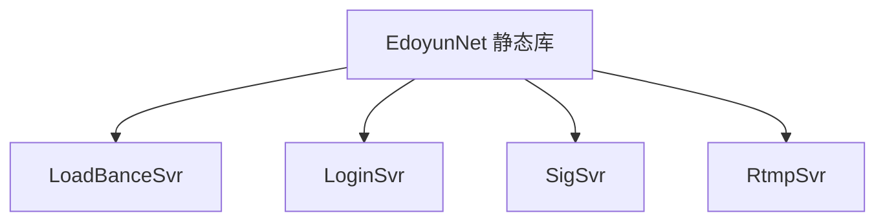

# ENET 阶段零：工程与构建基线学习讲义

> 对应[项目学习规划的阶段零](项目学习规划.md#stage-0)。参考用时：2～3 小时，环境安装与排障另计。
>
> 本阶段的目标是完成一次构建，认清四个服务、公共网络库和真实入口。已有 C++、Linux socket/epoll 知识直接复用；调度、协议、数据库及 RTMP 的内部实现分别在后续阶段学习。

## 1. 学完后应能回答什么

1. 哪些源码生成静态库，哪些源码生成服务程序？
2. CMake 配置、编译、链接和程序运行分别做了什么？
3. 构建结果在哪里，怎样判断构建是否完成？
4. 四个服务分别从哪个 `main()` 开始，运行前各需要哪些条件？

阅读时打开源码核对，操作命令均在 **Linux／WSL 终端中的 ENET 仓库根目录**执行。仓库放在哪里不影响本讲步骤。

## 2. 先认识工程和产物

### 2.1 一个网络库，四个服务程序

| 源码目录 | 构建目标 | 默认产物 | 职责与入口 |
| --- | --- | --- | --- |
| `EdoyunNet/` | `EdoyunNet`，静态库 | `lib/libEdoyunNet.a` | 公共网络能力，默认不构建自己的演示入口 |
| `LoadBanceServer/` | `LoadBanceSvr` | `bin/LoadBanceSvr` | 选择登录入口；[main.cpp](../LoadBanceServer/main.cpp)，8523 |
| `LoginServer/` | `LoginSvr` | `bin/LoginSvr` | 用户相关业务与数据库访问；[main.cpp](../LoginServer/main.cpp)，9867 |
| `SigServer/` | `SigSvr` | `bin/SigSvr` | 识别码登记、建流和输入转发；[main.cpp](../SigServer/main.cpp)，6539 |
| `RtmpServer/` | `RtmpSvr` | `bin/RtmpSvr` | RTMP 发布、播放及媒体分发；[main.cpp](../RtmpServer/main.cpp)，1935 |

表中产物路径相对于所选构建目录。例如使用 `linux-debug` 时，`bin/SigSvr` 相对于仓库根目录的路径是 `build/ninja-debug/bin/SigSvr`。

四个服务在链接时使用 `EdoyunNet`：



`libEdoyunNet.a` 是供服务程序链接的静态库文件。构建完成后，四个服务程序需要分别启动；每个服务都作为独立进程运行，并拥有自己的对象和调度线程。

### 2.2 找到默认构建范围

依次看三个位置：

1. [顶层 CMakeLists.txt](../CMakeLists.txt)：决定进入哪些子目录、全局 C++ 标准和输出目录。
2. [EdoyunNet/CMakeLists.txt](../EdoyunNet/CMakeLists.txt)：收集网络库源码，明确排除自己的 `main.cpp`。
3. 四个服务目录下的 `CMakeLists.txt`：分别声明可执行目标并链接网络库；登录服务还查找数据库客户端开发文件。

顶层的关键语句是：

```cmake
add_subdirectory(EdoyunNet)
add_subdirectory(RtmpServer)
add_subdirectory(SigServer)
add_subdirectory(LoadBanceServer)
if(ENET_BUILD_LOGIN_SERVER)
    add_subdirectory(LoginServer)
endif()
```

这里没有 `add_subdirectory(TCPServer)`，所以 `TCPServer/` 不参与默认构建。额外演示入口的实际文件名是 [TCPServer/mian.cpp](../TCPServer/mian.cpp)，另一个演示入口是 [EdoyunNet/main.cpp](../EdoyunNet/main.cpp)。本阶段只识别它们的用途，继续阅读上表四个真实入口。

### 2.3 分清构建依赖和业务运行依赖

| 对象 | 构建时需要 | 执行业务时还需要 |
| --- | --- | --- |
| 网络库、负载、信令、RTMP 服务 | Linux、C++17 工具链、CMake、构建工具与线程库 | 可绑定的本机地址、可用端口及对应的业务连接 |
| 登录服务 | 上述依赖，以及 MySQL/MariaDB 客户端头文件和链接库 | 数据库服务、密码、表结构和测试数据 |
| Windows 客户端 | 在客户端规划中准备 Qt、FFmpeg 等依赖 | 可连通的服务端地址，以及与服务端一致的协议 |

因此，数据库尚未启动，不影响把登录服务编译出来；只有头文件却没有链接库，也不足以完成登录服务构建。

## 3. 只补本项目用到的构建概念

### 3.1 配置、编译、链接、运行

| 环节 | 在本项目中做什么 | 主要观察位置 |
| --- | --- | --- |
| 配置与生成 | 读取 CMake 文件、探测工具链和依赖，生成 Ninja/Make 规则 | `cmake --preset ...` 的输出、`CMakeCache.txt` |
| 编译 | 将各 `.cpp` 编译为目标文件 | 编译器报告的源码、行号和诊断 |
| 链接 | 将目标文件、网络库和所需库组成服务程序 | 链接命令、`undefined reference` 等诊断 |
| 运行 | 操作系统加载程序，执行 `main()`，随后绑定端口和处理业务 | 运行时库、进程、日志及网络/数据库状态 |

`cmake --build` 会驱动编译和链接。配置阶段也可能为了探测工具链执行小规模试编译，不能仅凭日志里出现编译器就判断已经在构建项目源码。

### 3.2 读懂输出目录和静态库声明

顶层 CMake 指定：

```cmake
set(CMAKE_CXX_STANDARD 17)
set(CMAKE_CXX_STANDARD_REQUIRED ON)
set(CMAKE_CXX_EXTENSIONS OFF)
set(CMAKE_ARCHIVE_OUTPUT_DIRECTORY "${CMAKE_BINARY_DIR}/lib")
set(CMAKE_RUNTIME_OUTPUT_DIRECTORY "${CMAKE_BINARY_DIR}/bin")
find_package(Threads REQUIRED)
```

- `CMAKE_CXX_STANDARD` 选择 C++17；`CMAKE_CXX_STANDARD_REQUIRED=ON` 要求满足所选标准，不能退回更低标准。
- `CMAKE_CXX_EXTENSIONS=OFF` 选择标准 C++ 模式；例如 GCC 使用 `c++17` 而非 `gnu++17` 模式，但不保证编译器会拒绝所有扩展语法。
- `CMAKE_BINARY_DIR` 是本次选定的构建目录。
- 本项目中，`CMAKE_ARCHIVE_OUTPUT_DIRECTORY` 将静态库放入 `lib/`，`CMAKE_RUNTIME_OUTPUT_DIRECTORY` 将服务程序放入 `bin/`。
- `find_package(Threads REQUIRED)` 查找平台的线程支持，网络库通过 `Threads::Threads` 声明线程依赖。

标准选项的详细含义见 [CXX_STANDARD_REQUIRED](https://cmake.org/cmake/help/latest/prop_tgt/CXX_STANDARD_REQUIRED.html) 和 [CXX_EXTENSIONS](https://cmake.org/cmake/help/latest/prop_tgt/CXX_EXTENSIONS.html)。

网络库使用 `add_library(EdoyunNet STATIC ...)`；服务使用 `add_executable(...)` 并通过 `target_link_libraries(... EdoyunNet)` 建立依赖。构建一个服务目标时，构建工具会先保证它需要的网络库已经生成。

### 3.3 预设替你保存了什么

打开 [CMakePresets.json](../CMakePresets.json)，对照三个配置：

| 预设 | 生成器 | 构建类型 | 构建目录 |
| --- | --- | --- | --- |
| `linux-debug` | Ninja | Debug | `build/ninja-debug/` |
| `linux-release` | Ninja | Release | `build/ninja-release/` |
| `linux-make-debug` | Unix Makefiles | Debug | `build/make-debug/` |

主线选 `linux-debug`；没有 Ninja 时选 `linux-make-debug`。两种生成器使用不同目录，可以共存，不需要为了切换预设清空整个 `build/`。

**版本要求：**顶层 CMake 声明最低 3.20，但本仓库预设使用 schema `version: 3`，实际执行预设需要 **CMake 3.21 及以上**。schema 版本与 CMake 程序版本是不同概念，见 [CMake 官方预设版本说明](https://cmake.org/cmake/help/latest/manual/cmake-presets.7.html#versions)。

## 4. 动手建立构建基线

以下以 `linux-debug` 为例。选择 Make 路线时，将后文命令中的 `linux-debug` 换成 `linux-make-debug`，`build/ninja-debug/` 换成 `build/make-debug/`，并到对应目录查找产物。

### 4.1 确认当前终端和工具

```sh
uname -s
cmake --version
c++ --version
ninja --version
cmake --list-presets
```

应当看到：

- `uname -s` 返回 `Linux`。
- CMake 能解析预设，并列出 `linux-debug`、`linux-release`、`linux-make-debug`。
- 有支持 C++17 的工具链；选择 Ninja 路线时，`ninja` 命令可用。

如果此时在普通 Windows PowerShell 中，先进入 Linux／WSL 环境。顶层 CMake 检查目标系统为 Linux，ENET 的 epoll、POSIX socket 和 `/proc` 使用也决定了它不能直接按 Windows 原生程序构建。

### 4.2 配置并构建

数据库客户端开发文件已准备好时，先配置，成功后再构建。若配置失败，按第六节定位；缺少 Ninja 或数据库客户端开发文件时，先按 4.5 节选择处理方式，构建成功后继续 4.3 节。

```sh
cmake --preset linux-debug -DENET_BUILD_LOGIN_SERVER=ON
cmake --build --preset linux-debug
```

第一条完成配置与生成，第二条编译、链接。显式写 `ON` 表示本次构建包含登录服务。

配置成功时，日志末尾通常会显示 `Configuring done`、`Generating done`，并给出构建目录；构建成功时，可以看到静态库和服务程序的生成结果。再次构建且源码没有变化时，可能显示 `ninja: no work to do`，这是正常的增量构建结果。

### 4.3 找到产物，解释每个文件

按本次启用的目标核对以下产物。若关闭了登录服务，程序列表应为其余三个服务，并跳过下方针对 `LoginSvr` 的 `ldd` 检查。若使用辅助脚本，按 Make 预设查看 `build/make-debug/` 中的产物。

```sh
ls -l build/ninja-debug/bin
ls -l build/ninja-debug/lib/libEdoyunNet.a
ls -l build/ninja-debug/compile_commands.json
```

完整默认构建应得到：

```text
build/ninja-debug/
├── bin/
│   ├── LoadBanceSvr
│   ├── LoginSvr
│   ├── SigSvr
│   └── RtmpSvr
├── lib/
│   └── libEdoyunNet.a
└── compile_commands.json
```

`compile_commands.json` 保存各翻译单元的编译命令，供 clangd 等工具理解头文件目录和编译选项；它不是程序，也不是运行配置。

需要确认登录程序的动态库能否被找到时，可用 [ldd](https://man7.org/linux/man-pages/man1/ldd.1.html) 查看：

```sh
ldd build/ninja-debug/bin/LoginSvr
```

`ldd` 列出程序所需的动态库及当前解析到的路径，实际依赖的自建 `.so` 也会显示。静态库 `.a` 的所需目标代码已参与最终链接，不会作为独立运行时依赖列出。

若出现 `not found`，继续检查相应运行时库及搜索路径。动态库均能找到，仍不代表数据库连接或登录业务已成功。

### 4.4 按需：只构建一个目标

以后只修改某个服务时，可仅构建该目标及其依赖；已经完成全量构建时，无需重复此步。

```sh
cmake --build --preset linux-debug --target SigSvr
```

该命令只处理 `SigSvr` 及其依赖，目标已是最新版本时不会重复编译。`--target` 选择构建目标，不能替代配置阶段的依赖检查：默认启用登录服务时，CMake 仍会查找数据库客户端开发文件。

### 4.5 按缺失的依赖选择处理方式

只执行适用的分支，无需依次运行以下所有命令。

**Ninja 缺失：改用已有 Make 预设。**

```sh
cmake --preset linux-make-debug -DENET_BUILD_LOGIN_SERVER=ON
cmake --build --preset linux-make-debug
```

**数据库客户端开发文件缺失，先学网络库和三个非数据库服务：关闭登录服务。**

```sh
cmake --preset linux-debug -DENET_BUILD_LOGIN_SERVER=OFF
cmake --build --preset linux-debug
```

这会构建网络库、负载、信令和 RTMP 服务。登录服务的入口和依赖仍按源码阅读，完整登录链留阶段六。

选项会保存在该构建目录的 cache 中。以后恢复时显式设回 `ON`，再构建：

```sh
cmake --preset linux-debug -DENET_BUILD_LOGIN_SERVER=ON
cmake --build --preset linux-debug
```

旧的 `LoginSvr` 文件可能仍留在输出目录；判断本次是否启用该目标，可看配置值，而不是只看文件是否存在：

```sh
grep '^ENET_BUILD_LOGIN_SERVER:' build/ninja-debug/CMakeCache.txt
```

**需要完整构建，且系统缺少数据库客户端头文件：使用现有辅助脚本。**

```sh
bash scripts/build-linux.sh
```

先读 [脚本](../scripts/build-linux.sh) 的三段逻辑：

1. 检查系统中的 MySQL/MariaDB 头文件。
2. 缺少时，用 `apt download` 下载 MariaDB 客户端开发包和运行库，通过 `dpkg-deb -x` 解包到用户缓存，并传入头文件、库路径。
3. 使用 **Make Debug**，显式开启 `ENET_BUILD_LOGIN_SERVER` 后构建。

脚本需要 CMake、Make、编译工具，以及下载依赖包所需的工具和网络条件。它根据头文件是否存在来判断是否下载依赖，不能解决所有客户端库配置问题。脚本只准备构建依赖并执行构建，不负责安装数据库服务器、建表或准备业务数据；输出目录为 `build/make-debug/`。

### 4.6 使用 VS Code 时分清构建入口和位置

本讲的终端命令直接构建当前 Linux 仓库。VS Code 中还有两个入口：

- **CMake Tools 的“生成”按钮**：由扩展按当前选中的预设和目标构建。例如选中 `linux-debug` 时使用 Ninja，产物在当前仓库的 `build/ninja-debug/`。
- **`Ctrl+Shift+B` 默认构建任务**：执行 [.vscode/tasks.json](../.vscode/tasks.json) 中的 `ENET: build Debug`。任务名只是显示文字，实际预设由脚本决定；当前脚本固定使用 Make Debug，不会随 CMake Tools 的预设选择而改变。

同一个默认任务还会按执行环境选择脚本：

- 在 Linux／Remote-WSL 窗口，构建任务调用 `scripts/build-linux.sh`。
- 在普通 Windows 窗口，任务调用 `scripts/build-remote.ps1`，通过 SSH/SCP 构建远端副本；它不会自动切换到当前 WSL 仓库。

如果编辑器标红，但终端构建成功，先检查 clangd 使用的编译数据库。按[当前设置](../.vscode/settings.json)，clangd 从工作区根目录读取 `compile_commands.json`。CMake Tools 可以按配置复制该文件，单独运行终端构建命令或上述 Shell 任务则不会自动完成这一步。需要时，将当前 Linux 仓库本次构建生成的文件复制到工作区根目录；使用 Make 时，将下方目录换成 `build/make-debug/`：

```sh
cp build/ninja-debug/compile_commands.json compile_commands.json
```

编辑器提示与真实构建结果分别判断即可。

## 5. 顺着四个真实入口读一遍

### 5.1 先看共同骨架

四个入口的共同顺序是：

```text
main
  → 构造 EventLoop
  → 创建具体服务对象
  → Start(监听地址, 端口)
  → 保持主线程存活
```

对照源码定位每一步，不展开网络库内部实现。`Create()` 在这里负责创建服务对象；从对象构造和持有关系继续阅读即可。

### 5.2 四个入口各多做了什么

| 入口 | 本阶段关注的动作 |
| --- | --- |
| [LoadBanceServer/main.cpp](../LoadBanceServer/main.cpp) | `EventLoop(1)`；创建负载服务；监听 8523；`getchar()` 等待 |
| [LoginServer/main.cpp](../LoginServer/main.cpp) | `EventLoop(1)`；创建登录服务；监听 9867；`getchar()` 等待 |
| [SigServer/main.cpp](../SigServer/main.cpp) | `EventLoop(1)`；创建信令服务；监听 6539；`getchar()` 等待 |
| [RtmpServer/main.cpp](../RtmpServer/main.cpp) | `EventLoop(2)`；设置 Chunk 大小与事件回调；监听 1935；主线程循环休眠 |

本阶段对 RTMP 的设置只理解为服务参数和回调注册，协议含义留阶段八。

### 5.3 分清主线程和工作线程

[EventLoop 构造函数](../EdoyunNet/EventLoop.cpp) 会立即调用 `Loop()`，后者创建调度器和工作线程。因此：

- `EventLoop(1)` 表示一个调度工作线程，此外仍有主线程。
- `EventLoop(2)` 表示两个调度工作线程，此外仍有主线程。
- 部分 `main()` 中虽然读取了 `hardware_concurrency()`，实际传入 `EventLoop` 的仍是固定的 1 或 2。

先掌握这条边界：

```text
主线程：构造对象 → Start → socket/bind/listen → 注册监听事件 → 等待
调度工作线程：等待就绪事件 → 接入连接/读写回调
```

`Start()` 中的初始化代码由调用它的主线程执行，后续事件回调由工作线程执行。具体的调度器选择、Channel 与 epoll 的关系在阶段三学习，线程关闭问题在阶段十一学习。

### 5.4 运行准备先认清依赖，不急着跑整套业务

源码中的四个服务监听地址目前为 `172.21.205.121`，登录服务连接负载的地址也写在 [LoginServer.cpp](../LoginServer/LoginServer.cpp)。实际运行时必须对应实验环境，不能把源码中的固定地址当作本机必然具备的地址。

启动关系需要区分：

```text
先启动负载服务
  → 创建登录服务时尝试连接负载
  → 连接成功后上报资源信息并注册周期任务

处理登录等数据库业务
  → 首次取得 ORMManager
  → 读取 ENET_DB_PASSWORD → 连接数据库
```

- 登录服务构造时立即尝试连接负载，失败后缺少完整重连路径，因此负载服务先启动。
- 数据库连接由 [ORMManager::GetInstance](../LoginServer/ORMManager.cpp) 首次调用时触发，并非创建 `LoginServer` 就立即连接数据库。
- 数据库当前默认目标是本机 3306、`root` 用户、`users` 数据库；表结构和数据在阶段六准备，需要执行业务时，在启动 `LoginSvr` 前通过环境变量传入密码。
- 负载、登录和信令服务通过 `getchar()` 保持进程存活；标准输入已结束（EOF）时，`getchar()` 可能立即返回，使程序退出。RTMP 主线程则循环休眠。
- 登录、信令、RTMP 的部分失败分支后仍会打印 success，因此运行结果不能只靠一行“成功”日志判断。

本阶段完成构建、找到产物并读完入口即可；服务监听、登录业务、媒体发布等实际运行结果，在对应的后续阶段验证。

## 6. 遇到问题先定位在哪一层

| 现象 | 先检查什么 |
| --- | --- |
| 预设无法解析或版本不支持 | CMake 是否达到 3.21，是否在仓库根目录读取当前预设 |
| 提示只支持 Linux，或预设在当前平台不可用 | 当前终端是否在 Linux／WSL 环境 |
| 找不到 Ninja | 使用 `linux-make-debug`，或准备 Ninja 后继续原路线 |
| 找不到 `mysql.h` 或客户端库 | 登录构建开关、客户端开发文件；按 4.5 节选择处理方式 |
| 链接出现 `undefined reference` | 对应符号来自哪个库，目标链接项与所选库是否匹配 |
| 编译完成却找不到程序 | 当前预设的构建目录；辅助脚本使用 Make，SSH 任务产物在远端 |
| 启动时报共享库缺失 | 对程序运行 `ldd`，检查具体 `not found` 项 |
| clangd 标红，终端却能构建 | 实际 `compile_commands.json` 位置与编辑器配置 |

遇到问题只解决阻断当前构建的部分。若暂时关闭登录服务，记下这个事实，仍可继续网络库学习。

## 7. 自检：用自己的话解释

1. **为什么构建完成后没有一个叫 EdoyunNet 的服务进程？**
   它是静态库目标；四个服务程序链接它的代码，再各自运行。

2. **为什么不把看到的所有 main 文件都当成服务入口？**
   编译范围由 CMake 决定；网络库演示入口被排除，`TCPServer/` 也没进入顶层构建。

3. **没有运行数据库，为什么仍可能编译出 LoginSvr？**
   构建需要客户端开发文件；数据库实例和业务数据是另一层运行条件。

4. **EventLoop(1) 是否意味着整个进程只有一个线程？**
   不是，它会创建一个调度工作线程，主线程还负责构造、初始化和等待。

5. **为什么更改生成器时要看构建目录？**
   每个目录保存对应生成器的规则和 cache；现有预设已将 Ninja、Make 分开。

6. **为什么只构建 SigSvr 仍可能先遇到 MySQL 查找错误？**
   目标选择发生在构建阶段；配置时默认启用的登录目录已经要求查找数据库客户端依赖。

完成标准：

- [ ] 成功构建本次启用的目标，能指出程序、静态库和编译数据库的位置；关闭登录服务时注明该目标待补。
- [ ] 找到四个真实入口，说明每个服务的职责、端口、线程创建位置和进程存活方式。
- [ ] 能区分配置、编译、链接与业务运行问题，知道自己的下一步。

若尚未成功构建，第一项保留待补；可先继续独立的源码阅读。

完成后进入[阶段二：TCP 字节流与自定义协议](项目学习规划.md#stage-2)；阶段一只在出现具体基础疑问时按需查阅。

## 8. 随用随查的源码与资料

- [顶层 CMake](../CMakeLists.txt)、[构建预设](../CMakePresets.json)、[网络库 CMake](../EdoyunNet/CMakeLists.txt)、[登录服务 CMake](../LoginServer/CMakeLists.txt)：构建范围、依赖与输出。
- [Linux 构建脚本](../scripts/build-linux.sh)、[VS Code 任务](../.vscode/tasks.json)：不同操作入口实际执行什么。
- [CMake 命令行手册](https://cmake.org/cmake/help/latest/manual/cmake.1.html)：按问题查 `--preset`、`--build`、`--target`。
