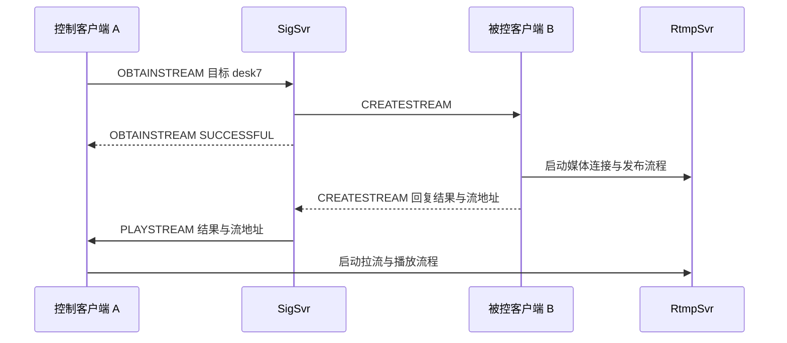

# ENET 阶段七：信令与远控状态机学习讲义

> 对应[项目学习规划的阶段七](项目学习规划.md#stage-7)。参考用时：8～12 小时，基础补学、环境配置和排障另计。
>
> 沿“登记识别码 → 请求目标 → 通知建流 → 返回播放地址 → 转发输入 → 清理关系”阅读，重点说明每一步改变了谁的状态和字段，以及失败后两端是否仍保持一致。

## 1. 先补状态机的读法

你已有 C++、Linux socket/epoll 基础，可以直接复用阶段二至六的报文、调度和生命周期知识。Qt 这里只追调用关系；Windows 输入模拟、采集编码、渲染及 RTMP 内部实现放到各自对应阶段。

### 1.1 状态、事件、条件和动作

用本项目的一步操作理解这四个词：

| 要素 | 例子 |
| --- | --- |
| 当前状态 | 控制连接 A 为 `IDLE` |
| 事件 | 收到 A 发来的 `OBTAINSTREAM` 请求 |
| 条件 | 目标 B 存在、不是 A 自己，且 B 为 `IDLE` |
| 动作 | 把 A 设为 `PULLER`，建立对端关系，通知 B 建流，向 A 回复成功 |

状态机不是只有一个枚举变量。`state_`、对端关系、目标连接和流地址共同决定下一条消息能否正确处理。看到状态赋值后，还要核对相关字段是否一起更新；看到错误返回时，则要检查此前是否已经修改过状态。

建议按以下顺序学习：

1. 分清信令、媒体和输入消息的去向，认识一个信令连接保存的字段。
2. 沿 `JOIN` 追踪识别码登记，再用一对空闲连接推演正常建流。
3. 对照“目标不存在”时两端各自的状态，理解请求发出、请求受理和流可用之间的区别。
4. 跟一次输入转发与关系清理，最后按需观察一个实际应答。

### 1.2 三条消息路径

```text
建流协商：A ←→ SigSvr ←→ B
媒体数据：B → RtmpSvr → A
远程输入：A → SigSvr → B
```

这张路径图中的 A、B 表示控制端和被控端客户端，分别消费目标画面和提供自身画面。媒体由客户端的媒体模块传送，`SigSvr` 负责协调和转发输入。

后文“服务端 A/B 连接”指信令服务为两端创建的 `SigConnection` 对象；“客户端 A/B 连接”指两端各自的信令对象。它们分别保存本地状态，不共享同一个 `state_`。

本阶段把 `rtmp://...` 当作媒体资源地址字符串：知道它由谁产生、谁保存、谁消费即可。拿到地址不等于已发布媒体，更不等于画面已经显示；RTMP 机制从阶段八开始学习。

## 2. 找到对象、字段和协议入口

| 源码 | 本阶段看什么 |
| --- | --- |
| [SigServer/main.cpp](../SigServer/main.cpp)、[SigServer.cpp](../SigServer/SigServer.cpp) | 监听入口、事件循环与信令连接的创建 |
| [SigConnection.h](../SigServer/SigConnection.h)、[SigConnection.cpp](../SigServer/SigConnection.cpp) | 状态判断、消息分发、对端关系和清理 |
| [ConnectionManager.h](../SigServer/ConnectionManager.h)、[ConnectionManager.cpp](../SigServer/ConnectionManager.cpp) | 识别码到连接的登记、查询和移除 |
| [SigServer/define.h](../SigServer/define.h) | 消息方向、字段与结果码 |
| [TcpConnection.cpp](../EdoyunNet/TcpConnection.cpp)、[TcpServer.cpp](../EdoyunNet/TcpServer.cpp) | 业务清理回调与网络关闭的衔接 |
| 客户端 [Net/SigConnection.cpp](https://github.com/slimesq/ECloudAssistant/blob/main/Net/SigConnection.cpp)、[SigConnection.h](https://github.com/slimesq/ECloudAssistant/blob/main/Net/SigConnection.h) | 两端状态与消息处理的差异 |
| 客户端 [RemoteManager.cpp](https://github.com/slimesq/ECloudAssistant/blob/main/UI/center/RemoteManager.cpp)、[AVPlayer.cpp](https://github.com/slimesq/ECloudAssistant/blob/main/Puller/UI/AVPlayer.cpp) | 被控连接与控制连接的创建、媒体回调 |

`HandleJion`、`RmoveCustom`、`objectes_`、`streamAddres_` 等名称保留源码拼写，便于检索。

### 2.1 状态属于连接，不是整台客户端

服务端每个 `SigConnection` 都有自己的 `state_`：

| 状态 | 当前源码中的含义 |
| --- | --- |
| `NONE` | 新连接，尚未成功登记识别码 |
| `IDLE` | 已登记，当前未被标记为控制或被控角色 |
| `PULLER` | 作为控制连接，已进入获取或使用目标流的流程；不保证已开始播放 |
| `PUSHER` | 作为被控连接，服务端已根据建流回复记录其推流角色；不保证媒体就绪 |
| `CLOSE` | 业务关系已被 `Clear()` 清理；是否同时关闭 TCP 要看调用路径 |

一份真实客户端可以同时建立两条信令连接：`RemoteManager::Init` 创建用于接受控制的连接；“开始远程”则经 `AVPlayer::Connect` 另建控制目标的连接。不要把一个应用实例直接等同于某一个固定状态。

两端状态枚举的排列不同，但当前报文没有传输这个状态枚举；它们是各自连接对象的本地成员。协议兼容性应核对真正发送的字段，而不是比较本地状态的数值。

### 2.2 连接字段与登记表各管什么

以下含义针对服务端连接：

| 字段或容器 | 内容与用途 |
| --- | --- |
| `code_` | 该连接通过 `JOIN` 登记的识别码 |
| `ConnectionManager::connMaps_` | `识别码 → TcpConnection::Ptr`，用于查找目标，持有连接的 `shared_ptr` |
| `objectes_` | 相关对端的识别码列表：控制连接保存目标，被控连接保存关注自己的控制连接 |
| `conn_` | 控制连接转发输入时使用的目标连接指针 |
| `streamAddres_` | 被控连接保存的媒体地址，服务端据此通知控制端播放 |

`objectes_` 保存的是字符串，不是连接对象；`conn_` 才是直接用于发送输入包的连接引用。两者可能因遗漏赋值而不一致。

`ConnectionManager` 的锁保护各次表操作，不能替代 `SigConnection` 中关系和状态的维护。当前 `SigSvr` 的 `EventLoop(1)` 创建一个调度工作线程；线程模型沿用阶段三。

### 2.3 同一个命令值，需要结合方向解释

| 命令 | 请求、通知或回复 |
| --- | --- |
| `JOIN` | 客户端发送自身登记码；服务端返回 `JoinReply_body.result` |
| `OBTAINSTREAM` | 控制端发送目标码；服务端用应答说明是否受理，部分分支直接发播放通知 |
| `CREATESTREAM` | 服务端通知被控端建流；被控端回复结果和流地址 |
| `PLAYSTREAM` | 服务端把结果和流地址发给控制端 |
| `DELETESTREAM` | 客户端可请求结束会话；服务端也用它通知对端剩余关联数量 |
| `MOUSE/MOUSEMOVE/KEY/WHEEL` | 控制端发送输入事件，服务端向其目标连接转发 |

例如，`CREATESTREAM` 通知只有包头，而回复有 `result` 和 `streamAddres[70]`。不要仅凭 `cmd` 就把同名请求、回复强转为同一个结构。

服务端 `SUCCESSFUL` 和客户端使用的成功结果值都是 0。报文布局、固定数组终止符和长度校验沿用阶段二，不在这里重新推导全部消息。

## 3. JOIN：识别码怎样变成可查询的连接

### 3.1 服务端的登记流程

沿 `HandleJion()` 阅读：

```text
连接当前为 NONE
  → 从 Join_body 取识别码
  → ConnectionManager::QueryConn(code) 检查是否已登记
      已存在 → 回复 ERROR，保留当前状态
      不存在 → 保存 code_，置 IDLE，AddConn(code, shared_from_this())
             → 回复 SUCCESSFUL
连接已经不是 NONE
  → 回复 ERROR
```

正常登记后，其他连接才能通过这个识别码查到它。`JOIN` 只建立当前信令连接的登记，不会创建媒体流。

`JOIN` 报文只携带识别码，当前处理没有查询数据库或验证该码与阶段六登录用户的对应关系。阶段六只返回登录结果和信令地址，没有签发登录票据，也不会自动把用户登记到 `connMaps_`。因此，登记成功只表示建立了识别码映射，不能据此认为已经完成身份认证。

上述正常流程以非空、未重复、正确终止的识别码为前提。练习使用不超过 9 个 ASCII 字节的短码，复用阶段二的固定数组约束。

### 3.2 客户端同名 code_ 的含义要分开

当前客户端 `Join()` 对两种连接采用不同身份：

- 被控连接：用传入的本机 `code_` 登记。
- 控制连接：用固定字符串 `154564` 登记；它自己的 `code_` 实际保存将要请求的目标识别码，随后用于 `OBTAINSTREAM`。

因此，控制连接的登记码和目标码不是同一个值。服务端的 `code_` 始终是登记码，客户端控制连接的 `code_` 却是目标码，读源码时不能直接对应。

多个控制连接使用相同的固定登记码，会遇到重复 `JOIN`。首轮不需要通过多开真实客户端验证多控制端场景。

## 4. 正常建流：每一步实际改变了什么

先固定一组数据：控制客户端 A 的信令连接登记为 `ctl7`，被控客户端 B 的信令连接登记为 `desk7`；服务端对应的两条连接均已 `JOIN`，当前都为 `IDLE`。下面用这两个短码推演服务端，真实客户端控制连接的固定登记码按上一节单独理解。

### 4.1 消息时序



图表示逻辑交接。不同 TCP 连接上的实际收发时刻可能交错，不能仅凭日志先后判断所有端点的处理顺序。

### 4.2 服务端状态与字段的变化

对照 `DoObtainStream()` 的目标 `IDLE` 分支及 `DoCreateStream()`：

| 处理到的位置 | 服务端 A 连接 | 服务端 B 连接 |
| --- | --- | --- |
| 各自登记完成 | `IDLE`，关系为空，`conn_` 为空 | `IDLE`，关系为空 |
| A 请求 B，被服务端受理 | 改为 `PULLER`；`objectes_=[desk7]`；`conn_=B` | 仍为 `IDLE`；`objectes_=[ctl7]`；向客户端 B 发出建流通知 |
| B 的建流回复携带非空地址，服务端找到处于 `PULLER` 的 A | 保持 `PULLER`，向客户端 A 发出 `PLAYSTREAM` | 保存 `streamAddres_`，此时才改为 `PUSHER` |

注意，服务端通知 B 建流时，没有立刻把 B 改成 `PUSHER`。

受理后、建流回复前，对端关系已经建立，但流地址尚未确认。当前没有单独的“建流中”状态或等待回复的超时处理；如果 B 一直不回复，流程可能停留在这个中间状态。

正常关系可以简写为：

```text
connMaps_["ctl7"]  → A：PULLER，conn_=B，objectes_=["desk7"]
connMaps_["desk7"] → B：PUSHER，streamAddres_=流地址，objectes_=["ctl7"]
```

这里的“正常”以建流回复和关联状态满足当前分支条件为前提，不代表当前实现已经处理了全部失败和并发场景。

### 4.3 服务端怎样消费建流回复

`DoCreateStream()` 先把回复中的地址保存到自身 `streamAddres_`，再遍历 `objectes_` 查找关注者：

- 地址为空：将找到的关注者设为 `IDLE`，向其发送 `PLAYSTREAM/ERROR`。
- 地址非空，关注者为 `PULLER`：将被控连接设为 `PUSHER`，向关注者发送成功播放通知。
- 地址非空，但关注者不是 `PULLER`：向其发送错误，并从被控连接的列表中移除该关注者；没有同步清理关注者自己的关系字段。

空地址分支也没有完整回滚：服务端 A 虽被设为 `IDLE`，但 `A.conn_` 和双方的 `objectes_` 仍保留。客户端 A 的 `doPlayStream()` 收到错误后只打印失败，本地仍为 `PULLER`。因此，一处状态恢复并不等于关联字段和两端状态都已恢复。

当前函数没有检查 `CreateStreamReply_body.result`，也不验证地址是否对应可播放的媒体资源。不能把“服务端转发了一个非空地址”解释成“建流一定成功”。

### 4.4 客户端的回调成功，不等于媒体已就绪

被控连接 `doCtreatStream()` 在本地 `IDLE && CONTROLLED` 时生成媒体 URL，再调用 `startStreamCb_`：

```text
startStreamCb_(URL) 返回 true
  → 填写流地址和成功结果，发送 CREATESTREAM 回复
  → 客户端本地状态设为 PUSHER
返回 false
  → 回复 SERVER_ERROR，地址保持空，本地仍为 IDLE
```

地址由客户端生成，当前使用硬编码的 `rtmp://192.168.31.30:1935/live/` 加递增编号；不是信令服务生成，也不是阶段六返回的信令地址。

实际回调链为 `RemoteManager::HandleStartStream → RtmpPushManager::Open → RtmpPublisher::OpenUrl`。`OpenUrl` 建立连接并启动握手后即返回，没有等待发布应答；调用返回不能证明发布已确认。

控制连接收到成功 `PLAYSTREAM` 后，把 URL 交给播放回调；这个调用也不能保证已经解码并显示首帧。阅读时分别判断请求是否受理、地址是否送达、发布是否得到确认，以及首帧是否显示。当前信令实现没有把这些条件逐一关联；RTMP 发布和媒体就绪在阶段八、九及统一联调中继续核对。

## 5. 目标不存在：两端为什么会状态不一致

这是本阶段只需重点跟踪的一次业务失败。

### 5.1 服务端保持原状态

假设 A 已成功登记、仍为 `IDLE`，请求一个没有登记的目标：

```text
DoObtainStream
  → QueryConn(目标码) 返回空指针
  → 回复 OBTAINSTREAM/ERROR
  → 返回，尚未修改 A 的角色、objectes_ 或 conn_
```

所以服务端 A 仍为 `IDLE`，关系为空。不要在推演图中凭空添加“先进入 PULLER，再退回 IDLE”的过程。

### 5.2 当前客户端没有消费这个失败结果

客户端 `doJoin()` 登记成功后，自动发送 `OBTAINSTREAM`。`obtainStream()` 在调用 `Send` 后就返回 0，`doJoin()` 随即把本地状态改成 `PULLER`；这个 0 表示函数完成了发送调用，不是服务端已经同意。

更关键的是，客户端 `HandleMessage()` 没有 `OBTAINSTREAM` 分支，这条应答被默认分支跳过，最后消费报文字节。

| 时刻 | 服务端 A 连接 | 客户端 A 连接 |
| --- | --- | --- |
| 已成功登记 | `IDLE` | `IDLE` |
| 客户端发出获取流请求 | 尚未处理，仍为 `IDLE` | 提前设为 `PULLER` |
| 服务端发现目标不存在并回复 | 保持 `IDLE` | 收到应答后没有处理错误，仍为 `PULLER` |

这解释了为什么“发送成功”的日志不代表目标可用，也解释了失败后为什么没有自动恢复到可重试的空闲态。

此处先指出缺少的应答处理和恢复动作，不要求立即新增状态枚举或重写两端状态机。

## 6. 输入转发与停止会话

### 6.1 输入实际发给谁

服务端 `HandleOtherMessage()` 的关键条件是：

```cpp
if (conn_ && state_ == PULLER)
{
    conn_->Send((char const*)data, data->len);
}
```

这些输入包不携带目标识别码，服务端使用此前保存的 `conn_` 决定转发目标。因此，仅仅把状态设成 `PULLER`，或在 `objectes_` 中加了目标码，还不足以保证输入能转发。

信令服务原样转发这些包，Windows 输入模拟由被控客户端执行。本阶段读到客户端相应处理入口即可，具体 Windows API 留给客户端对应阶段。

### 6.2 DELETESTREAM 里的 streamCount 是什么

`DeleteStream_body.streamCount` 取自接收方的 `objectes_.size()`，表示移除关系后列表中剩余的关联数。它不是视频帧数或媒体服务器中的流总数；列表中有残留记录时，也不能把它当作实时在线连接数。

例如，A 与 B 已建立上述正常关系，A 结束会话时，服务端从 B 的 `objectes_` 移除 A，再把 B 当前剩余关联数量发送给 B。若数量为 0，客户端 `doDeleteStream()` 调用停止媒体的回调；还有其他关联时则不停止。

这是通知对端决定是否停止媒体，不是服务端直接去删除 RTMP 媒体对象。

### 6.3 当前 Clear 还做了哪些事情

`HandleDeleteStream()` 只在连接为 `PULLER/PUSHER` 时调用 `Clear()`。`Clear()` 会：

1. 把当前连接置为 `CLOSE`，清空自身 `conn_`。
2. 找到 `objectes_` 中的对端，请其移除当前连接的识别码，并发送剩余关联数量。
3. 清空自身 `objectes_`，从 `ConnectionManager` 删除自身识别码登记。

它把“停止会话”和“退出识别码登记”放在同一个函数中，但没有主动关闭 TCP，也没有把当前状态恢复成 `NONE/IDLE`。因此，同一条仍连接的 socket 再发 `JOIN` 时，会因状态不是 `NONE` 而被拒绝。

关联方执行 `RmoveCustom()` 时，如果移除的是最后一条关联，就通过 `state_ = IDLE` 恢复服务端这条连接的空闲状态。它不会清空自己的 `conn_`，所以原来的目标连接仍可能被这份 `shared_ptr` 持有。

客户端收到数量为 0 的删除通知后只调用停止回调，本地信令状态仍可能是 `PULLER/PUSHER`。服务端的 `IDLE`、客户端本地状态和媒体是否停止，需要分别确认。

当前客户端也没有主动构造信令 `DELETESTREAM` 的发送路径；关闭播放器不能直接等同于发送了这个请求。

### 6.4 TCP 断线与业务清理怎样衔接

先看 `TcpConnection::Close()` 已被调用后的处理顺序，沿用阶段四的关闭路径：

```text
TcpConnection::Close
  → 设置 is_closed_，移除 Channel
  → closeCb_：SigConnection::DisConnected → Clear
  → disconnectCb_：TcpServer::RemoveConnection
  → 最后一个持有者释放对象，析构时才 close(fd)
```

信令类设置的是关闭回调，`TcpServer` 设置的是断开回调，两者没有相互覆盖。

但对端退出不保证当前实现一定进入这条路径：`BufferReader::Read()` 会原样返回 `recv` 的 0，而 `HandleRead()` 只在返回值小于 0 时调用 `Close()`，没有专门处理 EOF。收到关闭或错误事件等其他路径仍可能触发清理；能否移除登记，需要确认 `Close → Clear` 是否实际执行，不能只凭客户端已经退出判断。

对端仍可能通过 `conn_` 持有连接对象；`Clear()` 在析构时还会再次调用，不能只看某一处移除就断言对象已释放。此处先说明调用关系和遗留状态，所有权与重复清理在阶段十一继续检查。

客户端 `OnClose()` 这里只设置 `quit_=true`，没有在这个回调中停止媒体、恢复角色或重连。

## 7. 两个值得额外看清的分支

### 7.1 目标已经是 PUSHER

`DoObtainStream()` 遇到已为 `PUSHER` 且地址非空的目标时，会复用现有地址：

```text
A 为 IDLE，B 为 PUSHER 且有地址
  → A 改为 PULLER，双方添加对端码
  → 直接向 A 发送 PLAYSTREAM
```

这个分支不再通知 B 建流，也不另发 `OBTAINSTREAM` 成功应答。当前实现漏掉了 `A.conn_=B`；对于新的 A，可能能拿到播放地址，却因 `conn_` 为空而无法转发输入。

首轮只需对照一次赋值，不要求部署多个真实控制端。

### 7.2 服务端与客户端的半包处理不同

服务端 `OnRead()` 逐条消费完整消息，遇到半包时可读量不变，退出本轮并保留已有字节。客户端的 `OnRead()` 仍会在半包未被消费时立即重试，且在确认完整包头之前就读取长度字段。

服务端循环和剩余的包长校验问题见[阶段二讲义](阶段02_TCP字节流与自定义协议学习讲义.md)。观察到没有业务回复时，先确认哪一端已收到完整消息，再核对状态条件和媒体是否就绪。

即使用 `sendall` 一次发出完整报文，TCP 也不保证服务端一次读取就收到整帧。本阶段不要求故意分片或先修完解析器。

## 8. 练习：固定推演优先，运行观察按需

### 8.1 先把正常路径和失败路径各走一次

直接沿第四节的 A/B 表格跟源码，再沿第五节跟目标不存在。每一步只确认：

- 当前报文是谁发给谁的，处理函数是什么。
- 哪个连接的状态、对端列表、目标连接和地址被修改。
- 当前回复能证明什么，失败后有没有恢复所需字段。

不用另外写完整状态机报告，也不用重新实现信令服务。能指着已有字段解释即可。

### 8.2 有 SigSvr 可运行时，观察 JOIN 与无目标应答

本阶段可以直接访问学习用 `SigSvr`，不必先跑通负载、登录和数据库链路。运行前核对实际监听地址与端口：当前入口默认是 `172.21.205.121:6539`，启动日志中的 success 不能单独证明监听成功。

优先复用已有发送器或断点。需要一个独立请求片段时，可在 Linux／WSL 终端运行下面的 Python 标准库示例；把首行地址改成服务当前实际监听地址，并确认 `s7a` 未被使用、`missing7` 没有登记。

片段只做一次登记和一次无目标查询，不连接媒体服务器、不发送鼠标键盘事件。它按当前已核对的 Linux x86 小端布局处理报文：`JOIN=5`、`OBTAINSTREAM=6`，请求 14 字节，应答 8 字节，成功和错误值分别为 0、1。

```bash
SIG_HOST=127.0.0.1 python3 - <<'PY'
import os
import socket
import struct


def id_packet(command, code):
    field = code.encode("ascii")
    if not 0 < len(field) < 10:
        raise ValueError("code must contain 1-9 ASCII bytes")
    return struct.pack("<HH10s", 14, command, field)


def recv_exact(conn, count):
    data = bytearray()
    while len(data) < count:
        part = conn.recv(count - len(data))
        if not part:
            raise RuntimeError("connection closed before reply completed")
        data.extend(part)
    return bytes(data)


def recv_result(conn, expected_command):
    length, command = struct.unpack("<HH", recv_exact(conn, 4))
    if (length, command) != (8, expected_command):
        raise RuntimeError(f"unexpected reply: len={length}, cmd={command}")
    return struct.unpack("<i", recv_exact(conn, 4))[0]


with socket.create_connection((os.environ["SIG_HOST"], 6539), timeout=3) as conn:
    conn.sendall(id_packet(5, "s7a"))
    result = recv_result(conn, 5)
    print("JOIN result =", result)
    if result != 0:
        raise SystemExit("registration rejected; check duplicate code")
    conn.sendall(id_packet(6, "missing7"))
    print("OBTAINSTREAM result =", recv_result(conn, 6))
PY
```

前提满足时，预期分别打印 `JOIN result = 0` 和 `OBTAINSTREAM result = 1`。这个片段只验证报文应答；服务端 A 保持 `IDLE` 的结论需要结合源码或断点确认，它也不会复现真实客户端提前进入 `PULLER` 的本地行为。

片段退出会关闭客户端的测试 socket，服务端是否进入 `Close/Clear` 则要按第 6.4 节确认。若重复运行时登记被拒绝，先检查旧的 `s7a` 登记是否残留；也可换一个未使用的短码继续观察，不能据此认定状态恢复已经正确。

若运行超时，按阶段一和第七节区分监听、解析和业务问题；不要把等待超时直接解释成目标不存在的正常错误回复。

### 8.3 正常建流的运行观察不要求先准备媒体链路

正常建流先完成第四节的字段推演即可。若已有两端客户端可运行，再观察 `CREATESTREAM` 和 `PLAYSTREAM` 的交接，并区分建流回复、发布应答与画面出现。

只有实际定位建流问题需要隔离客户端时，才用现成工具模拟建流回复，将地址先作为普通字符串观察。不要为了本阶段另搭一套媒体模拟系统；真实发布、播放、输入与断开统一在阶段十二验收。

## 9. 自查与完成标准

可以口述或对照源码回答：

1. 为什么一个客户端应用能同时有被控连接和控制连接？两类连接的登记码与目标码分别来自哪里？
2. A 进入 `PULLER` 时，B 一定已经进入 `PUSHER` 吗？此时画面一定可播放吗？
3. `objectes_` 和 `conn_` 分别影响什么？为什么收到播放地址后仍可能无法转发输入？
4. 目标不存在时，服务端和客户端分别停在哪个状态？为什么？
5. `DELETESTREAM`、`Clear()`、媒体停止和 TCP 关闭为什么不是同一件事？
6. 两端状态枚举值不同，为何不能单凭这一点断言协议不兼容？

完成本阶段时，应能做到：

- [ ] 沿 `JOIN → OBTAINSTREAM → CREATESTREAM → PLAYSTREAM` 解释正常路径，指出每次实际赋值。
- [ ] 解释目标不存在时的回复及两端状态差异，分清发送调用成功与业务受理成功。
- [ ] 说明输入转发依赖的目标连接，以及停止会话和断线时关系的变化。
- [ ] 区分信令成功、媒体就绪与画面显示；运行受阻时明确哪些结论来自源码，哪些已实际观察。

接下来进入[阶段八：RTMP 握手、Chunk 与 AMF](项目学习规划.md#stage-8)。RTMP 为当前缺失的基础，先按阶段八补理论和已有代码样例，再读协议实现。
