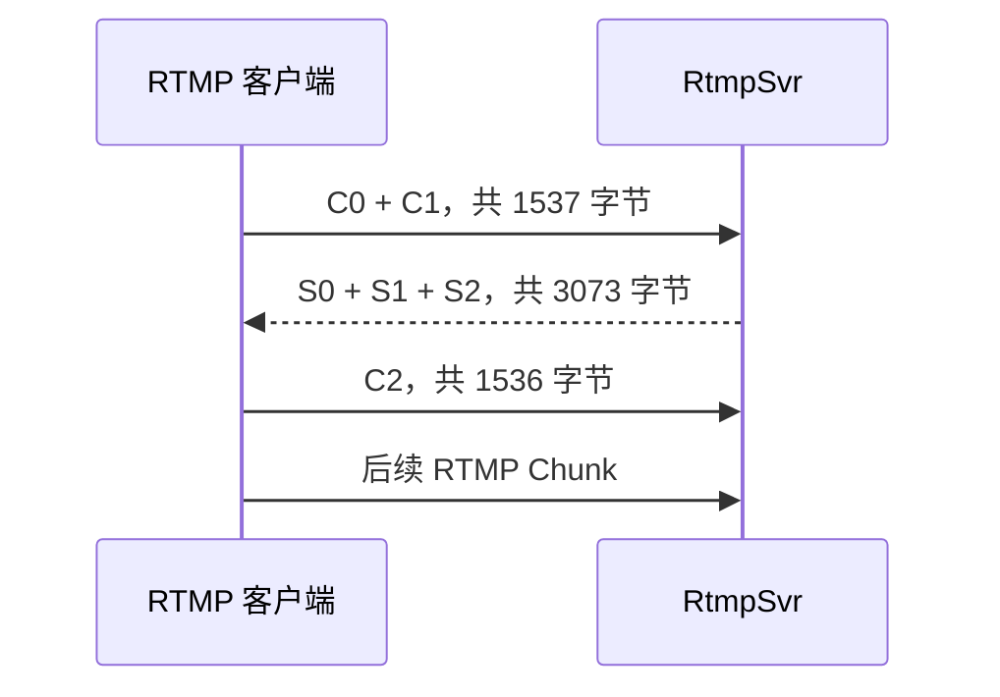

# ENET 阶段八：RTMP 握手、Chunk 与 AMF 学习讲义

> 对应[项目学习规划的阶段八](项目学习规划.md#stage-8)。源码阅读与局部实践参考用时：8～12 小时。
>
> 你目前没有 RTMP 基础，先完成本讲的共同基础与离线样例，再读完整实现。基础补学另参考 8～12 小时，两端只学一次；本阶段合计约 16～24 小时，环境配置和排障另计。

## 1. 学习路线与阅读边界

本阶段回答三个问题：连接如何进入 RTMP 通信，TCP 字节怎样还原成消息，命令参数怎样交给业务处理。

按以下顺序学习：

1. 分清 TCP、RTMP Message、Chunk 和 AMF0，认识三个不同用途的 ID。
2. 看懂握手的方向、字节数和分片等待。
3. 用同一条 300 字节消息推演 Chunk 头、负载与消息累计进度。
4. 学习项目使用的 AMF0 类型，运行第六节的离线样例。
5. 对照握手与 Chunk 解析器，再沿 `HandleInvoke` 找到 `connect/createStream/publish/play`。
6. 核对当前支持范围；媒体会话与帧分发进入阶段九后继续阅读。

| 源码 | 本阶段关注点 |
| --- | --- |
| [rtmp.h](../RtmpServer/rtmp.h)、[RtmpMessage.h](../RtmpServer/RtmpMessage.h) | 类型、ID、消息字段与累计进度 |
| [RtmpHandshake.h](../RtmpServer/RtmpHandshake.h)、[RtmpHandshake.cpp](../RtmpServer/RtmpHandshake.cpp) | 握手阶段、输入消费与回复 |
| [RtmpChunk.h](../RtmpServer/RtmpChunk.h)、[RtmpChunk.cpp](../RtmpServer/RtmpChunk.cpp) | 头部、消息体分块、按 CSID 保存上下文 |
| [amf.h](../RtmpServer/amf.h)、[amf.cpp](../RtmpServer/amf.cpp) | 基础类型编码、命令参数解码 |
| [RtmpConnection.cpp](../RtmpServer/RtmpConnection.cpp) | 握手与 Chunk 交接、消息分派、命令处理 |
| 客户端 [RtmpPublisher.cpp](https://github.com/slimesq/ECloudAssistant/blob/main/Pusher/rtmp/RtmpPublisher.cpp)、[RtmpConnection.cpp](https://github.com/slimesq/ECloudAssistant/blob/main/Pusher/rtmp/RtmpConnection.cpp) | 发起握手、接收结果、继续发布流程 |

`lenght`、`playload`、`CretaeStream` 等名称保留源码拼写。采集、编解码和渲染内部仍按客户端规划学习。

理论有疑问时，查 [Adobe RTMP 原始规范（SRS 镜像）](https://ossrs.net/lts/en-us/assets/files/rtmp_specification_1.0-25a467618b92a3115bc97d4b0038b0ff.pdf)中的 Chunk Stream 第 5～7 章、Commands 文档第 3～4 章，以及 [Adobe AMF0 原始规范（SRS 镜像）](https://ossrs.net/lts/en-us/assets/files/amf0_spec_121207-ac97fd4db9408706cd816b681ca3918c.pdf)的基本类型章节。PDF 合并了多份文档，查章节时同时确认所属文档。

## 2. 先分清层次和三个 ID

### 2.1 RTMP 不是在 TCP 上发送视频文件原字节

沿发送与接收方向分别理解：

```text
命令名、参数 / 音视频负载
  → 组成 RTMP Message
  → 拆成一个或多个 Chunk
  → TCP 字节流

TCP 收到字节
  → 保留未完成的头或块体
  → 按 CSID 累计并还原 Message
  → 根据 Message Type ID 分派
  → 命令消息再解码 AMF0，音视频消息交给媒体处理
```

- **Message** 是一条完整的协议消息，具有类型、长度、时间戳、Message Stream ID 和负载。
- **Chunk** 是传输 Message 负载时的一段，带有用于解释和继承消息信息的头部。
- **AMF0（Action Message Format 0）** 是某些消息负载的序列化方式，用来表示字符串、数字、对象等；它不是 Chunk 头的格式，也不是所有负载的格式。

协议在 TCP 之上分块，允许不同 CSID 的消息在块边界交错发送，减少应用层总要先发完一条大消息才能处理其他消息的等待。接收端再按各自 CSID 还原消息；这些 Chunk 仍复用同一条连接，不等于 TCP 分段，也不对应某次 `recv` 的边界。

项目常用的消息类型如下，对照 `rtmp.h` 和 `HandleMessage()`：

| Message Type ID | 含义 | 本阶段怎样看 |
| --- | --- | --- |
| 1 | Set Chunk Size | 固定二进制整数，改变一个方向的分块大小 |
| 5、6 | Window Acknowledgement Size、Set Peer Bandwidth | 连接控制；先分清用途与字段 |
| 8、9 | 音频、视频消息 | 负载先当作已有编码数据，分发留阶段九 |
| 18、20 | AMF0 数据、AMF0 命令 | 从类型标记还原元数据或命令参数 |

`RTMP_CHUNK_AUDIO_ID` 等常量表示项目选用的 CSID，不能与音频 Message Type ID=8 混用。`RTMP_AVC_SEQUENCE_HEADER=0x18`、`RTMP_AAC_SEQUENCE_HEADER=0x19` 则是项目内部媒体标记；`SendMediaData()` 最终仍把它们作为视频 9、音频 8 发送。

### 2.2 三个 ID 分别解决什么

| 名称 | 位置与用途 | 例子 |
| --- | --- | --- |
| Chunk Stream ID，简称 CSID | Basic Header 中，选择头部继承和分块累计上下文 | 本讲固定用 3 |
| Message Stream ID | Message Header 中，标识消息所属的逻辑流 | 连接命令用 0，创建流后使用返回的 ID |
| transaction ID | AMF 命令负载中的 Number，用于关联请求与结果 | `createStream` 的结果回送对应请求的事务 ID |

一个 Message 被拆出的多个 Chunk 使用同一个 CSID；这个 CSID 不必等于 Message Stream ID。事务 ID 也不是流 ID。

对于 `rtmp://host:1935/live/demo`，`host:1935` 是媒体服务入口，`live` 是 app，`demo` 是流名。它们共同用于定位资源；不能把流名或 URL 当成上述任意一个数字 ID。

## 3. 握手：固定长度数据先于 Chunk 消息

### 3.1 本项目的简化交互



C 表示客户端发送，S 表示服务端发送。这是本项目采用的发送分组；TCP 仍可能拆开或合并它们，不能按一次 `recv` 判断握手段。

下面列出简单握手的协议布局；本项目对时间填写和回显校验作了简化，具体区别见第九节。

| 握手段 | 长度 | 基本内容 |
| --- | --- | --- |
| C0 / S0 | 1 字节 | 版本，本项目检查或写入 3 |
| C1 / S1 | 1536 字节 | 4 字节时间、4 字节零、1528 字节随机区 |
| C2 / S2 | 1536 字节 | 时间、接收时刻及对方随机区的回显信息 |

握手时间字段以毫秒表达，与阶段六请求中的 Unix 秒时间戳用途不同。握手段也不使用后文的 Basic Header 或 Message Header。

先理解版本与回显的作用即可，不需要学习复杂握手或另写握手算法。当前 `RtmpHandshake` 是简化实现，具体校验边界在第九节说明。

### 3.2 分片等待的固定推演

以服务端为例：

| 已有输入与状态 | 当前应做什么 |
| --- | --- |
| 等 C0+C1，只有前 1000 字节 | 保留输入，等待剩余 537 字节 |
| C0+C1 共 1537 字节到齐 | 检查版本，消费这段，生成 S0+S1+S2，转为等 C2 |
| 等 C2，只有前 1024 字节 | 保留输入，等待剩余 512 字节 |
| C2 到齐，并在后面带上命令的 Chunk 字节 | 消费 C2，完成握手，再把残留字节交给 Chunk 解析 |

表中的数字是固定推演，不要求故意拆分网络发送。当前实现怎样返回与推进，见第七节。

## 4. Chunk：先推一条 300 字节消息

### 4.1 一个 Chunk 由哪些部分组成

```text
Basic Header
  + 按 fmt 决定的 Message Header
  + 必要时的 Extended Timestamp
  + 本块携带的 Message 负载片段
```

本讲使用 CSID=3，所以 Basic Header 只有 1 字节：高 2 位是 `fmt`，低 6 位直接表示 CSID。较大的 CSID 会使用扩展 Basic Header，遇到相应代码时再查规范。

`fmt` 控制本次发送哪些消息头字段，而不是音视频类型：

| fmt | Message Header 长度 | 本次提供的信息 |
| --- | --- | --- |
| 0 | 11 字节 | 绝对时间戳、消息总负载长度、类型、Message Stream ID |
| 1 | 7 字节 | 时间差、消息总负载长度、类型；继承 Message Stream ID |
| 2 | 3 字节 | 时间差；继承长度、类型和 Message Stream ID |
| 3 | 0 字节 | 继承上下文；既可能续接当前消息，也可能开始符合继承条件的下一条消息 |

因此，`fmt=3` 没有 Message Header，不代表整个 Chunk 没有头；Basic Header 仍在。首轮只用 `fmt=3` 续接同一条消息，下一条消息的时间继承作为读源码时的深入项。

Chunk 时间戳以毫秒计。“绝对时间戳”指相对于双方采用的时间起点的值，不是 Unix 日期时间；`fmt=1/2` 的时间差则相对于同一 CSID 上的上一条消息。例如，前一条消息的时间为 1000，下一条用 `fmt=1` 携带时间差 40，则下一条的时间为 1040。这条消息若拆成多个 Chunk，其续块仍属于 1040，不会每续一块再加 40。可对照 RTMP 规范 Chunk Stream 第 3、6.1.2 章。

字节序要逐字段看：24 位时间字段、24 位消息长度和扩展时间戳使用大端；`fmt=0` 中的 4 字节 Message Stream ID 使用小端。时间字段达到 `0xFFFFFF` 时，用该值作标记并携带 4 字节扩展时间戳；续块是否携带扩展字段也要结合前面的头部上下文判断。

### 4.2 固定参数与三块布局

本讲固定：

- CSID=3，Message Stream ID=1，时间戳=0。
- Message Type ID=20，整条负载 300 字节，Chunk Size=128。
- 首块 `fmt=0`，后两块 `fmt=3`。

这里的 300 字节是用于分块观察的填充数据，不是合法的 AMF 命令负载，离线样例不会把它交给 `HandleInvoke`。

首块头部如下：

```text
03 | 00 00 00 | 00 01 2C | 14 | 01 00 00 00
 ↑      ↑          ↑       ↑        ↑
fmt0  时间戳0    长度300   类型20   Message Stream ID=1
CSID3
```

后两块的 Basic Header 为 `C3`，即 `fmt=3`、CSID=3。消息总长度与每块负载长度分开计算：

| 块 | 头部字节 | 携带负载 | 在整段编码中的位置，从 0 起 |
| --- | --- | --- | --- |
| 第一块 | 12 | 128 | 头 0～11，负载 12～139 |
| 第二块 | 1 | 128 | 头 140，负载 141～268 |
| 第三块 | 1 | 44 | 头 269，负载 270～313 |

总编码长度为 `12 + 128 + 1 + 128 + 1 + 44 = 314` 字节。消息头中的 `300` 不含这些 Chunk 头，也不是 TCP 一次读写的长度。

### 4.3 Chunk Size 有方向，而且不含头部

`RtmpChunk` 初始 `in_chunk_size_` 与 `out_chunk_size_` 都为 128，分别用于接收和发送。

如果 A 通知 B：“我后续按 4096 字节分块”，则 A 的发送大小、B 解析 A 数据时的接收大小相互对应；B 发回 A 的大小不会因此自动改变。

在本项目中：

- 收到 type 1 的 Set Chunk Size：更新本端 `in_chunk_size_`。
- 本端 `SetChunkSize()`：更新 `out_chunk_size_` 并向对端发通知。
- 当前 RTMP 入口把目标发送大小设为 60000，正常 `connect` 处理中才发送设置通知。不能把它解释成“握手一结束，两个方向都已经是 60000”。

Set Chunk Size 的负载是 4 字节大端整数，不是 AMF Number。块大小约束的是每个 Chunk 的负载片段，不包括它的头部。

## 5. AMF0：从字段编码到命令参数

### 5.1 先认识项目用到的类型

对照 `AMF0DataType` 与 `AmfEncoder`：

| 类型 | 标记与内容 |
| --- | --- |
| Number | `00`，后跟 8 字节大端 IEEE-754 double |
| Boolean | `01`，后跟 1 字节，0 表示 false，非 0 表示 true |
| String | `02`，后跟大端 16 位字节长度，再跟 UTF-8 内容 |
| Object | `03`，后跟属性名和值，最后以 `00 00 09` 结束 |
| Null | 单字节 `05` |

String 长度是 UTF-8 的字节数，不是字符个数，也不包含 C 字符串末尾的零。Object 的属性名只有长度与内容，不带 String 的 `02` 标记；属性值才按各自类型编码。详细规则见前述 AMF0 规范第 1.3.1、2.2～2.5、2.7、2.11 节。

例如，Object 中单个属性 `app="live"` 的编码是：

```text
03 | 00 03 61 70 70 | 02 00 04 6C 69 76 65 | 00 00 09
对象       键 app             字符串值 live         对象结束
```

当前 `encodeObjects(empty)` 输出的是 `05`，即 Null；不是空 Object。项目用它填写某些命令中没有对象内容的位置，阅读注释时要以实际字节为准。

### 5.2 复用 play 与数值 1.0 的练习

两个 AMF 值的编码为：

```text
02 00 04 70 6C 61 79 | 00 3F F0 00 00 00 00 00 00
   String "play"     |           Number 1.0
```

前一项 7 字节，后一项 9 字节，共 16 字节。把 `1.0` 改为 `2.0` 时，数值部分变为 `00 40 00 00 00 00 00 00 00`。

这只是字符串和数字的编码练习，不是完整 `play` 命令。标准 `play/publish` 的事务 ID 为 0；`connect` 使用 1，`createStream` 的请求与结果通过相应事务 ID 关联，详见 RTMP 规范 Commands 文档第 4.1.1、4.1.3、4.2.1、4.2.6 节。

### 5.3 完整命令还需要什么

一条命令消息的负载一般依次包含：命令名、事务 ID、命令对象，以及该命令规定的后续参数。

例如，本项目解析 `play` 时需要取得流名，只有 `"play" + 1.0` 不足以表达请求。可以用下列字段顺序理解一个最小播放请求：

```text
String("play"), Number(0), Null, String("demo")
```

这些值放在 type 20 消息的负载中，再由 Chunk 层封装。`connect` 的对象包含 `app` 等字段；`createStream` 的结果带回后续要使用的 Message Stream ID。AMF 负责表达值，具体字段含义由命令决定。

音视频负载不会按这组命令参数解码；type 1 等控制消息也有自己的固定二进制格式。

## 6. 离线样例：复用现有编解码代码

在 Linux／WSL 终端的仓库根目录运行。这个驱动调用现有 AMF 编解码器和 Chunk 编码器，不启动服务、不准备媒体文件。

样例使用宽裕的 1024 字节输出数组，避免依赖当前 Chunk 容量预估的正确性。输出已在 Linux x86 小端主机上核对；协议字段仍按前文规定的字节序编码。

```sh
sampleDir="$(mktemp -d)"
c++ -std=c++17 -I. -x c++ - \
  RtmpServer/amf.cpp RtmpServer/RtmpChunk.cpp \
  EdoyunNet/BufferReader.cpp EdoyunNet/BufferWriter.cpp \
  -o "$sampleDir/RtmpBasics" <<'CPP'
#include <algorithm>
#include <array>
#include <cstdint>
#include <cstdio>
#include <memory>
#include "RtmpServer/amf.h"
#include "RtmpServer/RtmpChunk.h"

int main()
{
    AmfEncoder encoder{};
    encoder.encodeString("play", 4);
    encoder.encodeNumber(1.0);
    const auto data{encoder.data()};
    for (std::uint32_t index{}; index < encoder.size(); ++index)
    {
        std::printf("%02X ", static_cast<unsigned char>(data.get()[index]));
    }
    std::puts("");

    AmfDecoder decoder{};
    const int first{decoder.decode(data.get(), encoder.size(), 1)};
    const auto method{decoder.getString()};
    const int second{
        decoder.decode(data.get() + first, encoder.size() - first, 1)};
    std::printf("values=%s,%.1f used=%d+%d\n",
        method.c_str(), decoder.getNumber(), first, second);

    RtmpMessage message{};
    message.lenght = 300;
    message.type_id = 20;
    message.stream_id = 1;
    message.playload.reset(new char[300], std::default_delete<char[]>{});
    std::fill_n(message.playload.get(), 300, 'x');

    RtmpChunk chunk{};
    std::array<char, 1024> bytes{};
    const int encoded{chunk.CreateChunk(3, message, bytes.data(), bytes.size())};
    std::printf("chunk_bytes=%d remaining_length=%u\n", encoded, message.lenght);
    if (encoded != 314)
    {
        return 1;
    }
    for (std::size_t index{}; index < 12; ++index)
    {
        std::printf("%02X ", static_cast<unsigned char>(bytes[index]));
    }
    std::printf("\ncontinuation=%02X,%02X\n",
        static_cast<unsigned char>(bytes[140]),
        static_cast<unsigned char>(bytes[269]));
}
CPP
"$sampleDir/RtmpBasics"
```

预期输出：

```text
02 00 04 70 6C 61 79 00 3F F0 00 00 00 00 00 00
values=play,1.0 used=7+9
chunk_bytes=314 remaining_length=0
03 00 00 00 00 01 2C 14 01 00 00 00
continuation=C3,C3
```

这里的 `decode(..., 1)` 表示本次取一个 AMF 值，返回值是累计计入的字节数。先保存字符串，再解析下一项数值，是因为解码器保存的是有限的当前结果，不是返回完整的参数数组。

`remaining_length=0` 是当前 `CreateChunk()` 的实际行为：它递减输入消息的 `lenght` 直到 0。不要把这个函数当作不修改输入的序列化接口；保留原长度时，应在调用前保存所需值。

先解释输出与第四、五节的字节关系即可；这里只把 `1.0` 改成 `2.0` 比较一次，不要求扩展成新的协议工具。

## 7. 回到解析器：返回值与累计进度

### 7.1 握手 Parse 返回的是响应长度

`RtmpHandshake::Parse` 与 Chunk 解析器虽然同名，返回含义不同：

| 当前握手状态与输入 | 消费输入 | 返回值与后续状态 |
| --- | --- | --- |
| 等 C0+C1，输入不足 | 0 | 返回 0，继续等待 |
| C0+C1 完整且版本正确 | 1537 | 返回 3073，准备发送 S0+S1+S2，进入等 C2 |
| C2 输入不足 | 0 | 返回 0，继续等待 |
| C2 完整 | 1536 | 返回 0，但已进入握手完成态 |
| 版本检查失败 | 该分支不消费输入 | 返回负数，上层按失败处理 |

因此，握手返回 0 既可能是“还在等数据”，也可能是“已经完成但没有响应要发”。还要检查 `IsCompleted()` 和缓冲区变化。

`RtmpConnection::OnRead()` 每次只调用一次握手 `Parse()`。正常客户端必须先收到 S1 才能发送 C2；本项目服务端处理 C0+C1 后才生成 S1，因此不能把“一次发送 C0+C1+C2”当作正常交互。

当服务端已处于 `HANDSHAKE_C2`，本次收到 C2 加后续命令字节时，可以消费 C2 后立即把剩余字节交给 `HandleChunk`。这才是本节需要跟踪的握手与命令交接。

### 7.2 Chunk Parse 每次只推进一步

`RtmpChunk` 中需要同时观察两层进度：

| 状态或字段 | 作用 |
| --- | --- |
| `PARSE_HEADER/PARSE_BODY` | 当前解析头还是当前块体 |
| `chunk_stream_id_` | 当前块所属 CSID |
| `rtmp_message_[csid]` | 对应 Chunk Stream 的消息与继承上下文 |
| `index` | 当前 Message 已累计的负载字节数 |
| `lenght` | 这条 Message 的总负载长度 |

`Parse()` 返回值的含义：

- 正数：本次消费了这么多输入，可能只完成一个头或一块负载。
- 0：当前没有推进，输入可能为空，也可能不足以解析当前头或块体。
- 负数：解析错误。

整条消息是否完成，另看输出 `RtmpMessage::IsCompleted()`。`HandleChunk()` 在有推进时继续调用，返回 0 时退出本轮等待更多数据；这与阶段二信令解析器的原地循环问题不同。

### 7.3 对照同一组 314 字节输入

假设固定样例的全部 314 字节已经在 `BufferReader` 中，按当前实现连续调用：

| 调用 | 处理内容 | 返回值 | 内部消息累计 index | 剩余可读 | 是否输出完整 Message |
| --- | --- | --- | --- | --- | --- |
| 1 | fmt=0 头 | 12 | 0 | 302 | 否 |
| 2 | 第一块负载 | 128 | 128 | 174 | 否 |
| 3 | fmt=3 头 | 1 | 128 | 173 | 否 |
| 4 | 第二块负载 | 128 | 256 | 45 | 否 |
| 5 | fmt=3 头 | 1 | 256 | 44 | 否 |
| 6 | 最后一块负载 | 44 | 300 → 0（复制到输出后内部重置） | 0 | 是，输出的 index=lenght=300 |

最后一次输出后，内部消息调用 `Clear()` 为下一条做准备，不能把内部重置后的 index 与已经输出的消息混看。

如果只有完整首头加 50 字节负载，先消费 12 字节头，随后因当前块所需的 128 字节未齐而返回 0；这 50 字节保留在缓冲中，不会被当成一条完整 Message。

不同 CSID 的 Chunk 可以在块边界交错，map 保存各自上下文；同一 CSID 仍需按顺序继续其当前消息。首轮用单个 CSID 读懂累计过程，再按实际疑问核对交错和继承边界。

接收端保存不同 CSID 的上下文，与发送端是否安排交错调度是两回事。当前 `SendRtmpChunks()` 一次编码整条消息的全部 Chunk 并整体入队，分块本身不会使它自动按 Chunk 调度不同消息。

## 8. 从完整 Message 到发布或播放命令

### 8.1 先经过消息类型分派

服务端主线：

```text
OnRead
  → 握手未完成：RtmpHandshake::Parse
  → 握手完成：HandleChunk → RtmpChunk::Parse
  → 输出完整 RtmpMessage：HandleMessage
      type 1  → 设置接收 Chunk Size
      type 20 → HandleInvoke → AMF 命令
      type 18 → HandleNotify → 元数据
      type 8/9 → HandleAudio/HandleVideo
```

`rtmp.h` 声明了 Abort、ACK 等常量，但这不代表当前 `HandleMessage()` 已处理所有这些消息。

### 8.2 沿 connect、createStream、publish/play 阅读

以 `app=live`、流名 `demo` 为例：

| 交接 | 服务端实际处理与结果 |
| --- | --- |
| `connect`，Message Stream ID=0 | 取 AMF 对象中的 `app`；发送控制消息和带 `NetConnection.Connect.Success` 的 `_result` |
| `createStream`，Message Stream ID=0 | 返回 `_result` 和后续使用的流 ID，并保存到连接的 `stream_id_` |
| `publish`，使用返回的流 ID | 取流名，组成 `/live/demo`；成功分支回复 `NetStream.Publish.Start` 并登记发布者 |
| `play`，使用返回的流 ID | 取相同资源路径；回复播放状态，并将播放器接入会话 |

`HandleInvoke()` 先解码命令名，再根据 Message Stream ID 决定分支。后续字段解析会取得流名，所以“命令名解析成功”不等于全部参数已经正确。

当前流 ID 来自 `RtmpChunk::GetStreamId()` 的静态计数，不能把它写死为 1。本讲分块样例中的 1 是手动选择的固定值。

`connect` 中的控制回复顺序是：Window Acknowledgement Size、Set Peer Bandwidth、Set Chunk Size，然后 `_result`。函数 `SendAcknowlegement()` 实际发送 type 5 的窗口大小，不是 type 3 的累计字节 ACK。

### 8.3 对照客户端时，不只看状态枚举名称

客户端发布路径为：

```text
OpenUrl：建 TCP 连接，启动握手
  → 握手完成后发送 connect
  → 收到连接结果，发送 createStream
  → 取得返回的流 ID，发送 publish
  → 收到 NetStream.Publish.Start，设置 is_publishing_
```

`OpenUrl()` 返回不证明发布已经得到确认。当前客户端继续命令流程主要依据本地状态和解码结果，并未完整校验事务 ID；`Publish()` 还使用 `++number_` 生成递增事务 ID，与第五节所述标准 `publish` 使用 0 不同。阅读时分别核对规范和实际发送值。

服务端并没有在每一步依次赋值 `START_CONNECT/START_CREATE_STREAM`；握手是否完成看 `handshake_->IsCompleted()`。不要仅根据枚举声明补出源码中没有执行的状态转移。

服务端 `HandlePlay()` 发送 `Play.Reset/Play.Start` 后才取得会话，且 `GetSession()` 可能创建空会话；所以播放状态通知不证明已有发布者或已经能显示首帧。媒体缓存和实际分发在阶段九继续解释。

## 9. 当前实现边界怎样影响学习结论

读懂固定样例，不等于证明所有 RTMP 输入都兼容。首轮只需认清以下边界，不要求立即修复全部实现：

| 位置 | 当前情况与影响 |
| --- | --- |
| 握手 | S2 直接复制 C1，客户端 C2 直接复制 S1，未完整校验回显；输出容量形参也没有实际检查 |
| Chunk 编码容量 | 本例内部估算只有 310 字节，实际需要 314；不能把现有容量预检查当作写入安全保证 |
| 扩展 CSID | 解析变量使用 `uint8_t`，较大 ID 会截断，三字节计算也有问题；固定 CSID=3 不覆盖这部分 |
| 时间戳与继承 | `Clear()` 清部分时间字段、保留累计时间；扩展头重试还会提前修改上下文，不能从零时间戳续块样例推广到所有 fmt 继承 |
| 块大小输入 | `RtmpChunk::SetInChunkSize/SetOutChunkSize` 直接赋值，0 等非法值没有完整防护，会影响除法、取模和推进；外层 `Rtmp::SetChunkSize()` 则有 `0 < size <= 60000` 检查 |
| AMF 解码 | 只保存部分基础类型，错误与截断处理不完整；正的消费计数不能证明参数有效 |

AMF 解码器会在默认分支跳过单字节 Null，但没有把它保留成独立值；枚举列出更多类型，也不代表已完整实现。`decode()` 没有将内部错误可靠地作为负数传出，`HandleInvoke` 中的 `bytes_used < 0` 检查不能覆盖所有失败。

本阶段的固定样例只验证所涉及的编码与分块路径。扩展 CSID、时间戳继承、截断与容量只在实际遇到兼容性疑问时深入，不增加一轮必须完成的故障实验。

## 10. 练习、自查与进入下一阶段

先完成第六节的一次离线运行，再指着字节和源码回答：

1. Message、Chunk、AMF0 分别负责什么？三个 ID 怎样区分？
2. 服务端处理完整 C2 后，握手返回 0 为什么仍可能表示完成？
3. 300 字节消息为何编码成 314 字节？`fmt=3` 为什么仍有一个 `C3` 字节？
4. Chunk 解析返回 128 时，为什么未必已经得到完整 Message？
5. AMF String 与 Object 属性名的编码有什么不同？为什么 `play + 1.0` 不是完整播放请求？
6. A 发 Set Chunk Size 后，为什么 B 的发送大小不会自动跟着改变？

已有 RtmpSvr 和标准客户端可运行时，可在握手、`HandleChunk` 和 `HandleInvoke` 中观察输入量、返回值、完成标志及命令名。没有现成运行条件时，先完成固定推演与离线样例；不要求为本阶段单独搭抓包或媒体实验环境。

完成标准：

- [ ] 能说明握手各段的方向、大小、等待条件与当前实现的消费方式。
- [ ] 能沿同一条 300 字节消息解释头部、三块布局、解析状态与累计进度。
- [ ] 能解释 AMF 基础值，并从完整命令字段追到 `HandlePublish/HandlePlay`。
- [ ] 分清协议规则、源码行为与已实际验证的结果，知道固定样例没有覆盖哪些边界。

接下来进入[阶段九：RTMP 会话与媒体分发](项目学习规划.md#stage-9)，再学习序列头、关键帧与一推一拉。客户端阶段七复用这里的共同基础与样例。
