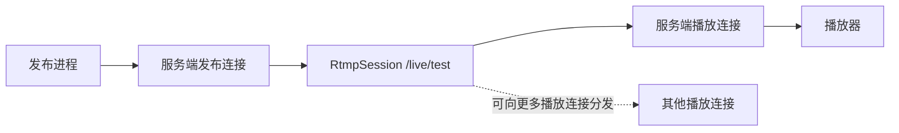

# ENET 阶段九：RTMP 会话与媒体分发学习讲义

> 对应[项目学习规划的阶段九](项目学习规划.md#stage-9)。参考用时：8～12 小时，媒体基础补缺、环境配置和排障另计。
>
> 复用阶段八的握手、Chunk 和 AMF 知识，沿“按流路径找到会话 → 接收媒体 → 补发配置并分发 → 停止与回收”阅读。局部实验使用现成 FFmpeg 工具完成一推一拉。

## 1. 学习顺序与范围

你用过音视频与 FFmpeg，本阶段只补分发所需的概念，不从头学习编码器或播放器开发。

建议顺序：

1. 分清编码、封装、解码配置、关键帧和普通媒体数据。
2. 认识流路径、会话、发布连接与播放连接，以及它们的持有关系。
3. 跟一条媒体消息，说明缓存、共享负载、重新分块和写队列中的复制点。
4. 用固定顺序推演新播放器怎样收到配置、怎样等待关键帧。
5. 用已有媒体文件尝试一推一拉，再核对停止时实际执行到哪一步。

| 源码 | 本阶段关注点 |
| --- | --- |
| [RtmpServer.cpp](../RtmpServer/RtmpServer.cpp)、[RtmpServer.h](../RtmpServer/RtmpServer.h) | 按流路径保存会话、查询发布者、定时清理 |
| [RtmpSession.h](../RtmpServer/RtmpSession.h)、[RtmpSession.cpp](../RtmpServer/RtmpSession.cpp) | Sink 登记、配置缓存、媒体分发 |
| [RtmpSink.h](../RtmpServer/RtmpSink.h) | 会话调用连接的统一接口 |
| [RtmpConnection.h](../RtmpServer/RtmpConnection.h)、[RtmpConnection.cpp](../RtmpServer/RtmpConnection.cpp) | 发布/播放角色、媒体处理、出站封装及停止 |
| [RtmpMessage.h](../RtmpServer/RtmpMessage.h)、[RtmpChunk.cpp](../RtmpServer/RtmpChunk.cpp) | 媒体负载、时间字段和重新分块 |
| [TcpConnection.cpp](../EdoyunNet/TcpConnection.cpp)、[BufferWriter.cpp](../EdoyunNet/BufferWriter.cpp) | 入队复制、部分写入和关闭边界 |

`AddSesion`、`playload`、`has_key_frame` 等名称保留源码拼写。采集、编解码和渲染内部按客户端规划学习。

## 2. 媒体基础只补到能解释分发

### 2.1 编码、封装和 RTMP 负载

| 名称 | 本阶段怎样理解 |
| --- | --- |
| H.264 / AVC | 视频编码格式，当前项目识别的主要视频类型 |
| AAC | 音频编码格式，当前项目识别的主要音频类型 |
| MP4、FLV | 封装格式；文件扩展名不能保证内部一定是 H.264/AAC |
| RTMP 音视频消息 | 承载相应格式的媒体负载，握手与 Chunk 外壳沿用阶段八 |

本实验从 MP4 取出已有编码数据，交给 FFmpeg 按 FLV/RTMP 所需形式封装。服务端处理的媒体负载沿用 FLV 音视频体的结构，不是把整个 MP4 或 FLV 文件原样转发；它也不在分发过程中解码或重新编码画面。

### 2.2 解码配置、普通帧与关键帧

| 内容 | 用途 | 当前项目中的位置 |
| --- | --- | --- |
| AVC 序列头 | 携带视频解码配置，例如 SPS/PPS 和 NALU 长度信息 | 发布连接、会话及各播放连接的配置成员 |
| AAC 序列头 | 携带 AudioSpecificConfig，例如编码对象类型、采样率和声道配置 | 发布连接、会话及各播放连接的配置成员 |
| 普通编码数据 | 承载后续图像或声音 | 随媒体消息转发 |
| 视频关键帧 | 为进入视频解码提供重要起点，区别于依赖其他图像的帧间数据 | 播放连接的首个关键帧门控 |
| `onMetaData` | AMF 属性，如宽高、帧率等描述 | 与音视频序列头分开处理 |

序列头是配置，不是已经解码的首帧；收到配置后，也不代表后续任意视频帧都能独立显示。晚加入的播放器通常需要先取得配置，再等后续合适的关键帧。

### 2.3 对照几个短字节前缀

根据 [Adobe FLV 原始规范 Annex E.4.2、E.4.3](https://veovera.org/docs/legacy/video-file-format-v10-1-spec.pdf)，结合 `HandleAudio/HandleVideo` 阅读：

| 负载前缀示例 | 含义 |
| --- | --- |
| `17 00 ...` | 首字节标记关键帧与 AVC，第二字节表示 AVC 序列头 |
| `17 01 ...` | 标记为关键帧的 AVC 编码数据 |
| `27 01 ...` | 标记为帧间图像的 AVC 编码数据 |
| `AF 00 ...` | 常见的 AAC 配置示例 |
| `AF 01 ...` | 常见的 AAC 编码帧示例 |

视频首字节的高 4 位是 FrameType，低 4 位是 CodecID；当前 AVC 对应 CodecID=7。AAC 则看音频首字节高 4 位的 SoundFormat=10，`AF` 只是常见示例，不能硬编码为所有 AAC 的唯一首字节。

AVC 普通负载中的 NALU 使用长度信息分隔，不能直接当作 Annex B 起始码格式。本实验采用已有 H.264/AAC 的 MP4 和 `-c copy -f flv`，不需要额外添加 `h264_mp4toannexb` 或自行拼接媒体字节。格式转换的区别可按需查 [FFmpeg 位流过滤器说明](https://ffmpeg.org/ffmpeg-bitstream-filters.html#h264_005fmp4toannexb)。

## 3. 按流路径组织会话，不按连接 ID 合并媒体

### 3.1 同一路径进入同一个会话

沿 `HandleInvoke()` 阅读：

```text
connect 取得 app = live
publish / play 取得 stream_name = test
  → stream_path_ = "/live/test"
  → RtmpServer::rtmp_sessions_["/live/test"]
```

发布者与播放器使用同一资源路径，才会进入同一个 `RtmpSession`。它们是不同的 RTMP TCP 连接，各自的 Message Stream ID 可以不同；路径、Message Stream ID 和阶段七的识别码不要混用。

本阶段可以直接连接媒体服务，不需要先跑通负载、登录和信令。`SigSvr` 的建流消息与这里的媒体连接是不同通道。



首轮只运行一路发布、一路播放；“一推多拉”先从分发循环理解。

### 3.2 GetSession 不是纯查询

- `GetSession(path)`：已有则返回，不存在则创建。
- `HasPublisher(path)`：调用 `GetSession` 后再检查发布者，因此这次检查也可能创建空会话。
- `HandlePublish`：成功后把发布连接加入会话。
- `HandlePlay`：把播放连接加入同一路径会话；此时未必已经有发布者。

所以，会话表中存在一个路径，不等于该路径已有媒体。阶段八已经说明，`Play.Start` 通知也不能单独证明媒体可读。

### 3.3 角色与发送标志分别表示什么

对照 `RtmpConnection.h`：

| 接口 | 当前判断条件 | 能说明什么 |
| --- | --- | --- |
| `IsPublisher()` | `state_ == START_PUBLISH` | 连接被标为发布角色 |
| `IsPlayer()` | `state_ == START_PLAY` | 连接被标为播放角色 |
| `IsPublishing()` | `is_publishing_` | 本地发布标志 |
| `IsPlaying()` | `is_playing_` | 本地媒体发送流程中的标志 |

`HandlePlay()` 设置播放角色并调用 `AddSink`，不会立即发送历史视频帧。`SendMediaData()` 对未关闭连接的非零负载，先设 `is_playing_=true`，之后仍可能因等待关键帧而直接返回。

因此，`IsPlaying()` 为 true 不证明媒体已经写完、解码或显示；`SendMediaData()` 返回 true 也可能表示当前包被门控跳过。

### 3.4 谁持有连接和缓存

```text
TcpServer::connects_          ── shared_ptr ──> RtmpConnection
RtmpServer::rtmp_sessions_    ── shared_ptr ──> RtmpSession
RtmpConnection               ── weak_ptr ──> RtmpServer / RtmpSession
RtmpSession::rtmp_sinks_      ── weak_ptr ──> RtmpSink
RtmpSession::publisher_       ── weak_ptr ──> 发布连接
RtmpSession 的 AAC/AVC 缓存   ── shared_ptr ──> 配置字节
各 RtmpConnection 的配置成员  ── shared_ptr ──> 该连接保存的配置字节
```

`RtmpSink` 是接口，当前实际对象为 `RtmpConnection`。会话转发媒体或元数据时，用 `weak_ptr::lock()` 临时取得强引用，失败则从这次遍历的 Sink 表中移除该项。

`GetClients()` 只统计可锁定的全部 Sink，包括发布者，不在这里删除过期项。它不是观众数，不判断 socket 是否健康或是否仍有媒体到达，也不等于 map 的原始项数。

## 4. 一条媒体消息怎样流向播放器

### 4.1 发布连接先识别配置，再交给会话

复用阶段八的完整 Message 输出：

```text
RtmpChunk 输出完整消息
  → HandleAudio / HandleVideo
  → 判断是否为 AAC / AVC 序列头
      是：复制完整媒体负载，更新发布连接与会话的缓存
  → RtmpSession::SendMediaData
  → 遍历可锁定且 IsPlayer() 的 Sink
  → 播放连接 SendMediaData
  → CreateChunk → TcpConnection::Send → 独立写队列
```

当前识别条件是：

- AAC：SoundFormat=10，第二字节为 0。
- AVC：FrameType=1、CodecID=7，第二字节为 0。

缓存保存的是完整 RTMP 媒体负载，包含前述媒体头部，不只是单独提取的 SPS/PPS 或音频配置字段。当前 `HandleAudio/HandleVideo` 在访问 `playload[0]` 及配置判断中的 `playload[1]` 前，没有相应的最小负载长度检查；Chunk 已还原完整 Message，也不代表其媒体负载格式合法。

### 4.2 共享负载与复制点

| 位置 | 当前数据关系 |
| --- | --- |
| Chunk 还原 Message | 得到由共享指针持有的入站媒体负载 |
| 普通媒体交给会话与各播放器 | 传递共享指针，可共享同一份原始负载 |
| 收到新的序列头 | 发布连接另分配缓冲并复制；会话 Setter 再共享这个缓存指针 |
| 播放连接接收序列头 | 将收到的共享指针保存到自己的配置成员；其 AVC 配置长度参与后续关键帧判断 |
| 每个播放器 `CreateChunk` | 将负载复制到该连接自己的 Chunk 输出缓冲 |
| `SendRtmpChunks → Send(buffer.get(), size)` | 走裸指针复制重载，再复制到各自写队列 |

因此，本层共享原始负载不等于全程零复制。各播放器有自己的流 ID、Chunk 封装、发送进度和排队数据；不会把发布者收到的 TCP 字节直接广播出去。

## 5. 新播放器怎样拿到配置并等待关键帧

### 5.1 AddSink 只登记，补发在后续媒体到来时发生

`RtmpSession::AddSink()` 把连接放进 `rtmp_sinks_`。若加入的是新发布者，它还会清会话的旧 AAC/AVC 配置并保存发布者引用。

播放连接加入时不会立刻回放缓存。下一次 `RtmpSession::SendMediaData()` 遍历到 `IsPlayer() && !IsPlaying()` 的连接，才会：

1. 尝试发送缓存的 AAC 序列头。
2. 尝试发送缓存的 AVC 序列头。
3. 再发送本次到达的媒体消息。

播放连接未关闭且补发的配置长度非零时，`SendMediaData()` 会更新该连接自己的 AAC/AVC 配置成员。后续等待关键帧时，检查的是该播放连接的 `avc_sequence_header_size_`，需要与会话中同名的缓存字段分开看。

缓存为空或长度为 0 时，相应发送不会产生有效负载。补发使用本次调用传入的时间戳；它不是在回放缓存产生时的一段历史媒体。

### 5.2 用固定顺序跟一次首个关键帧

假定发布者已发送有效 AAC/AVC 配置，会话缓存齐全，随后一个新建的播放连接加入：

| 到达或执行的步骤 | 当前实现对该播放器的处理 |
| --- | --- |
| `AddSink` | 只登记，尚未发送媒体 |
| 后续收到普通视频帧，前缀 `27 01` | 先补 AAC/AVC 配置，再检查当前帧；因尚无关键帧而跳过当前帧 |
| 收到普通 AAC 帧，前缀 `AF 01` | 在当前 AVC 门控条件下，也会被跳过 |
| 收到标记关键帧的 AVC 数据，前缀 `17 01` | 设置 `has_key_frame`，发送该视频消息 |
| 后续普通音视频 | 继续进入各自出站封装和写队列 |

这里的“发送”指进入本端发送路径，是否被播放器实际收到并显示仍需运行观察。

会话没有缓存普通视频帧或完整 GOP（图像组）。晚加入者不会从这里立即重放最近一组图像，需要等待后续数据；实际等待时间还取决于源视频关键帧间隔。

### 5.3 当前门控不能当作完善的首帧策略

`IsKeyFrame()` 只看 FLV 首字节的 FrameType=1、CodecID=7，没有解析 NALU 来验证它是否真是 H.264 IDR（可刷新参考图像关系的解码起点）。

当前等待条件还存在两点限制：

- 只有该播放连接已保存 AVC 配置且尚无关键帧时，才执行这段门控；没有 AVC 配置时并不会因此自动等待配置齐全。
- 判断作用于所有非序列头消息，普通 AAC 也会进入关键帧检查，不是只过滤视频。

`is_playing_` 又会提前置为 true，所以不能只看这个标志判断配置已经完整发送、音视频已经正常播放。首轮理解这几次实际判断即可，不要求设计新的 GOP 缓存或首帧策略。

## 6. 元数据、时间戳与慢播放器

### 6.1 onMetaData 与解码配置分别检查

当前 `HandleNotify()` 尝试解码 `@setDataFrame/onMetaData`，再调用会话转发。但是：

- `RtmpSession::SendMetaData()` 只遍历当前播放器，没有保存元数据供晚加入者回放。
- 播放连接的 `SendMetaData(metaData)` 没有使用传入参数，而是检查并编码自己的 `meta_data_`；普通播放连接的该成员通常为空。

因此，元数据转发和晚加入处理尚不完整。不要把日志中出现 `onMetaData` 与收到 AAC/AVC 解码配置等同；配置缓存、AMF 元数据和普通帧是三类内容。

### 6.2 从入站到出站核对时间字段

阶段八区分了消息头时间字段和累计时间。当前 `HandleAudio/HandleVideo` 传给会话的是 `rtmp_msg.timestamp`，没有使用累计后的 `rtmp_msg._timestamp`；出站连接又把收到的值写入新消息的 `_timestamp`。

在 `fmt=0` 的简单样例中它们可能相同，但带时间差继承的输入不能据此保证累计时间轴正确。出现时快时慢或音画不同步时，需要检查这条传递链，而不能仅因 Chunk 已完整解析就排除时间问题。

### 6.3 慢播放器怎样影响分发

各连接使用非阻塞 socket 和独立写队列，所以不能直接理解成“一个播放器没收完，所有播放器都同步等网络完成”。

但会话在整个遍历及 `SendMediaData/SendMetaData` 调用期间持锁；封装、复制、连接锁等待与发送尝试都会延长占锁时间。当前 RtmpSvr 使用两个调度线程，相关访问还要结合阶段三的线程归属理解。

会话没有据 Sink 返回值建立反馈，`TcpConnection::Send` 也没有将队列满传回生产端。因此，按连接排队不等于已有完整的慢客户端处理或发布端背压。队列与返回值复用阶段四，完整并发检查留阶段十一。

## 7. 停止：客户端退出、移除 Sink 和会话删除分别看

### 7.1 先分清入口

```text
RTMP 命令处理 ───────────────> HandleDeleteStream
TcpConnection::Close → OnClose → HandleDeleteStream
```

阶段七信令连接上的自定义 `DELETESTREAM` 是另一条通道，不会直接调用本节的会话移除函数。

标准 RTMP 命令名 `deleteStream` 与当前实现识别的 `DeleteStream` 大小写不同。当前 `HandleInvoke()` 只在 `rtmp_msg.stream_id == stream_id_` 分支识别 `DeleteStream`；Message Stream ID=0 的分支仅处理 `connect/createStream`。因此，标准工具发起停止不代表当前函数一定会执行。

### 7.2 1 毫秒定时器负责延迟移除 Sink

`HandleDeleteStream()` 找到会话后，在该连接所属调度器上添加一次性定时器：

```text
注册间隔 1 毫秒的回调，捕获 session、conn 的强引用
  → 调度线程后续扫描到期任务
  → session->RemoveSink(conn)
  → 返回 false，移除这次定时任务
```

这是把移除动作延后到定时回调，不是保证 1 毫秒内完成，也不等于立即释放连接。捕获的强引用会使会话和连接至少活到回调处理期间；完整停止同步仍需阶段十一检查。

该函数还清除 `is_playing_`、`is_publishing_`、`has_key_frame` 和 Chunk 上下文，但没有恢复 `state_`、清空 `stream_path_` 或主动关闭 TCP。

`RemoveSink()` 按 `IsPublisher()` 清会话的配置缓存和 `has_publisher_`，再删除该 Sink。发布者移除后，不会在这里自动关闭所有播放器或向其发送结束通知。

### 7.3 3 秒回调负责移除空会话

`RtmpServer` 的重复定时回调检查 `GetClients()==0`，满足时从 `rtmp_sessions_` 删除会话。

- `GetClients` 包含发布者和播放器，只统计能锁定的弱引用。
- 发布停止但播放器还被持有时，会话不一定为空。
- 从表中删除，也不等于其他强引用立即消失或对象已经析构。

因此，“发布者退出 → 所有播放器结束 → 3 秒后必定释放全部资源”不是当前实现的保证。

### 7.4 正常停止操作仍需确认服务端是否进入清理

`HandleRead()` 没有为 `recv()==0` 设置关闭分支，阶段四、七已经分析过。因此，按 `q`、关闭播放器或文件自然结束后，首先只能确认客户端操作；服务端是否进入 `Close → OnClose` 要实际观察。

重新发布也有边界：`RemoveSink()` 没有重置 `publisher_`，而 `GetPublisher()` 只看弱引用能否锁定。旧连接仍被持有时，即使其发布标志已经清零，新发布仍可能被判断为已有发布者。原有播放器的本地配置与关键帧标志也没有在新发布者加入时一并重置。

本阶段只跟一轮正常停止及实际阻断，不把修复重连、重新发布和全部关闭问题设为学习前提。

## 8. 最小实验：一个发布者、一个播放器

### 8.1 确认工具、文件与监听条件

服务在 Linux／WSL 中运行；`ffmpeg/ffprobe/ffplay` 可以在 Windows 或其他已有这些工具的机器上运行。播放器需要可用的图形和音频输出环境，不必为本实验在每个环境重复安装。

准备一个已有的短 MP4，包含 H.264 视频和 AAC 音频，时长应足够完成发布、启动播放和观察。先看文件信息：

```sh
ffprobe -v error -show_entries "stream=index,codec_type,codec_name" -of default=noprint_wrappers=1 "input.mp4"
```

确认第一路视频的 `codec_name=h264`、第一路音频的 `codec_name=aac`。MP4 后缀不能替代这项检查；下面两个 `-map` 都要求对应流确实存在。文件不符合时优先换一个已有的合适文件，不增加采集或转码编程任务。参数参考 [ffprobe 文档](https://ffmpeg.org/ffprobe.html#Main-options)。

在服务端按阶段零的构建结果启动 RtmpSvr，核对 [main.cpp](../RtmpServer/main.cpp) 的监听地址及 1935 端口。当前地址硬编码为 `172.21.205.121`，运行时需要对应本机可绑定、工具侧可访问的地址；不能只凭 success 日志判断监听成功。

### 8.2 发布与播放使用同一个 URL

将 `input.mp4` 和 `SERVER_IP` 换成实际文件与服务地址，替换文件路径时保留双引号，以支持带空格的路径。以下命令各占一行，可在已有工具的终端中运行。

终端一发布：

```sh
ffmpeg -re -i "input.mp4" -map 0:v:0 -map 0:a:0 -c copy -f flv "rtmp://SERVER_IP:1935/live/test"
```

- `-re` 按实时速度读取文件，避免一开始就尽快把整段文件送完。
- `-map` 选择第一路视频、第一路音频。
- `-c copy` 不重新编码，`-f flv` 选择输出封装。

发布开始、文件仍在持续读取时，在终端二或另一台具备输出条件的机器播放：

```sh
ffplay -rtmp_live live "rtmp://SERVER_IP:1935/live/test"
```

`-rtmp_live live` 明确按直播流读取，不表示当前教学服务已实现所有标准工具交互。两条 URL 中 `live` 是 app、`test` 是流名，拼写必须一致。命令含义见 [FFmpeg Streamcopy](https://ffmpeg.org/ffmpeg.html#Streamcopy)、[RTMP 文档](https://ffmpeg.org/ffmpeg-protocols.html#rtmp)与 [ffplay 文档](https://ffmpeg.org/ffplay.html)。

### 8.3 只观察必要交接点

优先看现有日志，必要时在下面的位置设断点：

| 交接点 | 要确认的内容 |
| --- | --- |
| `HandlePublish / HandlePlay` | 两条连接是否落到同一路径、是否加入同一个会话 |
| `HandleAudio / HandleVideo` | 配置与普通数据是否分别到达，缓存长度是否非零 |
| `RtmpSession::SendMediaData` | 是否遍历到播放器，是否尝试补发两类配置 |
| 播放连接 `SendMediaData` | 是否被关键帧门控跳过，是否进入出站封装 |
| 播放端 | 是否实际出现连续画面和声音 |

普通画面与声音可播放时，说明本次路径已经跑通；它不能证明晚加入、所有时间戳继承或慢读场景都正确。

首轮不需要另起第二个播放器或故意制造慢读。已有播放失败时，先按第九节定位，不要直接增加一组参数或改动整个媒体链。

### 8.4 停止并观察实际清理

先在 ffplay 窗口按 `q` 退出播放器，再在发布终端按 `q` 停止 ffmpeg；文件自然结束也可以作为发布端退出的观察。

结合第七节确认：

1. 客户端是否已退出，服务端是否实际进入 `Close/OnClose` 或删除流处理。
2. 延迟回调是否执行 `RemoveSink`，会话中是否还存在可锁定的 Sink。
3. 后续空会话扫描是否移除路径，还是因为残留连接而保留。

不要求另做资源统计报告。若正常操作没有走到清理，先指出阻断发生在哪里；不能把“已按停止”记录成“已完整释放”。文件结束后要重新发布时可重跑命令，但旧发布者清理和重新发布限制需先核对。

## 9. 失败时先检查哪一层

| 现象 | 优先检查 |
| --- | --- |
| 无法建立连接或没有发布应答 | 地址、监听、阶段八握手/Chunk/AMF 和标准命令兼容性 |
| 播放状态成功但没有媒体 | 路径是否相同、是否有发布者、是否持续到达音视频消息 |
| 已有数据但黑屏 | AVC 配置、后续关键帧、长度与时间字段、出站发送，再看播放器解码结果 |
| 无声 | 文件与映射是否有 AAC、配置是否到达、当前视频门控是否也跳过音频、播放机器音频输出 |
| 等待后才出画面 | 是否在等后续关键帧；当前没有 GOP 历史回放 |
| 停止后会话或发布者仍存在 | 是否进入关闭入口、延迟移除是否执行、弱引用是否仍可锁定及播放器是否残留 |

这些是排查入口，不是要求全部制造一遍的异常清单。环境或现有实现阻断运行时，先完成字段与调用链推演，实验结果保留待验证，后续具备条件再补。

## 10. 自查与完成标准

对照源码回答：

1. 为什么发布者和播放器的 Message Stream ID 不同，仍可以共享同一媒体会话？
2. AVC/AAC 序列头、普通媒体与 `onMetaData` 有什么区别？
3. 播放器加入后，缓存配置在哪次调用中补发？为什么可能还要等后续关键帧？
4. 共享原始负载后，每个播放器还有哪些复制和独立排队？
5. `IsPlaying()`、实际写入网络和画面显示之间有什么差别？
6. 延迟移除 Sink、删除会话表项和连接析构分别依赖什么条件？

完成标准：

- [ ] 能按流路径说明发布连接、播放连接和会话的关系。
- [ ] 能跟踪一条媒体消息及两类序列头，指出补发、门控、复制与发送的位置。
- [ ] 能观察或明确指出一推一拉实验的待验证部分，分清播放通知与实际画面、声音。
- [ ] 能解释正常停止操作后实际走过的清理路径，说明仍存活的引用或尚未执行的回调。

完成后按[总体执行顺序](项目学习规划.md#overall-learning-order)转入客户端阶段零、二至三，再继续后续客户端学习；ENET 的集中关闭检查、接口对照与联合联调按总体表安排回看。
