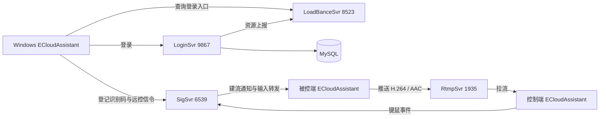
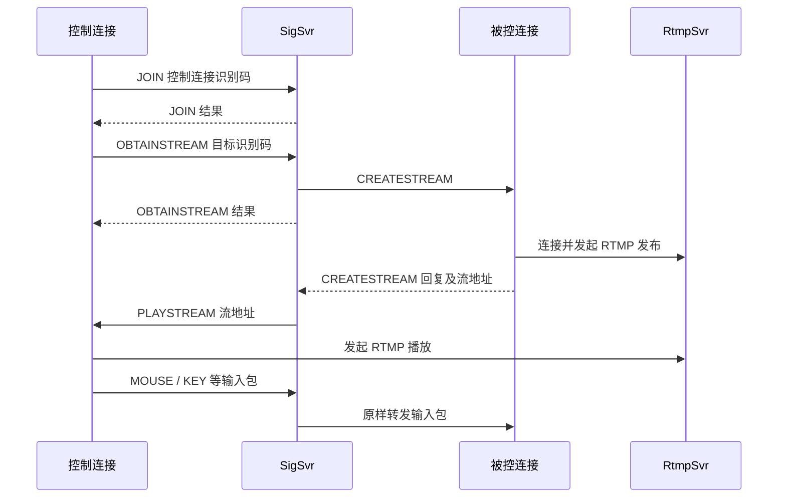

# ENET 项目学习规划

> 目标：理解并能够维护 ENET 的网络库、四类服务、协议、线程与资源生命周期，明确与 ECloudAssistant 的接口，并完成统一的跨端验收。

## 1. 主线学习目标

完成本规划后，应能够独立做到：

1. 从 `main()` 追踪到监听、接入、读写、业务分发、断线和进程退出。
2. 解释 `EventLoop`、`TaskScheduler`、`Channel`、`TcpServer` 和 `TcpConnection` 的职责，以及它们运行在哪些线程。
3. 按字节说明自定义协议的包头、长度、命令和字段，处理半包、粘包、部分发送与非法长度。
4. 解释负载服务如何发现登录服务，登录服务如何访问数据库并返回信令地址。
5. 手工推演识别码注册、请求远控、开始推流、通知拉流、键鼠转发和断开会话。
6. 从 RTMP 握手、Chunk、AMF 命令追踪到服务端会话分发、序列头、关键帧与媒体输出。
7. 为 socket、连接、缓冲区、定时器、数据库结果和媒体会话说明所有者与释放条件。
8. 区分正常设计、当前实现、已知缺陷和仍需运行验证的推测。
9. 能定位实际遇到的问题并解释影响；阻断当前实验且已经理解时再做最小修复，完整修复与回归作为按需深入。
10. 将客户端请求与服务端处理、响应及媒体输出对应起来，依据[联合联调与验收](#joint-validation)记录结果。

## 2. 项目边界与总体导航

### 2.1 工程地图

| 模块 | 构建/运行角色 | 核心职责 | 学习阶段 |
| --- | --- | --- | --- |
| `EdoyunNet/` | 静态库 | socket、epoll、事件循环、连接、缓冲区、定时器 | 1～5、11 |
| `LoadBanceServer/` | `LoadBanceSvr`，8523 | 接收登录服务的资源上报，为客户端返回登录入口 | 6 |
| `LoginServer/` | `LoginSvr`，9867 | 用户注册、登录、账号删除，访问 MySQL，返回信令地址 | 6 |
| `SigServer/` | `SigSvr`，6539 | 识别码登记、建流协调、键鼠事件转发 | 7 |
| `RtmpServer/` | `RtmpSvr`，1935 | RTMP 发布、播放和同一流的多连接分发 | 8～9 |
| `TCPServer/` | 默认未构建 | 额外的连接与 echo 演示 | 5 的辅助材料 |
| `scripts/`、`.vscode/` | 构建入口 | 本地 Linux 构建、Windows 经 SSH 构建 | 0 |

`EdoyunNet/main.cpp` 和 `TCPServer/` 演示均不参与默认构建。

### 2.2 项目分工

两份规划按实现归属分工，跨端学习以接口和观测结果衔接：

| 内容 | 主责规划 | 另一端的阅读边界 |
| --- | --- | --- |
| Linux socket、epoll、连接、缓冲区、定时器 | ENET 阶段 1～5、11 | 客户端只对照 `select` 与服务端的接口差异 |
| 负载、数据库、信令状态与 RTMP 会话分发 | ENET 阶段 6～9 | 客户端掌握请求、响应与错误分支 |
| Qt、客户端网络调度、采集、编解码、播放、输入执行与关闭 | ECloudAssistant 阶段 0～9 | ENET 阶段十只定位消息和媒体的生产、消费入口 |
| 协议差异、会话路径与联合记录 | 本文[阶段十二](#joint-validation) | 两边复用同一份简短记录 |

客户端实现按 [ECloudAssistant 学习规划](https://github.com/slimesq/ECloudAssistant/blob/main/docs/项目学习规划.md)学习。

<a id="overall-learning-order"></a>

### 2.3 总体执行顺序

先学习 ENET 的网络、业务与 RTMP 服务端，再进入客户端，最后检查关闭、核对接口并联合联调。按下表切换项目，阶段一按需查阅。

| 执行顺序 | 对应规划阶段 | 学习重点 | 进入下一步的依据 |
| --- | --- | --- | --- |
| 步骤 1 | ENET 0、2～5 | 构建与模块地图 → 协议 → 调度/连接/缓冲 → 定时器与 EdoyunNet 请求响应 | 能追踪消息的接收、处理、回复和关闭 |
| 步骤 2 | ENET 6 | 数据库定向补缺 → 资源上报/负载分配 → 用户查询与登录响应 | 能解释负载、登录、数据库和信令地址之间的关系 |
| 步骤 3 | ENET 7 | 跟踪正常状态链；用源码、断点或固定请求核对登记与建流 | 能解释控制/被控关系和一次目标离线；完整两端运行留联合验收 |
| 步骤 4 | ENET 8（含共同 RTMP 基础）、9 | 媒体基本概念与 RTMP 理论/现成样例 → 服务端实现 → FFmpeg/标准播放器实验 | 能解释握手、发布/播放、序列头与一推一拉；多播放器按需深入 |
| 步骤 5 | 客户端 0、2～3 | 尝试构建 → Qt 短板与 Qt 网络小实验 → 界面、启动请求与登录源码 | 能定位界面动作、请求发送和响应消费；未学内部保留接口边界 |
| 步骤 6 | 客户端 4 | 运行 Winsock 官方小例子 → 在客户端 Net 中看 select/缓冲 | 能解释初始化、平台差异、部分收发和连接关闭 |
| 步骤 7 | 客户端 5 | Windows 输入理论与测试窗口 → 信令和输入收发源码 | 能解释一次输入的产生、转发和执行 |
| 步骤 8 | 客户端 6 | 补媒体/采集概念 → 复用编码、采集示例或项目封装，逐条观察视频/音频 → 项目采编链 | 能说明格式、时间戳、线程与停止顺序；RTMP 内部暂留下一步 |
| 步骤 9 | 客户端 7 | 复用 RTMP 基础样例 → 发布连接、命令、序列头与媒体发送 | 能区分连接、握手、发布应答与媒体发出 |
| 步骤 10 | 客户端 8 | 运行解封装/解码与图像/音频示例 → 在项目中学习 YUV 上传和播放 | 能追踪 Packet、Frame、画面/声音及资源交接，无需另写播放器 |
| 步骤 11 | ENET 11、客户端 9 | 复用此前记录，检查关键线程、锁、资源与关闭 | 能解释正常退出和一个简单失败；复杂场景按需深入 |
| 步骤 12 | 两端 10 → ENET 12 | 核对接口与配置 → 两个客户端跑一次正常链和正常退出，再观察一个简单失败 | 记录成功部分与实际阻断；扩展边界按需选用 |

线程与资源关系随模块阅读检查，集中关闭检查安排在步骤 11；运行受阻时先推进不依赖它的部分。

## 3. 已知基础与时间口径

<a id="foundation-routing"></a>

### 3.1 已知基础与阶段归属

| 主题 | 当前基础 | 内容所在阶段 |
| --- | --- | --- |
| C++ | 能独立写代码并解释原理 | [阶段一](#stage-1)按需处理对象/回调疑问 |
| Linux socket/epoll | 能独立写代码并解释原理 | [阶段二至五](#stage-2)，直接对照项目封装 |
| 并发 | 介于熟练与理解不完整之间 | [阶段三](#stage-3)的线程前置、[阶段十一](#stage-11)的关闭检查 |
| 数据库 | 介于熟练与理解不完整之间 | [阶段六](#stage-6)内先补具体缺口 |
| Qt、音视频与 FFmpeg | 用过但理解不完整 | [客户端阶段二、三、六、八](https://github.com/slimesq/ECloudAssistant/blob/main/docs/项目学习规划.md#stage-2) |
| RTMP | 完全没学过 | [阶段八开头的共同基础](#rtmp-foundation)，两端只学一次 |
| Windows API（含 Winsock、采集与输入） | 从未接触过 | [客户端阶段四至六](https://github.com/slimesq/ECloudAssistant/blob/main/docs/项目学习规划.md#stage-4) |
| OpenGL 渲染与 Qt 音频输出 | 从未接触过 | [客户端阶段八](https://github.com/slimesq/ECloudAssistant/blob/main/docs/项目学习规划.md#stage-8) |

<a id="time-estimation"></a>

### 3.2 阶段任务与估时口径

表中为源码阅读与局部实践的参考用时；基础补学、环境配置和排障时间另计，按实际进度调整。

| 阶段 | 主题 | 参考用时 | 学习重点 |
| --- | --- | --- | --- |
| 0 | 工程与构建基线 | 2～3 小时 | 构建结果与模块入口（[讲义](阶段零工程与构建基线学习讲义.md)） |
| 1 | 已有基础复用与源码阅读方法 | 按需查阅 | 简短记录方法与实际缺口（[讲义](阶段一已有基础复用与源码阅读方法学习讲义.md)） |
| 2 | TCP 字节流与自定义协议 | 4～6 小时 | 一条请求的布局与分片推演（[讲义](阶段二TCP字节流与自定义协议学习讲义.md)） |
| 3 | epoll 与事件循环 | 6～8 小时 | 本项目调度与关键线程关系（[讲义](阶段三epoll与事件循环学习讲义.md)） |
| 4 | TCP 连接、收发缓冲区与背压 | 6～10 小时 | 一条消息的读写轨迹（[讲义](阶段四TCP连接收发缓冲区与背压学习讲义.md)） |
| 5 | 定时器与最短业务闭环 | 4～6 小时 | 现有请求响应与定时回调路径（[讲义](阶段五定时器与最短业务闭环学习讲义.md)） |
| 6 | 负载分配、登录与数据库 | 6～10 小时 | 资源上报、查询与结果有效期（[讲义](阶段六负载分配登录与数据库学习讲义.md)） |
| 7 | 信令与远控状态机 | 8～12 小时 | 正常建流与目标不存在的状态变化 |
| 8 | RTMP 握手、Chunk 与 AMF | 8～12 小时 | 握手记录、分块解析推演 |
| 9 | RTMP 会话与媒体分发 | 8～12 小时 | 一推一拉及正常停止的观察 |
| 10 | 客户端接口对照 | 2～4 小时 | 请求、响应、媒体与输入的接口映射 |
| 11 | 并发、关闭与资源回收 | 8～12 小时 | 关键共享状态与关闭路径 |
| 12 | 联合联调与验收 | 8～12 小时 | 一轮会话、正常退出和简单失败的共同结果 |

RTMP 共同基础和联合联调各安排一次，两端复用结果。

<a id="stage-0"></a>

## 4. 阶段零：工程与构建基线

配套讲义：[阶段零：工程与构建基线](阶段零工程与构建基线学习讲义.md)。

### 本阶段先补什么

熟悉 CMake 和调试工具的部分直接使用；不熟悉时，沿构建输出区分配置、编译、链接、启动及依赖路径。

构建后找到四个真实入口和输出位置，结合下图说明进程、端口及依赖关系。协议字节和调度细节分别在阶段二、三学习。



图中的客户端节点表示不同角色或连接，同一个 ECloudAssistant 程序具备控制端和被控端两种能力。当前客户端会为本机被控角色与主动控制角色建立不同的信令连接。

### 目标与阅读顺序

能说明四个进程为何共用一个网络库，区分构建依赖、运行依赖和客户端依赖。

依次阅读 [README](../README.md)、[顶层 CMake](../CMakeLists.txt)、[构建预设](../CMakePresets.json)、各模块的 `CMakeLists.txt`、[Linux 构建脚本](../scripts/build-linux.sh)、四个服务的 `main.cpp`。

### 构建与运行准备

在 Linux／WSL 终端的仓库根目录运行，配置成功后再构建：

```sh
cmake --preset linux-debug -DENET_BUILD_LOGIN_SERVER=ON
cmake --build --preset linux-debug
```

没有 Ninja 时，可使用 `linux-make-debug` 配置和构建预设。`bash scripts/build-linux.sh` 走 Make，并在缺系统 MariaDB 开发文件时使用用户缓存中的依赖。

依赖准备见 README 和构建脚本。

启动真实业务前还要确认：

- 服务绑定与内部连接地址当前为 `172.21.205.121`，客户端入口及 RTMP 地址为 `192.168.31.30`；应先统一为实验环境可达的地址。
- `LoginSvr` 使用 `ENET_DB_PASSWORD`，默认连接本机 MySQL 的 `root` 用户和 `users` 数据库；表结构与种子数据需要从 SQL 和字段使用处核对。
- `LoadBanceSvr` 要先于 `LoginSvr` 启动，因为登录服务构造时就尝试连接负载服务；当前没有完整重连机制。信令与 RTMP 在远控前准备好即可。
- 负载、登录和信令入口通过 `getchar()` 保持进程存活，直接后台启动可能遇到标准输入 EOF；学习时先分别在交互终端启动。

### 练习与验收

说明构建目标、关键依赖和输出位置。缺少数据库依赖时，可关闭 `ENET_BUILD_LOGIN_SERVER` 先构建另外三个服务。

- [ ] 能重新构建，并区分配置、编译、链接、启动四类失败。
- [ ] 能指出四个真实入口及两个未参与默认构建的演示入口。

记下代码与工具版本、构建结果和当前卡点；运行受阻时继续独立的源码或示例。

<a id="stage-1"></a>

## 5. 阶段一：已有基础复用与源码阅读方法（按需）

配套讲义：[阶段一：已有基础复用与源码阅读方法](阶段一已有基础复用与源码阅读方法学习讲义.md)。

### 局部补缺

C++ 和 Linux socket/epoll 已掌握，直接用于项目。对象、lambda 捕获或回调存活出现疑问时，用熟悉代码或短片段观察创建与释放。

只补当前不清楚的原理或 API；陌生主题先学概念，再运行或小改现成示例，解释输入和结果后进入项目。二进制布局、线程、定时器、数据库与 RTMP 的具体基础在后续使用阶段学习。

### 跟源码与简短记录

从一个问题出发，沿关键调用、数据和资源交接追踪，用日志、断点或运行结果核对。跨线程时确认调用线程、对象所有权和关闭方式；同一文件只展开当前阶段涉及的路径。

笔记可简记三项，复杂关系再画草图：

```text
本次要弄懂的问题：
关键调用 / 数据 / 资源：
观察结果与未解点：
```

区分源码推演、实际运行和待确认结论。已有实验直接复用，跨端协议差异集中记在阶段十二。

### 遇到阻断

区分概念、环境依赖和项目缺陷。已理解且很小的阻断可最小修复，其余记下原因后继续不依赖它的部分；未运行的功能保留待验证状态。

<a id="stage-2"></a>

## 6. 阶段二：TCP 字节流与自定义协议

配套讲义：[阶段二：TCP 字节流与自定义协议](阶段二TCP字节流与自定义协议学习讲义.md)。

### 本阶段先补什么

TCP 字节流知识直接复用。若固定数组、结构体偏移、打包或字节序仍有疑问，先用下方 JOIN 字节手推布局，再在现成片段中查看 `sizeof/offsetof`；能解释包长和字段后读收包代码。

### 目标与阅读顺序

掌握“网络收到的字节”和“业务消息”的区别，先读协议再读复杂业务。

1. [登录协议](../LoginServer/define.h)：`packet_head`、`UserLogin`、`LoginResult`。
2. [负载协议](../LoadBanceServer/loaddefine.h)：`Login_Info`、`LoginReply`。
3. [信令协议](../SigServer/define.h)：`JOIN`、建流与键鼠消息。
4. [客户端协议](https://github.com/slimesq/ECloudAssistant/blob/main/UI/tool/defin.h)：对应结构体和枚举。
5. [BufferReader](../EdoyunNet/BufferReader.h)：可读区、消费和剩余数据。

### 阅读重点

1. `len` 是否包含包头？`cmd` 是否能唯一决定包长？同一个 `Login` 命令在负载服务与登录服务的请求有何不同？
2. `#pragma pack(push, 1)` 解决什么？它是否解决字节序、字符串终止、非法字段和编译器布局的全部问题？
3. 长度只有 2 字节，接收缓冲区却可能很大，二者分别限制什么？
4. 一次到达两个完整包，或一个完整包后跟半个包，消费指针应怎样变化？
5. `len==0`、`len<sizeof(packet_head)`、命令对应体长不足时，当前代码会做什么？

### 练习与验收

在当前 x86 小端环境中，`JOIN` 请求的 `len=14`、`cmd=5`，识别码为 `345` 时可以表示为：

```text
0E 00 | 05 00 | 33 34 35 00 00 00 00 00 00 00
长度    命令    10 字节识别码
```

这些自定义包直接使用内存布局发送；地址中的 `htons(port)` 与包体字段的字节序处理要分别检查。RTMP 后续另有编码规则。

对照输入协议时注意两处字段差异：键盘包在客户端排列为 `type、key`，服务端为 `key、type`；滚轮在客户端是 `int8_t`，服务端是 `uint8_t`。目前信令服务直接转发输入包，两边 Windows 客户端使用同一布局，因此不能仅凭服务端声明差异断言实际输入解码已经出错。

先读 `packet_head` 和一条 JOIN 请求，把本阶段用到的命令、长度及收发位置补入[共同协议记录](#joint-validation)，其余包用到时再补。分片与非法长度先用给定字节手推，现象不清时再用现有程序打印消费位置。

- [ ] 能读懂一条 JOIN 请求的长度、命令和识别码字节。
- [ ] 能说明多次输入时缓冲区的变化，说明什么时候必须退出解析循环等待更多数据。
- [ ] 能区分布局相同、语义一致、实际互通三种结论。

<a id="stage-3"></a>

## 7. 阶段三：epoll 与事件循环

配套讲义：[阶段三：epoll 与事件循环](阶段三epoll与事件循环学习讲义.md)。

### 本阶段先补什么

复用 epoll 经验，先定向确认线程创建/`join`、原子停止标志和回调存活；某一项不清楚时，先看该概念，再运行/小改已有线程启动和停止片段，理解线程与对象何时结束后读项目调度。已掌握的部分不重复练习。

阅读 `TcpSocket` 时直接核对非阻塞设置、错误返回和 fd 所有权；分别用一句话说明 `EventLoop`、`TaskScheduler`、`Channel` 的职责。ENET 是就绪通知：`epoll_wait()` 返回后应用再调用 `recv/send`；IOCP 的完成通知只作可选对照。

### 目标与阅读顺序

从单线程就绪通知开始，理解项目如何将就绪 fd 映射回 C++ 回调。

直接核对 [TcpSocket.h](../EdoyunNet/TcpSocket.h)、[TcpSocket.cpp](../EdoyunNet/TcpSocket.cpp) 的封装与返回值，再读 [Channel.h](../EdoyunNet/Channel.h)、[EpoolTaskScheduler.cpp](../EdoyunNet/EpoolTaskScheduler.cpp)、[TaskScheduler.cpp](../EdoyunNet/TaskScheduler.cpp)、[EventLoop.cpp](../EdoyunNet/EventLoop.cpp)、[Acceptor.cpp](../EdoyunNet/Acceptor.cpp)。文件名为 `EpoolTaskScheduler`，类名为 `EpollTaskScheduler`，检索时保留源码拼写。

### 核心链路

```text
main 创建 EventLoop
  → 构造函数启动多个 TaskScheduler 线程
  → 每线程处理定时器并调用 epoll_wait
  → 通过 event.data.ptr 找到 Channel
  → Channel 调用读写或关闭回调
```

监听接入另跟一遍：`Acceptor::Listen → EventLoop::UpdateChannel → OnAccept → TcpServer 的新连接回调 → 业务 OnConnect`。

### 阅读重点

1. `epoll_ctl` 的 ADD、MOD、DEL 各在什么场景使用？`Channel` 自己是否拥有 socket？
2. 当前有无设置 `EPOLLET`？接入路径一次只 `accept()` 一个连接，对当前触发方式有什么含义？
3. `event.data.ptr` 中的原始地址由谁保证有效？移除 Channel 与当前批次回调之间有无竞态？
4. `epoll_wait(..., 0)` 在无客户端时如何影响 CPU？改成永久阻塞后，定时器和停止请求又如何唤醒它？
5. 监听 Channel、`EventLoop::AddTimer()` 和新连接分别选中哪个调度器？`GetTaskSchduler()` 是否把 0 号调度器永远排除？
6. 多个调度线程是否等于已有独立的业务任务池？慢回调会阻塞谁？

### 练习与验收

复用已有 epoll 经验，理清项目的“线程 → 调度器 → epoll fd → Channel → socket”关系；看不清时再画草图。服务可运行后，用断点或少量线程 ID 输出观察接入和读回调；空闲 CPU 可顺手查看，唤醒改造仅在需要时深入。

- [ ] 能解释本项目的就绪通知与随后 `recv/send` 的关系；IOCP 完成通知仅作选读对照。
- [ ] 能说明线程究竟在哪里创建，不把 `main()` 线程当成全部网络回调的执行线程。
- [ ] 能说明当前线程和调度器绑定，以及忙轮询对空闲 CPU 的影响；等待/唤醒改造按需深入。

### 本阶段资料

[epoll(7)](https://man7.org/linux/man-pages/man7/epoll.7.html)：核对 LT/ET 和就绪通知。

<a id="stage-4"></a>

## 8. 阶段四：TCP 连接、收发缓冲区与背压

配套讲义：[阶段四：TCP 连接、收发缓冲区与背压](阶段四TCP连接收发缓冲区与背压学习讲义.md)。

### 本阶段先补什么

复用已有 socket 返回值知识，先区分 EOF、暂时不可读/写和永久错误；不确定时查本节末尾手册，再沿一条正常收发和“只写出 3 字节”的固定样例核对索引。

### 目标与阅读顺序

把阶段二的包处理接入阶段三的事件模型，理解一条消息完整的接收和发送路径。

依次阅读 [TcpServer.cpp](../EdoyunNet/TcpServer.cpp)、[TcpConnection.cpp](../EdoyunNet/TcpConnection.cpp)、[BufferReader.cpp](../EdoyunNet/BufferReader.cpp)、[BufferWriter.cpp](../EdoyunNet/BufferWriter.cpp)，回看它们的头文件。

### 核心链路

```text
读：EPOLLIN → Channel → HandleRead → BufferReader::Read
    → 业务 readCb_ → 识别并消费完整包 → 保留未完成部分

写：业务 Send → BufferWriter::Append → HandleWrite → BufferWriter::Send
    → 部分写入则保留 writeIndex → 关注 EPOLLOUT → 继续发送
    → 队列为空时取消 EPOLLOUT
```

这是待核对的正常路径。阅读时要单独检查 EOF、临时不可读、永久错误、队列满和关闭状态的现有分支。

### 阅读重点

1. `BufferReader` 的 reader/writer index 如何变化？扩容时是否回收已消费的前缀空间？
2. `BufferWriter` 如何保持包的 FIFO 顺序？第一次只写出 3 字节时，下次从哪里继续？
3. `Send(char const*, size)` 与 `Send(shared_ptr<char>, size)` 的复制和存活保证有何不同？
4. `Append()` 返回失败时，`TcpConnection::Send()` 是否将失败反馈给业务？队列容量限制的是包数还是字节数？
5. 当前 `HandleRead()` 如何处理 `recv()==0`、`EAGAIN`？它与已有 socket 返回值语义是否一致？
6. `Send()` 会立即尝试写出，还是总会把写操作交回调度线程？`try_lock()` 失败后由谁继续推进？

### 练习与验收

先用断点或已有日志跟一次普通收发，部分发送可用固定的“本次只写出 3 字节”手推索引和事件关注变化。只有对缓冲行为仍有疑问时，再补分片或慢读实验。

- [ ] 能逐步解释“业务调用 Send”与“对端业务收到并处理”之间的区别。
- [ ] 能指出本条消息涉及的缓冲区所有者与复制点。
- [ ] 能说明当前队列上限还缺哪些反馈或流控，不能把它直接称为完善的背压机制。

### 本阶段资料

[recv(2)](https://man7.org/linux/man-pages/man2/recv.2.html)、[send(2)](https://man7.org/linux/man-pages/man2/send.2.html)用于核对返回值、EOF、部分收发及错误；有状态/背压疑问时可选读 [IOCP 阶段七](https://github.com/slimesq/IOCP/blob/ebb53f0f13a926c2ba63ec094b20fe9864667f9f/docs/IOCP阶段七状态机有序发送与背压学习讲义.md)，只对照概念，不增加 IOCP 实践任务。

<a id="stage-5"></a>

## 9. 阶段五：定时器与最短业务闭环

配套讲义：[阶段五：定时器与最短业务闭环](阶段五定时器与最短业务闭环学习讲义.md)。

### 本阶段先补什么

确认单调时钟与到期时间、回调返回值、取消及捕获对象存活。不熟悉的概念先补，再跟一个已有定时回调的注册、执行与移除。

### 目标与阅读顺序

借助现有演示梳理项目网络库的一次请求响应和定时回调；可运行时观察，受阻时先读源码，后续业务服务就绪后补运行验证。

阅读 [Timer.h](../EdoyunNet/Timer.h)、[Timer.cpp](../EdoyunNet/Timer.cpp)、`TaskScheduler::Start()`，然后对照 [EdoyunNet/main.cpp](../EdoyunNet/main.cpp) 与 [TCPServer/LConnection.cpp](../TCPServer/LConnection.cpp)。两个演示都不属于默认构建产物；网络库的 `main.cpp` 也没有实现完整的 echo 业务。

### 阅读重点

1. `timers_` 和 `events_` 为什么同时存在？`pair<到期时间, TimerId>` 解决什么？
2. `steady_clock` 与登录请求的 Unix 时间戳为什么用途不同？
3. 回调返回 `true`/`false` 对应重复还是移除？下一次执行是否补偿回调耗时？
4. 定时器在什么线程执行？添加、删除与执行是否有线程同步？捕获的 `this` 能活到什么时候？

### 练习与验收

先沿仓库已有 `TCPServer/LConnection` 的收发代码跟一条请求，或在已能启动的服务上用断点观察接入、读、业务回调、写和关闭。定时器只跟一个现有回调的注册与执行。

`TCPServer` 演示未纳入默认构建，且监听地址/端口需要核对；仅在需要隔离观察时单独启用。暂时无法运行时先说明源码路径，后续服务可运行后补一次观察。

重点区分“从事件表移除、业务关闭回调、移出连接表、实际 close(fd)”的位置。能说明这些步骤和定时回调的执行线程即可。

<a id="stage-6"></a>

## 10. 阶段六：负载分配、登录与数据库

配套讲义：[阶段六：负载分配、登录与数据库](阶段六负载分配登录与数据库学习讲义.md)。

### 本阶段先补什么

数据库只补实际短板：结果集与行指针的有效期、复制后再释放、`INSERT/UPDATE` 的用途及失败结果、同步查询阻塞事件线程。先解释当前不清楚的概念，再在实验库或已有示例中做一次查询、复制所需字段、释放结果并查看成功/失败返回；已有结果可直接复用。

这段基础实践与下方登录实验沿用同一测试用户和数据。准备表时仅满足当前 SQL 与 `row[n]` 字段顺序。

### 目标与阅读顺序

理解客户端为何先后访问两个端口，以及服务注册信息和用户数据的来源。

1. [LoginServer.cpp](../LoginServer/LoginServer.cpp)、[TcpClient.cpp](../LoginServer/TcpClient.cpp)：启动时连接负载服务，首次及周期上报资源。
2. [LoadBanceConnection.cpp](../LoadBanceServer/LoadBanceConnection.cpp)：接收资源上报和处理入口查询。
3. [LoadBanceServer.cpp](../LoadBanceServer/LoadBanceServer.cpp)：监控信息表与服务器选择。
4. [ORMManager.cpp](../LoginServer/ORMManager.cpp)：先补结果集有效期及必要 SQL 知识，再看连接、查询和字段顺序。
5. [LoginConnection.cpp](../LoginServer/LoginConnection.cpp)：登录处理、注册、账号删除（`Destory`）及超时判断。
6. 客户端 [LoginWgt.cpp](https://github.com/slimesq/ECloudAssistant/blob/main/UI/center/LoginWgt.cpp)：切换服务地址、发送登录包、消费响应。

### 核心链路

```text
LoginSvr 连接 LoadBanceSvr 并上报自身地址、端口和内存占用
客户端请求 LoadBanceSvr → 获得 LoginSvr 地址
客户端连接 LoginSvr → 提交 UserLogin
LoginSvr 查询用户 → 返回 LoginResult 中的信令地址
```

当前客户端界面提供登录入口，`HandleRegister()` 为空。首轮追登录查询即可；注册、账号删除先读源码，需验证时再在实验数据库中发送对应请求。`Destory` 实际删除用户记录，与退出登录、复位在线标记分开理解。

### 阅读重点

1. `LoadBanceServer::UpdateMonitor/GetMonitorInfo` 如何管理监控记录？无服务上报、服务失联时会发生什么，保存的 `Monitor_body*` 指向谁？
2. 数据库查询在哪个线程执行，同步查询会阻塞哪些网络回调？
3. `LoginConnection::HandleLogin` 实际校验哪些字段？注册、登录写入失败后会向客户端报告什么？
4. `ORMManager::selectClientByUsercode` 返回的 `MYSQL_ROW` 在 `mysql_free_result()` 后是否仍有效？需要保留的字段在哪里复制？
5. 在线标记需要更新现有记录时，当前代码调用了什么？`SELECT *` 与 `row[n]` 对建表字段顺序有什么依赖？

### 练习与验收

先跟一条资源上报与登录查询。需要实验表时，只按现有 SQL 和 `row[n]` 访问准备能容纳测试用户的最小表。

主线说明一次正常查询和一个简单失败，优先选用户不存在。无登录服务时，当前选择函数缺少空表检查，不能预期正常错误回复；先读源码即可。其他超时/断线场景只有实际遇到或需要定位时再运行。数据库结果指针等问题阻断实验时，按阶段一的方法处理。

- [ ] 能说明客户端、负载服务、登录服务、定时器和数据库之间的调用关系。
- [ ] 能解释登录服务构造阶段的连接失败为何影响后续入口发现。
- [ ] 能指出认证、在线状态、SQL 字符串构造和数据生命周期的当前实现边界。

<a id="stage-7"></a>

## 11. 阶段七：信令与远控状态机

### 本阶段先补什么

先辨认一个连接的状态、识别码、对端关系和流地址，结合下面已有时序追一次正常建流；仍看不清时才画状态草图或用固定请求验证。

### 目标与阅读顺序

理解识别码与 TCP 连接的映射，以及控制端、被控端、流地址之间的关系。

阅读 [SigServer.cpp](../SigServer/SigServer.cpp)、[ConnectionManager.cpp](../SigServer/ConnectionManager.cpp)，然后按下列方法追踪 [SigConnection.cpp](../SigServer/SigConnection.cpp)：

```text
OnRead / HandleMessage → HandleJion → DoObtainStream
→ DoCreateStream → HandleOtherMessage → HandleDeleteStream / Clear
```

同时对照客户端 [Net/SigConnection.cpp](https://github.com/slimesq/ECloudAssistant/blob/main/Net/SigConnection.cpp)。`HandleJion`、`RmoveCustom`、`objectes_` 等名称保留源码拼写，便于检索。

### 核心链路



前提是被控连接已 `JOIN` 成功，目标当前空闲。图展示业务意图；RTMP 发布状态在阶段八、九核对，真实客户端的建流回复、发布应答与首帧关联按[阶段十二](#joint-validation)实测。

### 阅读重点

| 提示 | 重点 |
| --- | --- |
| 连接状态 | `NONE`、`IDLE`、`PULLER`、`PUSHER`、`CLOSE` 的含义及正常建流的关键转移 |
| 对端关系 | `code_`、`objectes_`、`conn_`、`streamAddres_` 在正常链和断线时由谁修改 |

沿正常链辨认字段和状态，复杂关系画草图。两端本地状态枚举排列不同，先确认它们是否在线上传输；实际消息方向与失败分支补入[共同协议记录](#joint-validation)。

1. 半包到达时解析循环是否前进，何时等待更多字节？
2. 目标已推流分支是否设置 `conn_`，连接与对端关系怎样保持一致？
3. `RmoveCustom()` 中的 `state_ == IDLE` 实际是否修改状态？
4. `Clear()` 是否把停止远控会话与移除识别码登记混在一起？
5. 客户端收到获取流失败后是否恢复状态？

### 练习与验收

首轮只跟正常建流和一次目标不存在，说明控制/被控关系与状态变化。控制自己、多控制端、失败恢复与重复清理等按实际疑点选择深入。

观察运行时优先用已有发送器发一条 JOIN 并看应答，或用断点/手工数据跟源码。确需脱离真实客户端定位建流问题时，再用短脚本模拟固定请求，流地址可先视为普通字符串。完整两端流程留真实客户端就绪后验证。

- [ ] 能从 JOIN 说明建流、输入包转发与断开的路径；运行受阻的部分注明原因。
- [ ] 能区分状态机的设计意图和每条实际赋值，不把理想状态图当成当前行为。
- [ ] 能说明正常会话中识别码、连接和流的关系；多控制端与重连的复杂关系按需深入。

<a id="stage-8"></a>

## 12. 阶段八：RTMP 握手、Chunk 与 AMF

<a id="rtmp-foundation"></a>

### 本阶段先补什么

RTMP 共同基础由两端共用。当前 RTMP 为零基础，先学下面的概念并运行样例，再读服务端实现；客户端阶段七复用结果。基础学习参考用时 **8～12 小时**，与表中的源码阅读时间分开估计。

先按以下顺序建立模型：

1. 以已有 TCP 知识为起点，理解 RTMP 的握手、Message 与 Chunk、两类 Stream ID；先看简化交互，再辨认字节字段。
2. 学习 Chunk 头的 `fmt`、CSID、长度、时间戳、头部继承和大小端规则；手推默认 128 字节块大小下的 300 字节消息，再看分片如何保留解析进度。
3. 理解 AMF0 的 Number、Boolean、String、Object/Null 怎样表达命令参数，串起 connect、createStream、publish/play 和状态响应。媒体部分先区分普通帧与 AVC/AAC 配置，编解码内部按客户端规划补学。

理论查阅 [Adobe RTMP 1.0 原始规范（SRS 镜像）](https://ossrs.net/lts/en-us/assets/files/rtmp_specification_1.0-25a467618b92a3115bc97d4b0038b0ff.pdf)中的 Message、Handshake、Chunking 与 Command Messages；AMF 类型查阅 [Adobe AMF0 原始规范（SRS 镜像）](https://ossrs.net/lts/en-us/assets/files/amf0_spec_121207-ac97fd4db9408706cd816b681ca3918c.pdf)的基本类型章节。先覆盖项目使用的协议子集，再随源码扩展。

基础实践：

- **Chunk 固定推演**：取 CSID=3、Message Stream ID=1、时间戳=0、消息体长=300、块大小=128。首块使用 `fmt=0`，后两块使用 `fmt=3`，三块分别携带 128、128、44 字节消息体；辨认头部与消息体。随后读 `RtmpChunk::CreateChunk/Parse` 时继续用这组数值对照。
- **AMF 现成代码**：直接调用 [AmfEncoder](../RtmpServer/amf.h) 的 `encodeString/encodeNumber`，编码命令名 `play` 与事务 ID `1.0` 这两个字段。下面的驱动离线运行，只编码这两个字段，不是完整 RTMP 命令。

在 Linux 的 ENET 仓库根目录运行，编译产物写入临时目录：

```sh
sampleDir="$(mktemp -d)"
c++ -std=c++17 -I. -x c++ - \
  RtmpServer/amf.cpp EdoyunNet/BufferReader.cpp EdoyunNet/BufferWriter.cpp \
  -o "$sampleDir/AmfSample" <<'CPP'
#include <cstdint>
#include <cstdio>
#include "RtmpServer/amf.h"

int main()
{
    AmfEncoder encoder{};
    encoder.encodeString("play", 4);
    encoder.encodeNumber(1.0);
    const auto data{encoder.data()};
    for (std::uint32_t index{}; index < encoder.size(); ++index)
    {
        const auto byte{static_cast<unsigned char>(data.get()[index])};
        std::printf("%02X ", static_cast<unsigned int>(byte));
    }
    std::puts("");
}
CPP
"$sampleDir/AmfSample"
```

当前 x86 小端环境的预期输出是 `02 00 04 70 6C 61 79 00 3F F0 00 00 00 00 00 00`。说明字符串的类型、长度、内容与数值的类型、编码，再将 `1.0` 改为 `2.0` 比较变化即可，后续阅读继续使用这个样例。

能说明连接、握手、发布应答和媒体到达的区别，并跟懂一个命令和分块例子后，即可读完整实现。更复杂的继承头、交错流与边界在源码中遇到时再对照规范；两端复用同一份样例和简短笔记。

### 目标与阅读顺序

先理解协议层如何从 TCP 字节流还原 RTMP 消息，再进入媒体内容。

1. [rtmp.h](../RtmpServer/rtmp.h)、[RtmpMessage.h](../RtmpServer/RtmpMessage.h)：常量、消息类型和字段。
2. [RtmpHandshake.cpp](../RtmpServer/RtmpHandshake.cpp)：C0/C1、S0/S1/S2、C2 与状态推进。
3. [RtmpChunk.h](../RtmpServer/RtmpChunk.h)、[RtmpChunk.cpp](../RtmpServer/RtmpChunk.cpp)：分块、合并与解析状态。
4. [amf.h](../RtmpServer/amf.h)、[amf.cpp](../RtmpServer/amf.cpp)：命令参数编码和解码。
5. [RtmpConnection.cpp](../RtmpServer/RtmpConnection.cpp)：`OnRead → HandleChunk → HandleMessage → HandleInvoke`。
6. 客户端 [RtmpPublisher.cpp](https://github.com/slimesq/ECloudAssistant/blob/main/Pusher/rtmp/RtmpPublisher.cpp) 与 [RtmpConnection.cpp](https://github.com/slimesq/ECloudAssistant/blob/main/Pusher/rtmp/RtmpConnection.cpp)：对照 connect、createStream、publish。

### 阅读重点

1. TCP 连接、RTMP 握手完成、createStream 成功、publish 成功分别处于哪一步？
2. 握手包分片或 C2 后同时带上命令字节时，解析器怎样保留与继续消费？
3. 一个 RTMP Message 为什么可能跨多个 Chunk？不同 Chunk Stream 交错时，如何保存各自上下文？
4. CSID 与 Message Stream ID 分别表示什么？`fmt=0/1/2/3` 的头部长度和继承语义如何与实现对应？
5. 哪些字段采用大端，哪个 Stream ID 字段采用小端？扩展时间戳何时出现？
6. Set Chunk Size 调整的是哪一个方向？`Parse()` 返回 0、正数、负数时，上层分别如何继续？
7. AMF 命令名、事务 ID、对象和字符串参数如何变成 `connect/createStream/publish/play` 的业务调用？

### 练习与验收

沿用基础模块的固定消息样例，对照本项目的头部、剩余长度和解析进度。先看一次握手与发布/播放命令；交错 CSID、扩展时间戳、截断和容量边界作为读不清或排查兼容性时的深入项。

- [ ] 能从握手字节一路追踪到 `HandlePublish()` 或 `HandlePlay()`。
- [ ] 能逐步解释 Chunk 解析器的状态和每条消息的累计进度。
- [ ] 能指出当前支持的协议子集和尚未验证的边界，不将教学实现视为完整 RTMP 兼容性证明。

<a id="stage-9"></a>

## 13. 阶段九：RTMP 会话与媒体分发

### 本阶段先补什么

复用阶段八的 RTMP 基础，先区分 H.264/AAC、AVC/AAC 序列头、普通帧和关键帧，以及流路径与发布/播放角色。媒体格式已有经验直接复用；不清楚时先看现成媒体文件或工具输出中相关字段，再读分发代码。此处只学转发所需语义，采集、编解码与渲染内部在客户端阶段六、八学习。

### 目标与阅读顺序

理解按流路径组织“一推多拉”，以及新播放器为何需要序列头和关键帧。局部实验先使用现成 FFmpeg 与标准播放器作为媒体输入/输出，客户端采编和渲染内部仍按客户端规划学习。

阅读 [RtmpServer.cpp](../RtmpServer/RtmpServer.cpp)、[RtmpSession.h](../RtmpServer/RtmpSession.h)、[RtmpSession.cpp](../RtmpServer/RtmpSession.cpp)、[RtmpSink.h](../RtmpServer/RtmpSink.h)，再回到 `RtmpConnection` 的 `HandlePublish/HandlePlay/HandleAudio/HandleVideo/SendMediaData/HandleDeleteStream`。

### 核心链路

```text
发布者输入 Chunk → RtmpMessage → HandleAudio / HandleVideo
  → 找到 stream_path 对应的 RtmpSession
  → 缓存 AAC / AVC 序列头，向播放器分发
  → 播放连接 SendMediaData → 重新打 Chunk → TCP 发送
```

ENET 这里主要处理协议封装和媒体转发，H.264/AAC 的采集、编码、解码与渲染在客户端完成。

### 阅读重点

1. app、stream name 和 `stream_path` 怎样对应到同一个会话？`GetSession()` 是纯查询还是可能创建对象？
2. `RtmpServer`、`RtmpSession`、发布者和播放器之间哪些是强引用，哪些是弱引用？
3. AVC/AAC 序列头、普通帧、关键帧分别携带什么，何时发送给新加入的播放器？
4. `IsPlayer()`、`IsPlaying()`、`IsPublisher()` 有何区别？播放器加入与第一次媒体发送是同一时刻吗？
5. 推流断线后媒体引用怎样释放？为何有延迟 1ms 移除 Sink 的定时器和每 3 秒清理空会话的定时器？它们是否覆盖全部失败路径？
6. 一名播放器很慢时，其他播放器是否受锁持有时间或发送队列影响？元数据是否为晚加入者完整保留？

### 练习与验收

在信令链之外，用已有 H.264 视频、AAC 音频的短 MP4 文件试一路发布、一路播放。先启动 RtmpSvr，再在两个终端分别执行以下命令；将 `input.mp4` 和 `SERVER_IP` 换成实际文件和服务地址，播放器在有图形界面的机器上运行：

```sh
ffmpeg -re -i input.mp4 -map 0:v:0 -map 0:a:0 -c copy -f flv "rtmp://SERVER_IP:1935/live/test"
```

```sh
ffplay "rtmp://SERVER_IP:1935/live/test"
```

两条命令使用同一 URL：`live` 是 app，`test` 是流名。`-re` 按实时速度读取文件，`-c copy` 复用已有编码，`-f flv` 指定输出封装。观察画面、声音和序列头，再停止推拉并跟踪会话清理；文件结束后需要重新发布时，重跑第一条命令。参数可查 [FFmpeg RTMP 文档](https://ffmpeg.org/ffmpeg-protocols.html#rtmp)及 [Streamcopy](https://ffmpeg.org/ffmpeg.html#Streamcopy)。

第二个播放器、晚加入、慢读、同名发布和重新发布属于按需深入；想理解对应分支时先看源码。

- [ ] 能说明一个媒体 payload 从入站到多个出站连接的所有者和复制点。
- [ ] 能定位“命令成功但黑屏、无声、晚加入无法播放”分别应先检查哪一层。
- [ ] 能解释会话清理机制及其定时器与并发约束。

<a id="stage-10"></a>

## 14. 阶段十：客户端接口对照

### 本阶段先补什么

本阶段在客户端阶段零至九之后进行，核对接口的生产与消费位置。

### 目标与阅读顺序

把服务端的请求、响应和媒体输出与客户端入口对应起来，核对已记录的协议差异与会话路径。此阶段以静态对照为主；客户端构建、局部媒体实验和关闭审计按其学习规划完成，动态跨端验收统一进入[阶段十二](#joint-validation)。

| 接口 | 客户端入口 | 服务端对照重点 |
| --- | --- | --- |
| 登录入口 | [LoginWgt.cpp](https://github.com/slimesq/ECloudAssistant/blob/main/UI/center/LoginWgt.cpp) | 启动自动请求与按钮请求、地址切换、`LoginReply/LoginResult` 的含义 |
| 远控信令 | [SigConnection.cpp](https://github.com/slimesq/ECloudAssistant/blob/main/Net/SigConnection.cpp) | JOIN、获取流、建流、播放、停止的方向和失败响应 |
| RTMP 发布 | [RtmpPublisher.cpp](https://github.com/slimesq/ECloudAssistant/blob/main/Pusher/rtmp/RtmpPublisher.cpp) | connect/createStream/publish、序列头类型与流路径 |
| RTMP 播放 | [AVDEMuxer.cpp](https://github.com/slimesq/ECloudAssistant/blob/main/Codec/AVDEMuxer.cpp) | 播放 URL、流信息与断流结果；编解码内部交由客户端规划 |
| 输入转发 | [AVPlayer.cpp](https://github.com/slimesq/ECloudAssistant/blob/main/Puller/UI/AVPlayer.cpp)、客户端 `SigConnection` | 输入包产生与消费位置，服务端保持的转发关系 |

### 阅读重点

1. 登录、信令、RTMP 发布和 FFmpeg 播放各使用哪条连接，连接地址从哪里取得？
2. 每个跨端命令由谁产生、谁消费，哪些字段由服务端解析，哪些输入包仅透明转发？
3. 如何判断建流回复、发布应答与首个可播放帧属于同一会话？

### 练习与验收

沿正常会话的源码路径定位两端收发入口，核对尚不清楚的接口差异。已有运行记录直接复用，动态跨端验证在阶段十二进行。

- [ ] 能定位每个请求和响应在两端的发送、解析位置。
- [ ] 能按连接与流路径区分信令转发、RTMP 分发和客户端媒体问题。
- [ ] 已将待实测接口差异加入联合验收记录。

### 本阶段资料

对照 [ECloudAssistant 学习规划的阶段十](https://github.com/slimesq/ECloudAssistant/blob/main/docs/项目学习规划.md#stage-10)。重点定位输入协议头、序列头类型、发布应答、播放结果和地址/流路径，实际差异补入阶段十二共同记录。

<a id="stage-11"></a>

## 15. 阶段十一：并发、关闭与资源回收

### 本阶段先补什么

复用阶段三及客户端阶段九的线程与释放记录。只对关键共享状态的锁范围、原子标志、回调重入或停止/`join` 中未能解释的部分补概念；必要时改一个已有短片段核对。

### 目标与阅读顺序

重新阅读已经熟悉的模块，重点从“能跑一次”转向“多个线程与失败路径下是否仍成立”。

围绕 `EventLoop::Quit`、`TaskScheduler::Stop`、`TcpServer::Stop/RemoveConnection`、`TcpConnection::Close/~TcpConnection`、`SigConnection::Clear`、`RtmpConnection::HandleDeleteStream` 和定时器回调，复用已有记录，理清关键关闭顺序。客户端内部关闭由其阶段九审计，跨进程退出结果在联合验收中核对。

### 阅读重点

| 检查方向 | 关注内容 |
| --- | --- |
| 线程与共享状态 | 创建线程、调用线程、读写成员、锁或原子保护、跨线程访问位置 |
| 资源与所有权 | 创建者、长期所有者、临时持有者、移除条件、最终释放位置 |
| 关闭与重入 | 当前关闭入口、重复关闭、回调期间的对象存活与停机顺序 |

重点检查：

- `is_shutdown_` 当前为 `std::atomic_bool`；检查 `Start()` 重置、`Stop()`、等待唤醒与 `join` 的时序。原子读写本身之外，停止请求是否可能被启动重置覆盖，工作线程能否可靠退出？
- 分别核对 `TcpConnection::is_closed_` 等普通共享成员的读写线程和同步依据；停止标志为原子变量并不保护其他对象或状态。
- `TcpServer::connects_`、调度器选择索引、定时器两张表是否跨线程访问；RtmpSvr 使用两个调度线程时与单线程服务有何不同。
- `Send()` 立即写出导致的调用线程变化；连接锁、会话锁和服务锁是否形成锁顺序或回调重入问题。
- 从 epoll 表移除原始 `Channel*`、从连接表移除 `shared_ptr`、真正析构之间如何保持存活。
- 服务和连接析构前，捕获 `[this]` 的定时器是否已失效；epoll fd 和所有已接入 socket 是否最终释放。
- `TcpServer::Stop()` 遍历连接时，关闭回调是否同时修改同一个容器。

### 练习与验收

主线先观察一次连接、收发、主动断开和服务退出，确认关键线程与连接能结束；顺手查看空闲 CPU 即可。用现有日志、断点，必要时查看线程或 fd。

大量连接、慢读、快速断连、性能指标和 sanitizer 专项构建均为选做，仅在实际问题需要时使用。

- [ ] 能说明关键共享状态的保护方式，指出已看到的疑点。
- [ ] 能说明关键停机顺序，以及每一步等待或保护什么。
- [ ] 能解释本次观察中的线程、连接与资源退出；复杂泄漏或重入问题记录后按需深入。

### 本阶段资料

上述项目关闭入口是主资料；需要停机组织方式的对照时可选读 [IOCP 阶段九](https://github.com/slimesq/IOCP/blob/ebb53f0f13a926c2ba63ec094b20fe9864667f9f/docs/IOCP阶段九取消关闭与安全停机学习讲义.md)，不照搬 Overlapped operation 或取消排空机制。

<a id="stage-12"></a>

<a id="joint-validation"></a>

## 16. 阶段十二：联合联调与验收

使用两个客户端跟一次完整会话，观察正常退出和一个简单失败。多控制端、慢读和压力测试按需深入。

### 开始前确认

两端按总体顺序学到对应模块，能够构建并说明当前关键调用；零基础主题已运行/修改过相关小例子。核对本次代码版本、服务地址、端口，复用已有实验结果。

双端运行前，区分登录用户、本机识别码和控制目标：

- **登录码**：[LoginWgt.cpp](https://github.com/slimesq/ECloudAssistant/blob/main/UI/center/LoginWgt.cpp) 当前固定调用 `login.SetCode("345")`；两端分别使用自己的测试用户，并调整对应登录码。
- **本机与目标识别码**：[RemoteWgt.cpp](https://github.com/slimesq/ECloudAssistant/blob/main/UI/center/RemoteWgt.cpp) 的本机默认值也是 `345`，在登录成功时用于登记信令。可将控制端本机设为 `345`、被控端设为 `346`，控制端的远程目标填 `346`；本机码需在登录前配置好。
- **控制连接注册码**：[SigConnection::Join](https://github.com/slimesq/ECloudAssistant/blob/main/Net/SigConnection.cpp) 对主动控制连接固定使用 `154564`，应与其他已注册识别码区分。

环境或代码阻断时，记录位置、现象和已理解的原因；简单且已理解的可最小修复，其他部分后续再处理。未跑通的环节保持“阻断/待验证”，不标为功能通过，也不妨碍其他独立主题继续学习。

### 一轮主线操作

1. 先启动 LoadBanceSvr，再启动 LoginSvr，准备 SigSvr 和 RtmpSvr；用两个客户端核对实际地址和识别码。
2. 跟一次登录与建流，关联 JOIN、获取流、CREATESTREAM 和 PLAYSTREAM。当前登录按识别码查询及在线标记处理，账号/密码校验缺口按源码事实说明。
3. 观察一个被控端推流、一个控制端播放，核对画面/声音和一次鼠标或键盘操作；定位发布应答、序列头及播放入口。
4. 正常关闭远程窗口与程序，观察关键线程、连接和会话是否结束。
5. 选择一个容易观察的实际失败，如目标识别码不存在、服务不可达或连接取消，说明走到哪个分支。无需人为构造全部故障。

先用现有日志和断点定位；只有关联不清时才补少量临时输出，例如识别码、流地址或线程 ID。

### 简版验收表

| 层次 | 基本场景 | 按需深入 |
| --- | --- | --- |
| 登录与信令 | 跟懂一次地址切换、用户查询和建流状态 | 超时、数据库失败、多控制端、重复识别码 |
| 媒体与输入 | 一推一拉，观察画面/声音和一次实际输入 | 第二观看者、晚加入、慢读、同名发布、各类键值与 DPI |
| 关闭与失败 | 一次正常退出和一个简单失败，记录实际结果 | 异常断线、连续重连、重复清理、资源增长 |
| 协议与并发 | 能解释本次消息、关键线程和所有权 | 非法输入、交错 Chunk、专项检查工具与压力测试 |

按需项用于排查具体问题。已有正常/失败结果直接引用，实现或环境变化后再验证受影响部分。

### 记录和完成标准

简记本次协议差异、会话调用链、运行结果与未解点。

- [ ] 能从登录讲到建流、媒体、输入和退出，并指出两端关键入口。
- [ ] 能说明已观察的正常行为及一个简单失败；无法运行的环节有明确阻断记录。
- [ ] 能说明关键连接、线程与帧对象由谁持有、何时结束；尚未理解的问题留待深入。
