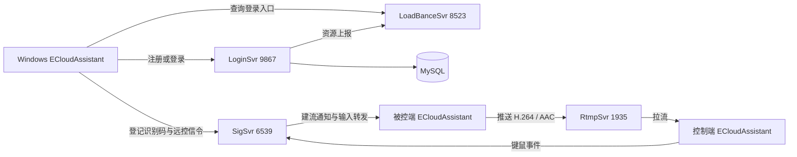
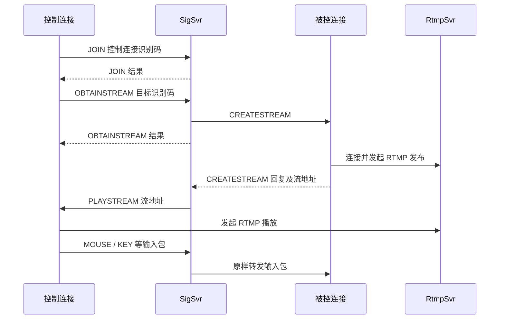

# ENET 项目学习规划

> 目标：完整理解 ENET 的网络库、四类服务、协议、线程与资源生命周期，并能结合 ECloudAssistant 解释一次远程控制从建立到结束的全过程。
>
> 编写日期：2026-11-02。主项目为 ENET；客户端对照版本为 ECloudAssistant `a8e029b`。源码变化后，应重新核对本文记录的构建结果和问题。

## 1. 怎样才算“完全理解”

完成本规划后，应能够独立做到：

1. 从 `main()` 追踪到监听、接入、读写、业务分发、断线和进程退出。
2. 解释 `EventLoop`、`TaskScheduler`、`Channel`、`TcpServer` 和 `TcpConnection` 的职责，以及它们运行在哪些线程。
3. 按字节说明自定义协议的包头、长度、命令和字段，处理半包、粘包、部分发送与非法长度。
4. 解释负载服务如何发现登录服务，登录服务如何访问数据库并返回信令地址。
5. 手工推演识别码注册、请求远控、开始推流、通知拉流、键鼠转发和断开会话。
6. 从 RTMP 握手、Chunk、AMF 命令追踪到会话分发、序列头、关键帧和音视频播放。
7. 为 socket、连接、缓冲区、定时器、数据库结果和媒体会话说明所有者与释放条件。
8. 区分正常设计、当前实现、已知缺陷和仍需运行验证的推测。
9. 为一个真实缺陷设计复现，再用最小修改与回归验证证明修复成立。
10. 在没有现成工程的情况下重建一个精简版本，并解释保留或调整每项设计的理由。

仅能编译、复述类名或看见远程画面，均不足以覆盖这些目标。

## 2. 参考方式与项目边界

本规划参考 IOCP 项目 `ebb53f0` 版本的文档组织，主要包括：

- [IOCP 学习路线](https://github.com/slimesq/IOCP/blob/ebb53f0f13a926c2ba63ec094b20fe9864667f9f/docs/IOCP学习路线.md)：分阶段目标、阅读顺序、练习与自检。
- [阶段六：TestConnection 业务链](https://github.com/slimesq/IOCP/blob/ebb53f0f13a926c2ba63ec094b20fe9864667f9f/docs/IOCP阶段六TestConnection业务链学习讲义.md)：用一条最短请求贯穿协议和网络层。
- [阶段七：状态机、有序发送与背压](https://github.com/slimesq/IOCP/blob/ebb53f0f13a926c2ba63ec094b20fe9864667f9f/docs/IOCP阶段七状态机有序发送与背压学习讲义.md)、[阶段九：取消、关闭与安全停机](https://github.com/slimesq/IOCP/blob/ebb53f0f13a926c2ba63ec094b20fe9864667f9f/docs/IOCP阶段九取消关闭与安全停机学习讲义.md)：持续追踪状态、所有权和异常收尾。

ENET 的主线需要围绕 Linux 的就绪通知模型重新组织：`epoll_wait()` 返回就绪事件，应用随后调用 `recv()`、`send()`。IOCP 的 Overlapped operation、完成通知和取消排空机制属于对照知识，不是阅读 ENET 的前置条件。

### 2.1 工程地图

| 目录 | 构建结果 | 核心职责 | 学习阶段 |
| --- | --- | --- | --- |
| `EdoyunNet/` | 静态库 | socket、epoll、事件循环、连接、缓冲区、定时器 | 1～5、11 |
| `LoadBanceServer/` | `LoadBanceSvr`，8523 | 接收登录服务的资源上报，为客户端返回登录入口 | 6 |
| `LoginServer/` | `LoginSvr`，9867 | 用户注册、登录、注销，访问 MySQL，返回信令地址 | 6 |
| `SigServer/` | `SigSvr`，6539 | 识别码登记、建流协调、键鼠事件转发 | 7 |
| `RtmpServer/` | `RtmpSvr`，1935 | RTMP 发布、播放和同一流的多连接分发 | 8～9 |
| `TCPServer/` | 默认未构建 | 额外的连接与 echo 演示 | 5 的辅助材料 |
| `scripts/`、`.vscode/` | 构建入口 | 本地 Linux 构建、Windows 经 SSH 构建 | 0 |

`EdoyunNet/main.cpp` 也是演示入口，被静态库构建排除。`TCPServer/` 未加入顶层构建；阅读其 CMake 文件不代表它已经生成可执行程序。

### 2.2 ENET 与客户端的关系



图中的客户端节点表示不同角色或连接，同一个 ECloudAssistant 程序具备控制端和被控端两种能力。当前客户端会为本机被控角色与主动控制角色建立不同的信令连接。

学习范围以服务端为中心，客户端深入到能解释协议生产、媒体消费和输入执行的程度。UI 样式不是重点；采集、编解码和线程切换则属于完整链路的一部分。

客户端本地对照目录为 `../../ECloudAssistant/`，以下链接假设两个仓库并排放置。未放置客户端时，可使用 [ECloudAssistant 仓库](https://github.com/slimesq/ECloudAssistant/tree/a8e029b2cc168320cf2db33e770b5f75766c950a)。

## 3. 学习方法、产出和时间安排

每个主题按以下顺序推进：

```text
解释概念 → 独立写一个小例子 → 找到项目中的对应实现
→ 用断点、日志或字节记录验证 → 推演一个失败场景 → 闭卷复述
```

每次阅读一个函数，都应回答：谁调用它；在哪个线程执行；读取和修改什么状态；持有什么锁；输入内存由谁拥有；成功、失败、断线后分别去哪里。

每阶段保留三类学习记录：一张调用或状态图、一份能重复执行的实验记录、一段自己的解释。实验记录至少包含命令、预期、实际结果和未解决的问题。未通过验收时，优先补小实验。

### 3.1 阶段总览

以下为建议有效学习时间，包含核心阅读、实验和复盘，不包含等待安装、环境迁移及额外扩展。基础已掌握的阶段可以通过验收后压缩。

| 阶段 | 主题 | 建议时间 | 核心产出 |
| --- | --- | --- | --- |
| 0 | 工程与构建基线 | 2～3 小时 | 构建记录、模块地图 |
| 1 | C++17 所有权与 Linux socket | 4～6 小时 | 同步 echo 小程序、资源表 |
| 2 | TCP 字节流与自定义协议 | 4～6 小时 | 协议表、分片与合包推演 |
| 3 | epoll 与事件循环 | 6～8 小时 | 最小 epoll 程序、线程图 |
| 4 | TCP 连接、收发缓冲区与背压 | 6～10 小时 | 一条消息的读写轨迹 |
| 5 | 定时器与最短业务闭环 | 4～6 小时 | 基于 EdoyunNet 的 echo 演示 |
| 6 | 负载分配、登录与数据库 | 6～10 小时 | 登录时序图、数据所有权图 |
| 7 | 信令与远控状态机 | 8～12 小时 | 状态转换表、建流与断流推演 |
| 8 | RTMP 握手、Chunk 与 AMF | 8～12 小时 | 握手记录、分块解析推演 |
| 9 | RTMP 会话与媒体分发 | 8～12 小时 | 一推多拉的媒体生命周期图 |
| 10 | 客户端对照与完整远控链 | 8～12 小时 | 画面、声音、输入的双端轨迹 |
| 11 | 并发、关闭、资源回收与性能 | 8～12 小时 | 线程与锁表、关闭审计记录 |
| 12 | 分层联调、修复与独立重建 | 8～12 小时 | 验证矩阵、精简实现、最终复述 |

总计约 **80～121 小时**。按每周 8～10 小时安排，约需 8～16 周。阶段顺序优先于日历；完整理解所需的缺陷修复与环境排障可能带来额外时间。

### 3.2 阅读与修复的配合

正常链路先建立整体印象，异常路径在对应阶段立即记录。若缺陷阻止后续实验，就先做最小修复并补回归；其余问题集中在阶段十一、十二处理。原始现象、问题证据和修复后的行为应分别保留。

本规划中的实验与测试是后续学习任务；新增本文不代表这些任务已经完成。

## 4. 阶段零：工程与构建基线

### 目标与阅读顺序

能说明四个进程为何共用一个网络库，区分构建依赖、运行依赖和客户端依赖。

依次阅读 [README](../README.md)、[顶层 CMake](../CMakeLists.txt)、[构建预设](../CMakePresets.json)、各模块的 `CMakeLists.txt`、[Linux 构建脚本](../scripts/build-linux.sh)、四个服务的 `main.cpp`。

### 操作与当前基线

在仓库根目录运行：

```sh
cmake --preset linux-debug
cmake --build --preset linux-debug
```

没有 Ninja 时，可使用 `linux-make-debug` 配置和构建预设。`bash scripts/build-linux.sh` 走 Make，并在缺系统 MariaDB 开发文件时使用用户缓存中的依赖。

2026-11-02 已在当前机器验证：CMake 3.22.1、G++ 11.4.0、Ninja 1.10.1 下，`EdoyunNet` 和四个服务构建成功，四个可执行文件的共享库依赖可解析。Ninja 位于当前用户目录；MariaDB 开发文件使用 `~/.cache/enet-vscode-build/deps/`，相关路径已写入本机 `build/ninja-debug/CMakeCache.txt`。换机器或删除缓存后需要重新准备依赖。

当前尚未完成服务运行、数据库表结构、Windows 客户端构建及完整远控联调。仓库未配置 `add_test()`/CTest 测试集，后续需要按实验逐步建立验证。

启动真实业务前还要确认：

- 服务绑定与内部连接地址当前为 `172.21.205.121`，客户端入口及 RTMP 地址为 `192.168.31.30`；应先统一为实验环境可达的地址。
- `LoginSvr` 使用 `ENET_DB_PASSWORD`，默认连接本机 MySQL 的 `root` 用户和 `users` 数据库；表结构与种子数据需要从 SQL 和字段使用处核对。
- `LoadBanceSvr` 要先于 `LoginSvr` 启动，因为登录服务构造时就尝试连接负载服务；当前没有完整重连机制。信令与 RTMP 在远控前准备好即可。
- 负载、登录和信令入口通过 `getchar()` 保持进程存活，直接后台启动可能遇到标准输入 EOF；学习时先分别在交互终端启动。

### 练习与验收

画出“目标 → 源文件 → 库 → 外部依赖”表，记录实际输出目录与编译数据库位置。解释为什么关闭 `ENET_BUILD_LOGIN_SERVER` 可以构建另外三个服务，但不能验证完整登录流程。

- [ ] 能重新构建，并区分配置、编译、链接、启动四类失败。
- [ ] 能指出四个真实入口及两个未参与默认构建的演示入口。
- [ ] 清楚哪些结果已验证，哪些仍待实验。

## 5. 阶段一：C++17 所有权与 Linux socket

### 目标与阅读顺序

掌握后续源码会用到的能力：RAII、智能指针、lambda 捕获、继承与虚析构、`enable_shared_from_this`、线程和互斥锁，以及 POSIX socket 的返回值约定。

从 [TcpSocket.h](../EdoyunNet/TcpSocket.h)、[TcpSocket.cpp](../EdoyunNet/TcpSocket.cpp) 开始，再阅读 [TcpConnection.h](../EdoyunNet/TcpConnection.h)、[TcpServer.h](../EdoyunNet/TcpServer.h)，暂时只识别成员和资源所有者。

### 必须回答

1. fd、C++ 对象、`shared_ptr` 和 `weak_ptr` 分别表示什么？连接对象析构与 socket 关闭是否是同一个动作？
2. 捕获 `[this]` 会延长对象生命周期吗？为什么只能在共享所有权已经建立后使用 `shared_from_this()`？
3. 谁调用 `socket → bind → listen → accept → recv/send → close`？`accept()` 得到的 fd 与监听 fd 是什么关系？
4. `recv()==0`、`EINTR`、`EAGAIN/EWOULDBLOCK` 和其他错误分别应怎样处理？
5. 原始指针、引用或 `MYSQL_ROW` 指向的存储失效后，复制指针是否有帮助？

### 练习与验收

单独写一个同步 echo 小程序：使用 RAII 管理 fd，完整循环发送，能区分正常 EOF 与错误。把监听 fd、已接入 fd 和收发缓冲区列成资源表；再用一个 lambda 小例子解释悬空 `this`。

- [ ] 能闭卷复述同步 TCP 的建立、通信和回收路径。
- [ ] 能为项目中的每种智能指针说明选择理由，而非仅复述用法。
- [ ] 能解释为什么“某个容器有锁”不能保证容器中原始指针指向的数据仍有效。

## 6. 阶段二：TCP 字节流与自定义协议

### 目标与阅读顺序

掌握“网络收到的字节”和“业务消息”的区别，先读协议再读复杂业务。

1. [登录协议](../LoginServer/define.h)：`packet_head`、`UserLogin`、`LoginResult`。
2. [负载协议](../LoadBanceServer/loaddefine.h)：`Login_Info`、`LoginReply`。
3. [信令协议](../SigServer/define.h)：`JOIN`、建流与键鼠消息。
4. [客户端协议](../../ECloudAssistant/UI/tool/defin.h)：对应结构体和枚举。
5. [BufferReader](../EdoyunNet/BufferReader.h)：可读区、消费和剩余数据。

### 必须回答

1. `len` 是否包含包头？`cmd` 是否能唯一决定包长？同一个 `Login` 命令在负载服务与登录服务的请求有何不同？
2. `#pragma pack(push, 1)` 解决什么？它是否解决字节序、字符串终止、非法字段和编译器布局的全部问题？
3. 长度只有 2 字节，接收缓冲区却可能很大，二者分别限制什么？
4. 一次到达两个完整包，或一个完整包后跟半个包，消费指针应怎样变化？
5. `len==0`、`len<sizeof(packet_head)`、命令对应体长不足时，当前代码会做什么？
6. 两个服务端头文件中的同名全局枚举为何不适合直接放进同一个比较程序？

### 字节练习

在当前 x86 小端环境中，`JOIN` 请求的 `len=14`、`cmd=5`，识别码为 `345` 时可以表示为：

```text
0E 00 | 05 00 | 33 34 35 00 00 00 00 00 00 00
长度    命令    10 字节识别码
```

这些自定义包直接使用内存布局发送；地址中的 `htons(port)` 与包体字段的字节序处理要分别检查。RTMP 后续另有编码规则。

2026-11-02 在 Linux 上对两边协议头做过临时 C++ 探针检查：22 种结构体的大小和命令值一致，包括 `packet_head=4`、`UserLogin=77`、`LoginResult=26`、`CreateStreamReply_body=78`。这只是头文件对照，未替代 Windows 编译和网络验证。

还存在两处字段差异：键盘包在客户端排列为 `type、key`，服务端为 `key、type`；滚轮在客户端是 `int8_t`，服务端是 `uint8_t`。目前信令服务直接转发输入包，两边 Windows 客户端使用同一布局，因此不能仅凭服务端声明差异断言实际输入解码已经出错。

### 练习与验收

建立协议表，逐项记录命令值、方向、请求/响应类型、总长、字段偏移和失败响应。分别推演包头分片、包体分片、两个包连在一起、非法长度四类输入。再在独立小程序中实现“需要更多数据、解析成功、非法包”三个明确结果。

- [ ] 能手写并解释一个 `JOIN` 请求的全部字节。
- [ ] 能画出多次输入时缓冲区的变化，说明什么时候必须退出解析循环等待更多数据。
- [ ] 能区分布局相同、语义一致、实际互通三种结论。

## 7. 阶段三：epoll 与事件循环

### 目标与阅读顺序

从单线程就绪通知开始，理解项目如何将就绪 fd 映射回 C++ 回调。

依次阅读 [Channel.h](../EdoyunNet/Channel.h)、[EpoolTaskScheduler.cpp](../EdoyunNet/EpoolTaskScheduler.cpp)、[TaskScheduler.cpp](../EdoyunNet/TaskScheduler.cpp)、[EventLoop.cpp](../EdoyunNet/EventLoop.cpp)、[Acceptor.cpp](../EdoyunNet/Acceptor.cpp)。注意文件名为 `EpoolTaskScheduler`，类名为 `EpollTaskScheduler`，检索时保留源码拼写。

### 要追踪的链路

```text
main 创建 EventLoop
  → 构造函数启动多个 TaskScheduler 线程
  → 每线程处理定时器并调用 epoll_wait
  → 通过 event.data.ptr 找到 Channel
  → Channel 调用读写或关闭回调
```

监听接入另跟一遍：`Acceptor::Listen → EventLoop::UpdateChannel → OnAccept → TcpServer 的新连接回调 → 业务 OnConnect`。

### 必须回答

1. `epoll_ctl` 的 ADD、MOD、DEL 各在什么场景使用？`Channel` 自己是否拥有 socket？
2. 当前有无设置 `EPOLLET`？接入路径一次只 `accept()` 一个连接，对当前触发方式有什么含义？
3. `event.data.ptr` 中的原始地址由谁保证有效？移除 Channel 与当前批次回调之间有无竞态？
4. `epoll_wait(..., 0)` 在无客户端时如何影响 CPU？改成永久阻塞后，定时器和停止请求又如何唤醒它？
5. 监听 Channel、`EventLoop::AddTimer()` 和新连接分别选中哪个调度器？`GetTaskSchduler()` 是否把 0 号调度器永远排除？
6. 多个调度线程是否等于已有独立的业务任务池？慢回调会阻塞谁？

### 练习与验收

先独立写一个单线程 epoll echo 小程序，记录 fd 和事件标志；再画项目的“线程 → 调度器 → epoll fd → Channel → socket”图。用线程 ID 日志验证接入和后续读回调的线程，观察空闲 CPU。

- [ ] 能解释 Reactor 就绪通知与 IOCP 完成通知的差别。
- [ ] 能说明线程究竟在哪里创建，不把 `main()` 线程当成全部网络回调的执行线程。
- [ ] 能为当前绑定关系画出准确线程图，并提出带唤醒机制的等待改进方案。

## 8. 阶段四：TCP 连接、收发缓冲区与背压

### 目标与阅读顺序

把阶段二的包处理接入阶段三的事件模型，理解一条消息完整的接收和发送路径。

依次阅读 [TcpServer.cpp](../EdoyunNet/TcpServer.cpp)、[TcpConnection.cpp](../EdoyunNet/TcpConnection.cpp)、[BufferReader.cpp](../EdoyunNet/BufferReader.cpp)、[BufferWriter.cpp](../EdoyunNet/BufferWriter.cpp)，回看它们的头文件。

### 两条核心轨迹

```text
读：EPOLLIN → Channel → HandleRead → BufferReader::Read
    → 业务 readCb_ → 识别并消费完整包 → 保留未完成部分

写：业务 Send → BufferWriter::Append → HandleWrite → BufferWriter::Send
    → 部分写入则保留 writeIndex → 关注 EPOLLOUT → 继续发送
    → 队列为空时取消 EPOLLOUT
```

这是待核对的正常路径。阅读时要单独检查 EOF、临时不可读、永久错误、队列满和关闭状态的现有分支。

### 必须回答

1. `BufferReader` 的 reader/writer index 如何变化？扩容时是否回收已消费的前缀空间？
2. `BufferWriter` 如何保持包的 FIFO 顺序？第一次只写出 3 字节时，下次从哪里继续？
3. `Send(char const*, size)` 与 `Send(shared_ptr<char>, size)` 的复制和存活保证有何不同？
4. `Append()` 返回失败时，`TcpConnection::Send()` 是否将失败反馈给业务？队列容量限制的是包数还是字节数？
5. 当前 `HandleRead()` 如何处理 `recv()==0`、`EAGAIN`？它与阶段一得到的正确语义一致吗？
6. `Send()` 会立即尝试写出，还是总会把写操作交回调度线程？`try_lock()` 失败后由谁继续推进？

### 练习与验收

用本地 socket 对或独立客户端制造“分片发送”和“暂不读取的慢客户端”。记录缓冲区索引、发送进度、队列长度与事件关注变化。为一个实际暴露的问题保留最小复现；先验证语义，再讨论优化。

- [ ] 能逐步解释“业务调用 Send”与“对端业务收到并处理”之间的区别。
- [ ] 能指出全部缓冲区的所有者与复制点。
- [ ] 能说明当前队列上限还缺哪些反馈或流控，不能把它直接称为完善的背压机制。

## 9. 阶段五：定时器与最短业务闭环

### 目标与阅读顺序

在不依赖数据库、信令和 RTMP 的情况下，使用项目网络库完成一次可观察的请求响应。

阅读 [Timer.h](../EdoyunNet/Timer.h)、[Timer.cpp](../EdoyunNet/Timer.cpp)、`TaskScheduler::Start()`，然后对照 [EdoyunNet/main.cpp](../EdoyunNet/main.cpp) 与 [TCPServer/LConnection.cpp](../TCPServer/LConnection.cpp)。两个演示都不属于默认构建产物；网络库的 `main.cpp` 也没有实现完整的 echo 业务。

### 必须回答

1. `timers_` 和 `events_` 为什么同时存在？`pair<到期时间, TimerId>` 解决什么？
2. `steady_clock` 与登录请求的 Unix 时间戳为什么用途不同？
3. 回调返回 `true`/`false` 对应重复还是移除？下一次执行是否补偿回调耗时？
4. 定时器在什么线程执行？添加、删除与执行是否有线程同步？捕获的 `this` 能活到什么时候？

### 练习与验收

在独立学习目录编写最小 `EchoConnection`：继承 `TcpConnection`，设置读回调，原样回复收到的字节；另加一个可计数的定时器。这一实验先研究字节流，业务分包规则另行加入。

在以下函数设置断点，跟完一个请求：

```text
Acceptor::OnAccept
TcpServer::AddConnection
TcpConnection::HandleRead
BufferReader::Read
EchoConnection 的读回调
TcpConnection::HandleWrite
BufferWriter::Send
TcpConnection::Close
TcpConnection::~TcpConnection
```

`Close()` 是私有方法，可以用调试器定位。记录“从事件表移除、执行业务关闭回调、从连接表移除、实际 close(fd)”各自发生的位置。

- [ ] 能完成不依赖四类业务服务的读写演示，并解释每个调用的线程和数据。
- [ ] 能说明定时器注册表、排序表和回调的生命周期。
- [ ] 能解释演示中的哪些行为已经由基类完成，哪些由派生类提供。

## 10. 阶段六：负载分配、登录与数据库

### 目标与阅读顺序

理解客户端为何先后访问两个端口，以及服务注册信息和用户数据的来源。

1. [LoadBanceServer.cpp](../LoadBanceServer/LoadBanceServer.cpp)：监控信息表与服务器选择。
2. [LoadBanceConnection.cpp](../LoadBanceServer/LoadBanceConnection.cpp)：资源上报和入口查询。
3. [LoginServer.cpp](../LoginServer/LoginServer.cpp)、[TcpClient.cpp](../LoginServer/TcpClient.cpp)：启动时连接负载服务，周期读取内存信息并上报。
4. [LoginConnection.cpp](../LoginServer/LoginConnection.cpp)：注册、登录、注销及超时判断。
5. [ORMManager.cpp](../LoginServer/ORMManager.cpp)：连接、SQL、结果集和字段顺序。
6. 客户端 [LoginWgt.cpp](../../ECloudAssistant/UI/center/LoginWgt.cpp)：切换服务地址、发送登录包、消费响应。

### 核心链路与问题

```text
LoginSvr 连接 LoadBanceSvr 并上报自身地址、端口和内存占用
客户端请求 LoadBanceSvr → 获得 LoginSvr 地址
客户端连接 LoginSvr → 提交 UserLogin
LoginSvr 查询用户 → 返回 LoginResult 中的信令地址
```

必须回答：无登录服务上报时会发生什么；失联服务何时剔除；保存的 `Monitor_body*` 指向谁的存储；数据库查询是否阻塞事件线程；登录究竟校验哪些字段；注册和登录写入失败是否仍可能向客户端报告成功。

特别追踪 `selectClientByUsercode()` 返回的 `MYSQL_ROW`：`mysql_free_result()` 后哪些内存仍有效？在线标记应更新现有记录，当前代码实际调用了什么？`SELECT *` 配合 `row[n]` 对建表顺序有什么依赖？

### 练习与验收

先用模拟的资源记录验证入口分配，再在单独实验数据库中核对 SQL。根据插入语句和全部 `row[n]` 使用位置列出候选字段、顺序、类型、约束及待确认项；该结果是重建方案，不能标为仓库提供的正式表结构。

记录未注册、已在线、请求超时、数据库不可用、无登录服务、登录服务断线等场景。数据库结果指针和监控指针的问题若阻止实验，应先最小修复，再继续正常链路。

- [ ] 能画出客户端、负载服务、登录服务、定时器和数据库之间的时序图。
- [ ] 能解释登录服务构造阶段的连接失败为何影响后续入口发现。
- [ ] 能指出认证、在线状态、SQL 字符串构造和数据生命周期的当前实现边界。

## 11. 阶段七：信令与远控状态机

### 目标与阅读顺序

理解识别码与 TCP 连接的映射，以及控制端、被控端、流地址之间的关系。

阅读 [SigServer.cpp](../SigServer/SigServer.cpp)、[ConnectionManager.cpp](../SigServer/ConnectionManager.cpp)，然后按下列方法追踪 [SigConnection.cpp](../SigServer/SigConnection.cpp)：

```text
OnRead / HandleMessage → HandleJion → DoObtainStream
→ DoCreateStream → HandleOtherMessage → HandleDeleteStream / Clear
```

同时对照客户端 [Net/SigConnection.cpp](../../ECloudAssistant/Net/SigConnection.cpp)。`HandleJion`、`RmoveCustom`、`objectes_` 等名称保留源码拼写，便于检索。

### 分别建立三张表

| 表 | 至少包含的内容 |
| --- | --- |
| 连接状态表 | `NONE`、`IDLE`、`PULLER`、`PUSHER`、`CLOSE` 的含义和每处赋值 |
| 对端关系表 | `code_`、`objectes_`、`conn_`、`streamAddres_` 的写入、读取、移除条件 |
| 消息表 | JOIN、OBTAINSTREAM、CREATESTREAM、PLAYSTREAM、DELETESTREAM 的发起方、响应和失败分支 |

客户端和服务端的本地状态枚举排列不完全相同；先确认它们是否在线上传输，避免只按数值做错误对比。

### 正常业务时序



前提是被控连接已 `JOIN` 成功，目标当前空闲。图展示业务意图；客户端回报建流时是否已经收到 RTMP 发布成功响应，需要在阶段八、十实测，不能只看 `Open()` 返回值。

### 必须回答、练习与验收

依次推演目标不存在、控制自己、目标正在控制别人、目标已推流、多个控制连接、推流失败、任一端断线七类场景。对每一步记录双方状态和关系表变化。

重点检查：半包时解析循环是否前进；目标已推流分支是否设置 `conn_`；`RmoveCustom()` 中 `state_ == IDLE` 实际是否修改状态；`Clear()` 是否把停止一段远控会话与移除识别码注册混在一起；客户端收到获取流失败后是否恢复状态。

- [ ] 能闭卷复述从 `JOIN` 到第一条键鼠转发的完整流程。
- [ ] 能区分状态机的设计意图和每条实际赋值，不把理想状态图当成当前行为。
- [ ] 能解释多控制端、重连和重复清理需要保持哪些关系不变量。

## 12. 阶段八：RTMP 握手、Chunk 与 AMF

### 目标与阅读顺序

先理解协议层如何从 TCP 字节流还原 RTMP 消息，再进入媒体内容。

1. [rtmp.h](../RtmpServer/rtmp.h)、[RtmpMessage.h](../RtmpServer/RtmpMessage.h)：常量、消息类型和字段。
2. [RtmpHandshake.cpp](../RtmpServer/RtmpHandshake.cpp)：C0/C1、S0/S1/S2、C2 与状态推进。
3. [RtmpChunk.h](../RtmpServer/RtmpChunk.h)、[RtmpChunk.cpp](../RtmpServer/RtmpChunk.cpp)：分块、合并与解析状态。
4. [amf.h](../RtmpServer/amf.h)、[amf.cpp](../RtmpServer/amf.cpp)：命令参数编码和解码。
5. [RtmpConnection.cpp](../RtmpServer/RtmpConnection.cpp)：`OnRead → HandleChunk → HandleMessage → HandleInvoke`。
6. 客户端 [RtmpPublisher.cpp](../../ECloudAssistant/Pusher/rtmp/RtmpPublisher.cpp) 与 [RtmpConnection.cpp](../../ECloudAssistant/Pusher/rtmp/RtmpConnection.cpp)：对照 connect、createStream、publish。

### 必须回答

1. TCP 连接、RTMP 握手完成、createStream 成功、publish 成功分别处于哪一步？
2. 握手包分片或 C2 后同时带上命令字节时，解析器怎样保留与继续消费？
3. 一个 RTMP Message 为什么可能跨多个 Chunk？不同 Chunk Stream 交错时，如何保存各自上下文？
4. CSID 与 Message Stream ID 分别表示什么？`fmt=0/1/2/3` 的头部长度和继承语义如何与实现对应？
5. 哪些字段采用大端，哪个 Stream ID 字段采用小端？扩展时间戳何时出现？
6. Set Chunk Size 调整的是哪一个方向？`Parse()` 返回 0、正数、负数时，上层分别如何继续？
7. AMF 命令名、事务 ID、对象和字符串参数如何变成 `connect/createStream/publish/play` 的业务调用？

### 练习与验收

先手算当前默认 128 字节 Chunk Size 下，一个 300 字节消息如何分块；记录每块头部和剩余长度。再推演两条 CSID 交错、头部只到一半、扩展时间戳和不同 CSID 编码范围。

对独立编解码实验加入截断输入与边界大小，核对每次是否真正消费数据、容量是否足够、字段是否越界。结合协议规范和标准客户端验证；自编发送器与自编接收器互通可能掩盖共同错误。

- [ ] 能从握手字节一路追踪到 `HandlePublish()` 或 `HandlePlay()`。
- [ ] 能逐步解释 Chunk 解析器的状态和每条消息的累计进度。
- [ ] 能指出当前支持的协议子集和尚未验证的边界，不将教学实现视为完整 RTMP 兼容性证明。

## 13. 阶段九：RTMP 会话与媒体分发

### 目标与阅读顺序

理解按流路径组织“一推多拉”，以及新播放器为何需要序列头和关键帧。

阅读 [RtmpServer.cpp](../RtmpServer/RtmpServer.cpp)、[RtmpSession.h](../RtmpServer/RtmpSession.h)、[RtmpSession.cpp](../RtmpServer/RtmpSession.cpp)、[RtmpSink.h](../RtmpServer/RtmpSink.h)，再回到 `RtmpConnection` 的 `HandlePublish/HandlePlay/HandleAudio/HandleVideo/SendMediaData/HandleDeleteStream`。

### 核心链路

```text
发布者输入 Chunk → RtmpMessage → HandleAudio / HandleVideo
  → 找到 stream_path 对应的 RtmpSession
  → 缓存 AAC / AVC 序列头，向播放器分发
  → 播放连接 SendMediaData → 重新打 Chunk → TCP 发送
```

ENET 这里主要处理协议封装和媒体转发，H.264/AAC 的采集、编码、解码与渲染在客户端完成。源码中的 `TODO` 注释需要结合其后的真实调用阅读，有注释不代表功能一定尚未实现。

### 必须回答

1. app、stream name 和 `stream_path` 怎样对应到同一个会话？`GetSession()` 是纯查询还是可能创建对象？
2. `RtmpServer`、`RtmpSession`、发布者和播放器之间哪些是强引用，哪些是弱引用？
3. AVC/AAC 序列头、普通帧、关键帧分别携带什么，何时发送给新加入的播放器？
4. `IsPlayer()`、`IsPlaying()`、`IsPublisher()` 有何区别？播放器加入与第一次媒体发送是同一时刻吗？
5. 推流断线后媒体引用怎样释放？为何有延迟 1ms 移除 Sink 的定时器和每 3 秒清理空会话的定时器？它们是否覆盖全部失败路径？
6. 一名播放器很慢时，其他播放器是否受锁持有时间或发送队列影响？元数据是否为晚加入者完整保留？

### 练习与验收

在信令链之外先验证 RTMP：一个发布者、一个播放器，再增加第二个播放器。若有可用 FFmpeg/播放器，用独立生成的媒体源验证，避免采集、数据库和键鼠问题同时混入。

观察晚加入、慢播放器、发布者退出、同名重复发布、播放器全部退出、同路径重新发布等场景，记录序列头、首个关键帧、会话数量与发送队列变化。

- [ ] 能说明一个媒体 payload 从入站到多个出站连接的所有者和复制点。
- [ ] 能定位“命令成功但黑屏、无声、晚加入无法播放”分别应先检查哪一层。
- [ ] 能解释会话清理机制及其定时器与并发约束。

## 14. 阶段十：客户端对照与完整远控链

### 目标与阅读顺序

把服务端每条消息与客户端的产生、消费位置对应起来。客户端使用 Windows API，当前 Linux 环境只完成源码阅读，构建和真实采集、播放实验需要 Windows。

| 顺序 | 客户端入口 | 要解释的行为 |
| --- | --- | --- |
| 1 | [main.cpp](../../ECloudAssistant/main.cpp)、[MainWgt.cpp](../../ECloudAssistant/UI/center/MainWgt.cpp) | Qt 应用、页面及信号槽连接 |
| 2 | [LoginWgt.cpp](../../ECloudAssistant/UI/center/LoginWgt.cpp)、[RemoteWgt.cpp](../../ECloudAssistant/UI/center/RemoteWgt.cpp) | 登录地址切换、本机与目标识别码 |
| 3 | [RemoteManager.cpp](../../ECloudAssistant/UI/center/RemoteManager.cpp)、[SigConnection.cpp](../../ECloudAssistant/Net/SigConnection.cpp) | 被控角色初始化、控制连接建立和消息处理 |
| 4 | [RtmpPushManager.cpp](../../ECloudAssistant/Pusher/RtmpPushManager.cpp)、`Pusher/capture/`、`Pusher/rtmp/` | 桌面和系统音频采集、编码、发布 |
| 5 | [AVDEMuxer.cpp](../../ECloudAssistant/Codec/AVDEMuxer.cpp)、`Codec/H264_Decoder.cpp`、`Codec/AAC_Decoder.cpp` | 拉流、分流、解码和帧队列 |
| 6 | [AVPlayer.cpp](../../ECloudAssistant/Puller/UI/AVPlayer.cpp)、`Puller/Render/` | 视频渲染、音频输出、输入事件采集 |

### 三条跨端轨迹

```text
画面：gdigrab 桌面采集 → 像素转换 → H.264 编码 → 自实现 RTMP 发布
      → ENET RtmpSvr → FFmpeg 拉流与解码 → OpenGL 显示

声音：WASAPI 采集 → PCM 缓冲 → 重采样与 AAC 编码 → RTMP
      → ENET RtmpSvr → AAC 解码 → Qt 音频输出

输入：控制窗口 Qt 事件 → 自定义输入包 → SigSvr 原样转发
      → 被控端解析 → QCursor / SendInput 执行
```

### 必须回答

1. 登录使用 `QTcpSocket`，信令与自实现 RTMP 发布使用 `Net` 的事件循环，FFmpeg 拉流又使用怎样的线程？
2. GUI、select 调度、采集、编码、解复用、解码和播放各在哪些线程？哪些信号明确使用 `Qt::QueuedConnection`？
3. `AVPacket` 与 `AVFrame` 有何区别？BGRA、YUV420P、PCM、H.264、AAC 分别出现在什么位置？
4. 采集分辨率和编码参数为何需要一致？当前 `2560x1440` 硬编码、音频参数和帧率如何影响其他机器？
5. 鼠标坐标如何从显示窗口映射回被控屏幕？Qt 键值是否能直接作为 Windows 虚拟键值？释放事件的类型是否正确设置？
6. 何时才算推流或拉流真正成功？首次初始化、失败后退出、停止后再次启动是否复位全部状态？

### 练习与验收

选一帧视频、一帧音频、一次鼠标移动和一组按键按下/松开，逐步列出经过的函数、线程、协议和数据表示。键鼠实验使用自己的测试窗口，并记录注入结果与实际收到的事件。

检查自定义输入结构体、匿名控制识别码、AAC 序列头发送接口和键盘释放分支。将控制端关闭、被控端停止采集、推流断开和播放线程退出分别画成流程。

- [ ] 能从一次“开始远程”操作追踪到首帧，再从一次输入追踪到被控端执行。
- [ ] 能区分服务器转发问题、客户端采编问题和播放器问题。
- [ ] 能解释一次成功、一次失败和一次重新连接时的全部角色与线程变化。

## 15. 阶段十一：并发、关闭、资源回收与性能

### 目标与阅读顺序

重新阅读已经熟悉的模块，重点从“能跑一次”转向“多个线程与失败路径下是否仍成立”。

围绕 `EventLoop::Quit`、`TaskScheduler::Stop`、`TcpServer::Stop/RemoveConnection`、`TcpConnection::Close/~TcpConnection`、`SigConnection::Clear`、`RtmpConnection::HandleDeleteStream`、定时器回调及客户端各类 `Close()` 建立关闭地图。

### 要完成的三次审计

| 审计 | 要记录的内容 |
| --- | --- |
| 线程与共享状态 | 创建线程、调用线程、读写成员、锁或原子保护、跨线程访问位置 |
| 资源与所有权 | 创建者、长期所有者、临时持有者、移除条件、最终释放位置 |
| 关闭与重入 | 发起关闭的全部入口、重复关闭、回调执行期间的对象存活、停机顺序 |

必须逐项检查：

- `is_shutdown_` 等普通布尔值是否被多个线程无同步访问；停止请求如何使工作线程可靠退出。
- `TcpServer::connects_`、调度器选择索引、定时器两张表是否跨线程访问；RtmpSvr 使用两个调度线程时与单线程服务有何不同。
- `Send()` 立即写出导致的调用线程变化；连接锁、会话锁和服务锁是否形成锁顺序或回调重入问题。
- 从 epoll 表移除原始 `Channel*`、从连接表移除 `shared_ptr`、真正析构之间如何保持存活。
- 服务和连接析构前，捕获 `[this]` 的定时器是否已失效；epoll fd 和所有已接入 socket 是否最终释放。
- `TcpServer::Stop()` 遍历连接时，关闭回调是否同时修改同一个容器。
- 客户端在没有成功初始化时调用 `Close()`，是否解引用空线程或空连接；停止后再次启动是否重置退出标志。

### 实验与验收

分别观察空闲 CPU、大量连接、慢读者、快速断连、服务退出时仍有活跃会话。记录线程数、fd 数量、队列积压、延迟和退出完成时间。

可使用 GDB、`ss`、`/proc/<pid>/fd` 和可用的性能工具；地址/未定义行为检查与线程检查分别安排独立构建。先解释报告，再修改源码，最后重跑触发问题的最小实验。

- [ ] 能为所有跨线程成员说明保护机制或指出缺失的机制。
- [ ] 能画出合理的停机顺序，并解释每一步等待或保护什么。
- [ ] 能用观测证明重复运行后资源回到预期状态，而非只凭析构日志判断。

## 16. 阶段十二：分层联调、修复与独立重建

### 联调顺序

按依赖递增推进，每层通过后再加入下一层：

1. EdoyunNet 的独立 echo 与收发缓冲实验。
2. 模拟资源上报与负载入口查询。
3. LoginSvr 与实验数据库，再接入负载服务。
4. 用小协议客户端验证 SigSvr 登记、建流通知和输入包转发，先不混入真实采集。
5. 独立媒体源到 RtmpSvr，再由标准播放器消费。
6. ECloudAssistant 在 Windows 上构建，先单独验证推流和拉流。
7. 打通登录、信令和真实媒体，最后加入键鼠、断线与重连。

建议在每条日志带上时间、线程 ID、连接标识、识别码或流路径、命令、长度和状态前后值。跨进程定位同一会话时，以识别码与流路径关联记录。

### 最低验证矩阵

| 层次 | 正常场景 | 至少一个失败或边界场景 | 应保留的证据 |
| --- | --- | --- | --- |
| 传输与协议 | 完整包、连续包 | 半包、非法长度、EOF、部分发送 | 字节记录、缓冲区变化 |
| 负载与登录 | 上报、分配、登录 | 无上报、服务断线、超时、数据库失败 | 地址选择、SQL 与响应结果 |
| 信令 | 注册、获取流、输入转发 | 重复识别码、多控制端、目标退出 | 状态表、关系表和通知 |
| RTMP | 发布、一推多拉 | 晚加入、慢读、同名发布、推流退出 | 命令、序列头、首帧、会话数 |
| 客户端 | 音画与输入正常 | 初始化失败、关闭播放、再次连接 | 线程退出、事件及帧记录 |
| 生命周期 | 多次启动、停止 | 活跃连接中退出、重复清理 | fd、对象、线程和退出时间 |

这里列出的是待执行验收，不表示当前版本已经通过。

### 综合练习

先挑一个已有明确复现的问题，写清“触发条件 → 当前行为 → 预期行为 → 最小修复 → 回归结果”。协议、状态和生命周期问题需要能够覆盖其失败条件的验证。

随后在独立学习目录重建一个精简服务：包含事件循环、连接对象、完整消息解析、有界发送队列、识别码登记和两客户端的会话协调。可以复用已理解的 RTMP 编解码组件；画清接入边界，并解释序列头、发布、播放与清理路径。无需重写 UI 样式或所有音视频算法。

### 最终验收

- [ ] 30 分钟内画出四个服务、网络库、数据库和客户端角色的架构图。
- [ ] 闭卷复述一条消息从网卡后的 socket 接收到业务处理、发送和关闭的源码路径。
- [ ] 逐字节解释登录与信令协议，独立推演分片、合包和非法输入。
- [ ] 推演一推多拉、多控制端、失败建流和断线后的状态与引用变化。
- [ ] 解释 RTMP 握手、Chunk、AMF、发布/播放、序列头、关键帧与会话分发。
- [ ] 从客户端采集与编码追踪到播放，再反向追踪一次输入注入。
- [ ] 为每个关键资源说明所有者、执行线程、同步方式和释放条件。
- [ ] 给出至少一次可复现缺陷的修复与回归证据。
- [ ] 解释精简重建版每层的职责，以及它与当前源码的取舍。
- [ ] 对无法确认的行为明确标注证据缺口，并知道下一步如何验证。

## 17. 当前源码中的学习问题清单

以下来自本次源码阅读。它们是对应阶段的调查起点，不代表全部问题，也不代表已经运行复现或修复。

| 位置 | 已看到的实现或差异 | 建议验证方向 | 阶段 |
| --- | --- | --- | --- |
| 两端 `SigConnection::OnRead/HandleMessage` | 不完整包未消费数据，外层仍按可读字节循环 | 分别分片发送包头、包体，观察是否忙循环 | 2、7 |
| `LoadBanceServer::UpdateMonitor/GetMonitorInfo` | 保存收包缓冲区内指针，空表时直接取 `vec[0]` | 记录存储有效期、空表及断线后的行为 | 6 |
| `ORMManager::selectClientByUsercode` | 释放结果集后返回其中的行指针 | 追踪查询结果的拥有者与实际读取时间 | 6 |
| `LoginConnection::HandleLogin` | 主要按识别码查询；在线状态写入调用 INSERT | 核对账号口令校验、重复记录与错误反馈 | 6 |
| `SigConnection::RmoveCustom/DoObtainStream` | 状态处使用比较表达式；目标已推流分支未设置 `conn_` | 检查最后一个控制者离开、第二个控制者输入转发 | 7 |
| 两端输入协议头 | 键盘字段顺序及滚轮有符号性不同 | 核对实际转发与解码路径，先确认影响范围 | 2、10 |
| 客户端 `AVPlayer::keyReleaseEvent` | 将 RELEASE 写入 `body.key`，随后又覆盖 key | 观察按下/释放包中 type 字段 | 10 |
| 客户端 `RtmpPublisher::PushVideoFrame` | AAC 序列头调用 `SendVideoData` | 核对媒体类型、服务端音频序列头缓存和声音 | 8～10 |
| 两端地址、识别码与采集参数 | 存在固定 IP、`345`、`154564` 和分辨率 | 多机器、多实例、不同屏幕参数实验 | 0、10 |
| 网络线程、定时器与关闭回调 | 存在普通共享标志、原始指针和 `[this]` 捕获 | 并发、停机、资源与重入审计 | 3～5、11 |

每确认一项，应补充复现条件、影响范围和结果；阅读疑点与实测结论分开记录。

## 18. 每次学习的笔记模板

```text
主题与日期：
本次只回答的问题：
源码文件与函数：
前置条件与调用者：
执行线程、共享状态与锁：
输入输出及实际字节：
资源所有者与存活条件：
正常路径与下一步：
失败、断线、重复调用与退出路径：
实验命令与预期：
观察结果与证据：
设计意图和当前实现的差异：
我的闭卷解释：
尚未确认的问题及下一步实验：
```

阅读顺序以阶段安排为准，函数定位以名称为主。未来若补充分阶段讲义，每份应延续“范围与前置知识、最小模型、源码映射、正常与失败轨迹、练习、验收”的结构；本文目前是总规划，不假设这些讲义已经存在。

## 19. 按需查阅的资料

资料随阶段查阅；具体 API 应与本机版本及项目使用方式对照。

| 主题 | 资料 | 建议查阅阶段 |
| --- | --- | --- |
| Linux 就绪通知、LT/ET | [epoll(7)](https://man7.org/linux/man-pages/man7/epoll.7.html) | 3 |
| 接收返回值、EOF、临时错误 | [recv(2)](https://man7.org/linux/man-pages/man2/recv.2.html) | 1、4 |
| 部分发送、错误与发送标志 | [send(2)](https://man7.org/linux/man-pages/man2/send.2.html) | 1、4 |
| Qt 对象所属线程和事件投递 | [Threads and QObjects](https://doc.qt.io/qt-6/threads-qobject.html) | 10～11 |
| Windows 输入事件执行 | [SendInput](https://learn.microsoft.com/en-us/windows/win32/api/winuser/nf-winuser-sendinput) | 10 |
| 客户端实现与构建依赖 | [ECloudAssistant 指定版本](https://github.com/slimesq/ECloudAssistant/tree/a8e029b2cc168320cf2db33e770b5f75766c950a) | 2、6～10 |

RTMP 的 fmt、CSID、时间戳和 AMF 应结合协议规范核对；FFmpeg 的发送/接收编解码接口、Qt 音频 API 则应查询与实际依赖版本匹配的官方文档。先记录客户端依赖版本，再决定需要阅读或迁移哪些 API。

## 20. 第一次学习的立即行动

第一次建议只完成以下内容：

1. 按阶段零重新构建，列出真实生成的四个程序。
2. 阅读四个 `main.cpp` 和顶层 CMake，画出进程与端口地图。
3. 阅读 `TcpSocket`，复述监听 fd 与连接 fd 的区别。
4. 阅读 `packet_head` 和 `Join_body`，解释本文给出的 JOIN 字节。
5. 为 `EventLoop`、`TaskScheduler`、`Channel` 写下各自一句话职责。
6. 记录当前无法解释的三件事，带入阶段一至三逐个验证。

第一次结束时的产出应是一张项目地图和一份自己的问题清单。后续按阶段验收逐步填满整条链路。
